# Meshtastic Android 实现设计文档

## 1. 概述

### 1.1 应用定位

Meshtastic Android 是开源 Mesh 通信项目 [Meshtastic](https://meshtastic.org) 的官方 Android 客户端。应用通过蓝牙(LE)、USB 串口或 TCP/IP 与运行 Meshtastic 固件的 LoRa 无线电设备建立连接，为用户提供去中心化 Mesh 网络中的消息收发、节点发现、位置共享和远程设备配置功能。

项目采用 **Kotlin Multiplatform (KMP)** 架构，共享核心业务逻辑和 UI 层（Compose Multiplatform），Target 平台包括 Android、Desktop (JVM) 和 iOS。Android 作为主目标平台，拥有完整的平台特定实现（前景服务、BLE、通知、Widget 等）。

### 1.2 核心交互

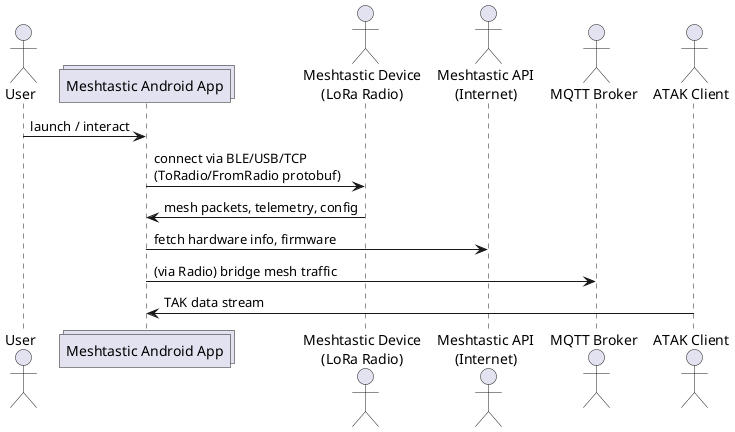

---

## 2. 功能清单

| 功能名 | 说明 | 优先级 |
|--------|------|--------|
| 设备连接管理 | BLE/USB/TCP 多方式连接、自动重连、连接状态管理 | P0 |
| 文本消息收发 | Mesh 网络文本消息发送/接收、送达状态、表情回复 | P0 |
| 节点网络浏览 | Mesh 节点列表、在线状态、排序/过滤/搜索 | P0 |
| 节点详情查看 | 节点信息、遥测数据、位置、信号详情 | P0 |
| 地图显示 | 节点位置地图、地图图层切换、航点显示 | P0 |
| 设备无线配置 | LoRa/频道/用户/设备/网络/蓝牙等全配置管理 | P0 |
| 模块配置管理 | MQTT/串口/通知/遥测等 14+ 模块配置 | P0 |
| 远程节点管理 | 通过安全会话远程管理其他节点配置 | P1 |
| 频道管理 | 频道创建/编辑/分享（QR/NFC）、PSK 密钥管理 | P0 |
| 联系人管理 | 联系人列表、静音/收藏、消息搜索 | P1 |
| 路由追踪 | Traceroute 探测、路径可视化 | P1 |
| 快捷消息 | 预定义消息模板、自定义排序 | P2 |
| 固件更新(OTA) | 固件版本检查、下载、XModem 协议传输 | P1 |
| 前台 Mesh 服务 | 后台持续连接、通知栏显示 | P0 |
| 系统通知 | 新消息/节点事件/低电量通知、通知直接回复 | P1 |
| 主屏幕 Widget | 节点统计信息 Widget | P2 |
| QR 码/NFC 分享 | 频道/联系人通过 QR 码或 NFC 分享和导入 | P1 |
| 地理围栏 | 节点进出区域通知 | P2 |
| 网络发现(Discovery) | 频率扫描发现临时节点 | P2 |
| 消息过滤 | 关键词过滤 + Homoglyph 检测 | P2 |
| 设备锁定 | Lockdown 密码保护配置更改 | P1 |
| TAK Server 集成 | ATAK 数据桥接、内置 TAK Server | P2 |
| Android Auto | 车载消息通知 | P2 (仅 google) |
| App Functions (AI) | Android 系统 AI 助手集成 | P2 (仅 google) |
| OPML 导出 | 节点数据库导出备份 | P2 |
| 调试面板 | 日志查看、消息追踪、导出 | P2 |

---

## 3. 实现模型

### 3.1 上下文视图

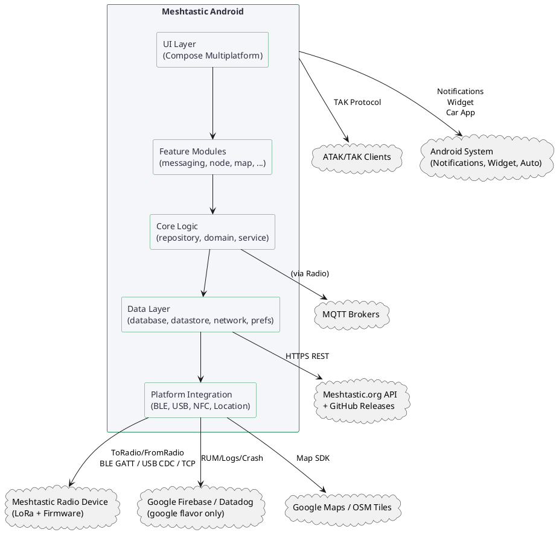

### 3.2 总体架构

项目采用严格的分层架构 (Clean Architecture)，通过 Kotlin Multiplatform 实现代码共享。

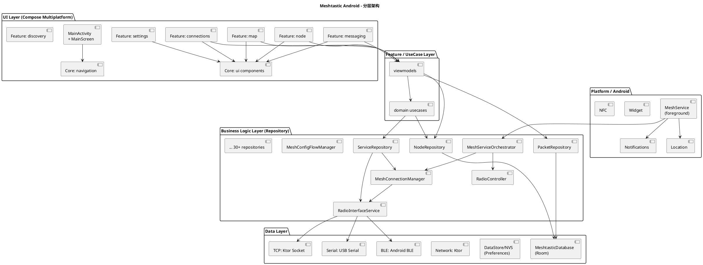

### 3.3 模块划分

项目由 Gradle multi-module 构建管理，共 36 个模块，分为核心层（core）、功能层（feature）和应用层（app）。

#### 3.3.1 模块清单

**应用层**：
| 模块 | 路径 | 职责 |
|------|------|------|
| `androidApp` | `:androidApp` | Android 主应用模块，包含 MainActivity、DI 配置、平台特定 Compose 提供者 |
| `desktopApp` | `:desktopApp` | Desktop (JVM) 应用，Compose Desktop 入口 |

**核心层 (core:)**:
| 模块 | 路径 | 职责 |
|------|------|------|
| `:core:model` | `core/model/` | 领域模型（Node, Message, Channel, Position, DataPacket 等）、工具类 |
| `:core:database` | `core/database/` | Room 数据库定义、DAO、Entity、数据转换器 |
| `:core:repository` | `core/repository/` | 仓库接口和实现（30+），业务逻辑控制器 |
| `:core:service` | `core/service/` | Mesh Service 实现（前台服务、Orchestrator、Worker） |
| `:core:data` | `core/data/` | 数据源实现、仓库实现、Manager 实现 |
| `:core:domain` | `core/domain/` | UseCase 层（远程管理、配置、导出/导入） |
| `:core:ui` | `core/ui/` | 共享 UI 组件（主题、颜色、通用组件）、ViewModel |
| `:core:common` | `core/common/` | 通用工具类（协程调度器、格式化、权限） |
| `:core:di` | `core/di/` | Koin 依赖注入模块注册 |
| `:core:navigation` | `core/navigation/` | 导航路由定义、多返回栈、Deep Link 路由 |
| `:core:network` | `core/network/` | Ktor HTTP 客户端配置、API 接口定义 |
| `:core:ble` | `core/ble/` | Android BLE 传输实现 |
| `:core:prefs` | `core/prefs/` | 偏好设置实现（DataStore 封装） |
| `:core:datastore` | `core/datastore/` | DataStore 配置 |
| `:core:resources` | `core/resources/` | Compose 资源（字符串、图标、字体） |
| `:core:barcode` | `core/barcode/` | 条码/二维码扫描实现（CameraX + MLKit） |
| `:core:nfc` | `core/nfc/` | NFC 读写 Compose 效果 |
| `:core:takserver` | `core/takserver/` | TAK Server 实现 |
| `:core:testing` | `core/testing/` | 测试工具和 stubs |
| `:core:konsist` | `core/konsist/` | Konsist 架构一致性检查 |

**功能层 (feature:)**:
| 模块 | 路径 | 职责 |
|------|------|------|
| `:feature:messaging` | `feature/messaging/` | 消息收发 UI：联系人列表、消息列表、快捷消息 |
| `:feature:node` | `feature/node/` | 节点管理 UI：节点列表、详情、遥测图表、指南针 |
| `:feature:map` | `feature/map/` | 地图展示 UI：地图视图、节点标记、地图控件 |
| `:feature:connections` | `feature/connections/` | 设备连接 UI：BLE/USB/TCP 设备列表 |
| `:feature:settings` | `feature/settings/` | 设置 UI：无线配置、模块配置、管理、调试 |
| `:feature:discovery` | `feature/discovery/` | 网络发现 UI：扫描控制、结果、历史 |
| `:feature:intro` | `feature/intro/` | 首次引导 UI：隐私政策、分析同意 |
| `:feature:firmware` | `feature/firmware/` | 固件更新 UI |
| `:feature:docs` | `feature/docs/` | 帮助文档 UI |
| `:feature:wifi-provision` | `feature/wifi-provision/` | WiFi 凭据配置 UI |
| `:feature:car` | `feature/car/` | Android Auto 车载 UI（仅 google） |
| `:feature:widget` | `feature/widget/` | 主屏幕 Widget（Glance） |

**构建辅助**：
| 模块 | 路径 | 职责 |
|------|------|------|
| `:baselineprofile` | `baselineprofile/` | 基线配置文件生成 |
| `:screenshot-tests` | `screenshot-tests/` | Compose 截图测试 |
| `:docs-screenshots` | `docs-screenshots/` | 文档截图 |
| `build-logic:convention` | `build-logic/convention/` | Gradle 约定插件 |

### 3.4 设计系统规格文档

#### 3.4.1 色彩系统

基于 Meshtastic Design Standards v1.3 定义。

**Light 主题色彩**：

| Token | Hex | 用途 |
|-------|-----|------|
| primaryLight | #2D8F52 (Green 700) | 主色按钮、选中状态、强调元素 |
| onPrimaryLight | #FFFFFF | 主色上的文字/图标 |
| primaryContainerLight | #B5F5CE (Green 300) | 主色容器（背景色块） |
| onPrimaryContainerLight | #002E13 (Green 950) | 主色容器上的文字 |
| secondaryLight | #555668 (Neutral 600) | 次要色（标签、次要按钮） |
| onSecondaryLight | #FFFFFF | 次要色上的文字 |
| secondaryContainerLight | #D5D6E0 (Neutral 200) | 次要色容器 |
| onSecondaryContainerLight | #2C2D3C (Neutral 800) | 次要色容器上的文字 |
| tertiaryLight | #2855A8 (Blue 700) | 第三色（链接、信息） |
| onTertiaryLight | #FFFFFF | 第三色上的文字 |
| tertiaryContainerLight | #E8EAF6 (Blue 50) | 第三色容器 |
| onTertiaryContainerLight | #001849 (Blue 950) | 第三色容器上的文字 |
| errorLight | #BA1A1A (Error 600) | 错误色 |
| onErrorLight | #FFFFFF | 错误色上的文字 |
| errorContainerLight | #FDEAEA (Error 100) | 错误容器 |
| backgroundLight | #F5F6FA (Neutral 50) | 背景 |
| onBackgroundLight | #2C2D3C (Neutral 800) | 背景上的文字 |
| surfaceLight | #F5F6FA (Neutral 50) | 表面 |
| onSurfaceLight | #2C2D3C (Neutral 800) | 表面上的文字 |
| surfaceVariantLight | #DADBE7 (NV 200) | 表面变体 |
| outlineLight | #767892 (NV 500) | 轮廓线 |
| surfaceContainerLight | #ECEDF3 (Neutral 100) | 容器表面 |
| surfaceContainerHighestLight | #D5D6E0 (Neutral 200) | 最高容器表面 |

**Dark 主题色彩**：

| Token | Hex | 用途 |
|-------|-----|------|
| primaryDark | #67EA94 (Green 500) | 主色（暗色模式更亮） |
| onPrimaryDark | #0F1017 (Neutral 950) | 主色上的文字 |
| primaryContainerDark | #2D8F52 (Green 700) | 主色容器 |
| onPrimaryContainerDark | #B5F5CE (Green 300) | 主色容器文字 |
| backgroundDark | #1A1B26 (Neutral 900) | 背景 |
| surfaceDark | #1A1B26 (Neutral 900) | 表面 |
| onSurfaceDark | #ECEDF3 (Neutral 100) | 表面文字 |

**节点颜色**：根据节点编号自动生成颜色对（前景色 + 背景色），使用 `nodeColorsFromNum()` 函数计算。每种颜色代表不同节点，确保在多节点列表中可区分。

#### 3.4.2 主题系统

**主题入口**：`AppTheme` composable 位于 `core/ui/theme/Theme.kt`

```kotlin
@Composable
fun AppTheme(
    darkTheme: Boolean = isSystemInDarkTheme(),
    dynamicColor: Boolean = true,
    content: @Composable () -> Unit
)
```

**主题模式常量**（存储在 `uiPrefs.theme`）：
- `MODE_DYNAMIC (6969420)`：Android 12+ 动态颜色（Material You）
- `AppCompatDelegate.MODE_NIGHT_YES (2)`：强制暗色模式
- `AppCompatDelegate.MODE_NIGHT_NO (1)`：强制亮色模式
- 其他值：跟随系统

**主题组件**：
- `MaterialExpressiveTheme`：使用 Material3 Expressive 风格
- 动态颜色方案：`dynamicColorScheme()` 基于系统壁纸取色
- `MotionScheme.expressive()`：Material 表现力动画方案
- `AppTypography`：自定义排版（见 3.4.3）

**暗色模式切换**：
- `MainActivity` 中通过 `SystemBarStyle` 同步状态栏和导航栏颜色
- 启用 Edge-to-Edge 显示，状态栏和导航栏透明
- Android 15+ 设置 `LAYOUT_IN_DISPLAY_CUTOUT_MODE_ALWAYS`

#### 3.4.3 排版系统

使用 Material3 Expressive 排版 + 自定义 `AppTypography`（定义在 `core/ui/theme/Type.kt`）。

排版规格：[推断] 基于 Material3 Expressive 标准：
- Display Large/Bold：大标题（如频道名称）
- Headline Large/Medium/Small：屏幕标题
- Title Large/Medium/Small：卡片标题、设置分组标题
- Body Large/Medium/Small：正文
- Label Large/Medium/Small：标签文本

#### 3.4.4 间距与尺寸系统

[推断] 基于 Material3 标准间距系统，主要尺寸值：
- `InsetDivider`：内嵌分隔线（带 inset）
- `NodeItem` / `NodeItemCompact`：节点列表项的不同密度布局
- `ListItem`：通用列表项，支持 leading/trailing content
- `TitledCard`：带标题的卡片容器

#### 3.4.5 图标与图形资源

图标系统定义在 `core/ui/icon/` 目录下，分类组织：

| 分类文件 | 包含图标 |
|----------|----------|
| `Actions.kt` | 复制、分享、删除、编辑、刷新等动作图标 |
| `Battery.kt` | 电池电量指示器图标（多级电量） |
| `Counter.kt` | 计数器图标 |
| `Device.kt` | 设备类型图标（BLE、USB、TCP、LoRa 芯片） |
| `Elevation.kt` | 海拔/高度图标 |
| `Hardware.kt` | 硬件型号图标（T-Beam、Heltec 等） |
| `Map.kt` | 地图相关图标 |
| `MeshtasticIcons.kt` | 品牌和通用 Meshtastic 图标 |
| `Messages.kt` | 消息、聊天、发送图标 |
| `Navigation.kt` | 导航、指南针图标 |
| `NoDevice.kt` | 无设备空状态图标 |
| `Nodes.kt` | 节点相关图标 |
| `Person.kt` | 用户/联系人图标 |
| `Security.kt` | 安全、锁定、密钥图标 |
| `Settings.kt` | 设置分类图标 |
| `Signal.kt` | 信号强度指示器（LoRa SNR 级别） |
| `Status.kt` | 连接状态图标 |
| `Telemetry.kt` | 遥测图标（温度、湿度、气压等） |

**图标实现方式**：使用 Compose `Canvas` 自定义绘制，支持可缩放矢量图形和主题着色。

**其他图形资源**：
- `NodeCardGlow`：节点卡片外发光效果
- `NodeKeyStatusIcon`：节点密钥状态指示器（PKC 已设置/未设置/不匹配）
- `NodeSignedStatusIcon`：XEdDSA 签名状态图标
- `SecurityIcon`：安全级别图标
- `TransportIcon`：传输方式图标（BLE/USB/TCP/MQTT）
- `LoraSignalIndicator`：LoRa 信号强度可视化
- `MaterialBatteryInfo` / `MaterialBluetoothSignalInfo`：Material 风格的电池/蓝牙指示器

#### 3.4.6 动画规格

[推断] 基于 Material3 `MotionScheme.expressive()`：
- 屏幕转场：shared axis transition
- 列表项动画：fade + slide
- 导航栏图标：`AnimatedConnectionsNavIcon` 连接状态动画图标
- 加载指示器：标准 Material3 CircularProgressIndicator
- FAB 动画：`MenuFAB` 展开/折叠动画
- `ImportFab`：导入按钮动画
- `LoadingOverlay`：半透明加载遮罩层

---

### 3.5 数据存储模块 (core:database) 实现设计

#### 3.5.1 模块介绍

`core:database` 模块负责所有本地持久化数据的管理。基于 Room (KMP 版本) 构建，提供跨平台（Android/JVM/iOS）的数据库访问能力。数据库中存储节点信息、消息包、联系人设置、表情回复、Mesh 日志、固件信息缓存等 16 张表。

#### 3.5.2 功能描述

- Room SQLite 数据库封装（版本 44）
- 16 个实体（Entity）定义
- 9 个 DAO 数据访问接口
- 类型转换器（Converters）
- 数据库创建、迁移和破坏性回退策略
- 全文本搜索（FTS）支持
- 连接池配置（生产环境单连接池，多平台多连接池）

#### 3.5.3 文件夹结构

```
core/database/src/
  commonMain/kotlin/org/meshtastic/core/database/
    MeshtasticDatabase.kt          # Room Database 定义（44版，16表）
    DatabaseBuilder.kt             # 跨平台数据库构建器
    DatabaseConstants.kt           # 数据库常量
    DatabaseManager.kt             # 数据库管理器（开关数据库实例）
    DatabaseProvider.kt            # 数据库实例提供者
    MeshtasticDatabaseConstructor.kt # Room Constructor
    Converters.kt                  # 类型转换器（ByteString, Telemetry等）
    dao/
      DeviceHardwareDao.kt         # 硬件信息 DAO
      DeviceLinkDao.kt             # 设备链接 DAO
      DiscoveryDao.kt              # 发现 DAO
      FirmwareReleaseDao.kt        # 固件发布 DAO
      MeshLogDao.kt                # Mesh 日志 DAO
      NodeInfoDao.kt               # 节点信息 DAO
      PacketDao.kt                 # 数据包 DAO (含 FTS)
      QuickChatActionDao.kt        # 快捷消息 DAO
      TracerouteNodePositionDao.kt # 路由追踪 DAO
    entity/
      DeviceHardwareEntity.kt      # 硬件信息实体
      DeviceLinkEntity.kt          # 设备链接实体
      DiscoveredNodeEntity.kt      # 发现的节点实体
      DiscoveryPresetResultEntity.kt # 发现预设结果实体
      DiscoverySessionEntity.kt    # 发现会话实体
      FirmwareReleaseEntity.kt     # 固件发布实体
      MeshLog.kt                   # Mesh 日志实体
      MyNodeEntity.kt              # 本地节点实体
      NodeEntity.kt                # 节点实体 (+ NodeWithRelations, MetadataEntity)
      Packet.kt                    # 数据包实体 (+ PacketEntity, ContactSettings, ReactionEntity)
      PacketFts.kt                 # 全文本搜索虚拟表
      QuickChatAction.kt           # 快捷消息实体
      TracerouteNodePositionEntity.kt # 路由追踪实体
    di/
      CoreDatabaseModule.kt        # Koin DI 模块
  androidMain/kotlin/org/meshtastic/core/database/
    DatabaseBuilder.kt             # Android 平台数据库构建器
    di/
      CoreDatabaseAndroidModule.kt # Android 特定 DI 模块
```

#### 3.5.4 架构图谱

**实体关系图 (ER Diagram)**：

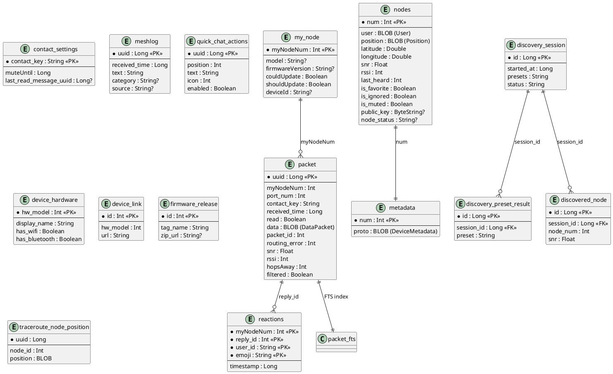

**DAO 接口层次**：

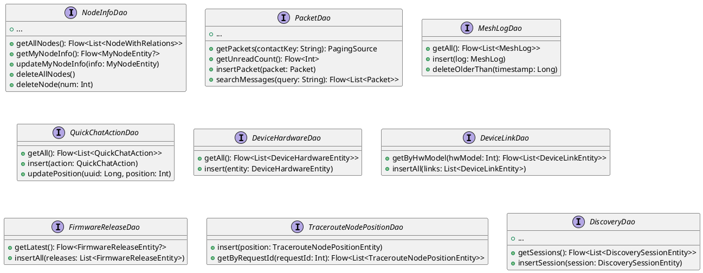

#### 3.5.5 功能与用例分析

**用例 1：插入接收到的 Mesh 消息**
- 前置条件：设备已连接，`FromRadioPacketHandlerImpl` 解析了进站数据包
- 步骤：
  1. 从 protobuf `MeshPacket` 提取字段构造 `Packet` 实体
  2. 调用 `PacketDao.insertPacket(packet)` 写入 `packet` 表
  3. 同时写入 `packet_fts` 表（全文本搜索索引）
  4. 如果包含节点信息，更新或插入 `NodeEntity`
  5. 如果包含位置信息，更新节点位置字段
- 后置条件：消息可被查询和显示，节点信息被更新

**用例 2：查询与某联系人的所有消息（分页）**
- 前置条件：数据库中有该联系人的消息
- 步骤：
  1. 调用 `PacketDao.getPackets(contactKey)` 获取 `PagingSource<Int, PacketEntity>`
  2. Compose `LazyColumn` 使用 `collectAsLazyPagingItems()` 收集分页数据
  3. 分页自动加载，每页大小由 Room Query 定义
  4. 每条 Packet 通过 `toMessage(getNode)` 转换为 `Message` 领域模型
- 后置条件：消息列表分页显示，支持无限滚动

**用例 3：全文本搜索消息**
- 前置条件：已启用 FTS，有带文本内容的消息
- 步骤：
  1. 调用 `PacketDao.searchMessages(query)` 使用 FTS MATCH 查询
  2. FTS 通过 `packet_fts` 表匹配 `message_text`
  3. JOIN 回 `packet` 表获取完整数据
  4. 返回匹配消息的 Flow 更新 UI
- 后置条件：搜索结果实时显示匹配的消息

#### 3.5.6 接口设计

**核心 DAO 方法签名**：

```kotlin
// NodeInfoDao
fun getAllNodes(): Flow<List<NodeWithRelations>>
fun getNodeByNum(nodeNum: Int): Flow<NodeWithRelations?>
fun observeMyNodeInfo(): Flow<MyNodeEntity?>
fun upsertNode(node: NodeEntity)
fun setFavorite(num: Int, isFavorite: Boolean)
fun setIgnored(num: Int, isIgnored: Boolean)
fun setMuted(num: Int, isMuted: Boolean)
fun cleanNodeDb()

// PacketDao
fun getPackets(contactKey: String, myNodeNum: Int): PagingSource<Int, PacketEntity>
fun getPacketByUuid(uuid: Long): Flow<PacketEntity?>
fun getUnreadCount(): Flow<Int>
fun insertPacket(packet: Packet): Long
fun markRead(uuid: Long)
fun searchMessages(query: String): Flow<List<PacketEntity>>

// MeshLogDao
fun observeAll(): Flow<List<MeshLog>>
fun insert(log: MeshLog)
fun deleteOlderThan(timestamp: Long)
```

#### 3.5.7 核心算法

**消息去重和更新**：
1. 检查 `packet_id` + `from` 组合是否已存在
2. 如果已存在且新数据状态更新（如收到 ACK），则更新现有记录
3. 如果不存在，则插入新记录

**连接池选择逻辑**（`configureCommon`）：
- `multiConnection = true`（桌面/iOS/Tests）：4 读 1 写连接池，`ioDispatcher` 协程上下文
- `multiConnection = false`（Android 生产）：单连接池，`ioDispatcher.limitedParallelism(1)`
- 原因：Android 协程取消风暴下多连接池的许可信号量可能耗尽

#### 3.5.8 错误处理

- **数据库破坏性回退**：`fallbackToDestructiveMigration(dropAllTables = false)` 在无法匹配迁移路径时重建数据库
- **自动迁移**：44 个版本间共 41 个自动迁移步骤（`AutoMigration`），删除表/列使用显式 `AutoMigrationSpec`
- **协程取消**：使用 `limitedParallelism(1)` 防止取消风暴导致的线程池耗尽
- **数据库文件不存在**：自动创建新数据库文件

#### 3.5.9 依赖关系

- **内部依赖**：`core:model`（实体映射到领域模型）、`core:common`（时间函数、协程调度器）
- **外部依赖**：
  - `androidx.room3`：Room 数据库（KMP 版本）
  - `okio`：ByteString 序列化
  - `kotlinx.coroutines`：Flow、协程支持

---

### 3.6 设备通信模块 (core:repository + core:service) 实现设计

#### 3.6.1 模块介绍

`core:repository` 和 `core:service` 模块共同构成应用的核心业务逻辑层。`core:repository` 定义了所有业务接口（Repository、Controller、Manager 抽象），`core:service` 提供了 Android 平台的前台服务实现和核心服务编排器（MeshServiceOrchestrator）。`core:data` 提供了这些接口的具体实现。

#### 3.6.2 功能描述

- 设备连接管理（BLE/USB/TCP）及连接状态维护
- 消息发送队列和送达确认处理
- Mesh 数据包的序列化/反序列化（ToRadio/FromRadio protobuf）
- 设备配置管理流程（Config Flow）
- 节点数据接收和更新
- MQTT 桥接管理
- 存储转发（Store & Forward）支持
- 远程管理会话管理
- 固件 OTA 更新（XModem 协议）
- 遥测数据处理
- Lockdown 设备锁定管理

#### 3.6.3 文件夹结构

```
core/repository/src/commonMain/kotlin/org/meshtastic/core/repository/
  ServiceRepository.kt              # 核心服务仓库接口
  RadioInterfaceService.kt          # 无线电接口服务接口
  RadioTransport.kt                 # 传输层抽象
  RadioTransportFactory.kt          # 传输工厂接口
  RadioTransportCallback.kt         # 传输回调
  RadioController.kt                # 无线电控制器接口
  AdminController.kt                # 管理员控制器接口
  NodeController.kt                 # 节点控制器接口
  QueryController.kt                # 查询控制器接口
  CommandSender.kt                  # 命令发送器接口
  MeshConnectionManager.kt          # 连接状态管理器接口
  MeshConfigFlowManager.kt          # 配置流程管理器接口
  MeshConfigHandler.kt              # 配置包处理器接口
  MeshDataHandler.kt                # 数据包处理器接口
  MeshMessageProcessor.kt           # 消息处理器接口
  MeshNotificationManager.kt        # 通知管理器接口
  MeshWorkerManager.kt              # Worker 管理器接口
  MeshLocationManager.kt            # 位置管理器接口
  MeshBeaconRepository.kt           # Beacon 仓库接口
  MessageFilter.kt                  # 消息过滤接口
  MessageQueue.kt                   # 消息队列接口
  MqttManager.kt                    # MQTT 管理器接口
  AppPreferences.kt                 # 应用偏好设置接口集合
  NodeRepository.kt                 # 节点仓库接口
  PacketRepository.kt               # 数据包仓库接口
  MeshLogRepository.kt              # Mesh 日志仓库接口
  LocationRepository.kt             # 位置仓库接口
  LocationService.kt                # 位置服务接口
  FileService.kt                    # 文件服务接口
  FirmwareReleaseRepository.kt      # 固件发布仓库接口
  EventFirmwareRepository.kt        # 活动固件仓库接口
  DeviceHardwareRepository.kt       # 设备硬件仓库接口
  DeviceLinkRepository.kt           # 设备链接仓库接口
  QuickChatActionRepository.kt      # 快捷消息仓库接口
  RadioConfigRepository.kt          # 无线电配置仓库接口
  HistoryManager.kt                 # 历史记录管理器接口
  DiscoveryPacketCollector.kt       # 发现数据包收集器接口
  LockdownCoordinator.kt            # 锁定协调器接口
  LockdownPassphraseStore.kt        # 锁定密码存储接口
  NotificationManager.kt            # 通知管理器接口
  Notification.kt                   # 通知数据模型
  PlatformAnalytics.kt              # 分析平台接口
  SessionManager.kt                 # 会话管理器接口
  XModemManager.kt                  # XModem 协议管理器接口
  XModemFile.kt                     # XModem 文件模型
  ...

core/data/src/commonMain/kotlin/org/meshtastic/core/data/
  manager/
    MeshConnectionManagerImpl.kt    # 连接管理器实现
    MeshConfigFlowManagerImpl.kt    # 配置流程实现
    MeshDataHandlerImpl.kt          # 数据处理器实现
    MeshConfigHandlerImpl.kt        # 配置处理器实现
    MeshMessageProcessorImpl.kt     # 消息处理器实现
    FromRadioPacketHandlerImpl.kt   # 进站数据包处理器
    AdminPacketHandlerImpl.kt       # 管理包处理器
    PacketHandlerImpl.kt            # 通用包处理器
    CommandSenderImpl.kt            # 命令发送器实现
    MqttManagerImpl.kt              # MQTT 管理器实现
    SessionManagerImpl.kt           # 会话管理器实现
    NodeManagerImpl.kt              # 节点管理器实现
    HistoryManagerImpl.kt           # 历史记录管理器实现
    TelemetryPacketHandlerImpl.kt   # 遥测处理器实现
    StoreForwardPacketHandlerImpl.kt # 存储转发处理器
    TracerouteHandlerImpl.kt        # 路由追踪处理器
    NeighborInfoHandlerImpl.kt      # 邻居信息处理器
    XModemManagerImpl.kt            # XModem 协议实现
    MessageFilterImpl.kt            # 消息过滤实现
    LockdownCoordinatorImpl.kt      # 锁定协调器实现
    GeofenceMonitor.kt              # 地理围栏监视器
    GeofenceCrossingStore.kt        # 地理围栏穿越记录
    DataLayerHeartbeatSender.kt     # 数据层心跳发送器
    RequestTimer.kt                 # 请求超时定时器
  repository/
    NodeRepositoryImpl.kt           # 节点仓库实现
    PacketRepositoryImpl.kt         # 数据包仓库实现
    MeshLogRepositoryImpl.kt        # Mesh 日志仓库实现
    FirmwareReleaseRepositoryImpl.kt # 固件发布仓库实现
    DeviceHardwareRepositoryImpl.kt # 硬件仓库实现
    DeviceLinkRepositoryImpl.kt     # 链接仓库实现
    QuickChatActionRepositoryImpl.kt # 快捷消息仓库实现
    RadioConfigRepositoryImpl.kt    # 配置仓库实现
    TracerouteSnapshotRepositoryImpl.kt # 路由追踪快照实现
    EventFirmwareRepositoryImpl.kt  # 活动固件仓库实现
    LocationRepositoryImpl.kt       # 位置仓库实现 (Android)
  ai/
    AiFunctionProvider.kt           # AI 功能提供者接口
    AiFunctionProviderImpl.kt       # AI 功能实现
    FuzzyNameResolver.kt            # 模糊名称解析
    RateLimiter.kt                  # 速率限制器
  ...
```

#### 3.6.4 架构图谱

**设备通信分层架构**：

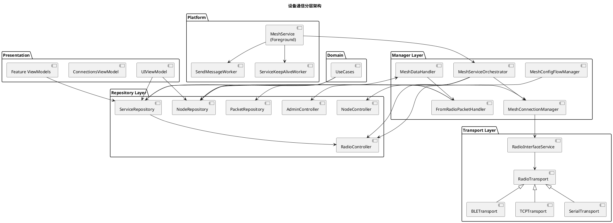

**核心时序图：连接流程**：

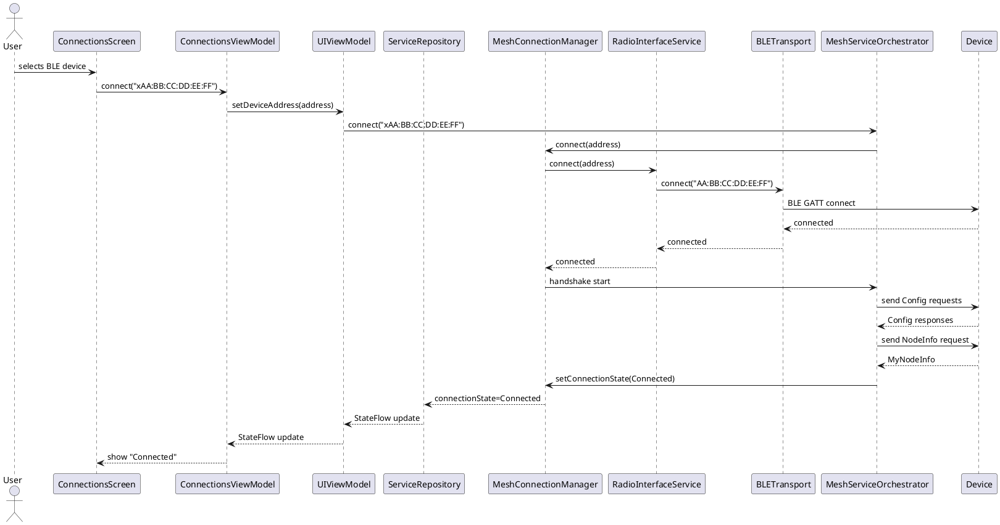

#### 3.6.5 功能与用例分析

**用例 1：发送文本消息**
- 前置条件：设备已连接 (ConnectionState.Connected)
- 步骤：
  1. 用户在 `MessageScreen` 输入文本并点击发送
  2. `MessageViewModel` 调用 `MessagingController.sendMessage()`
  3. `DataPacket` 被构造（to, channel, text, replyId）
  4. `MessageQueue.enqueue(packet)` 加入发送队列
  5. `ServiceRepository.sendPacket(packet)` 将 DataPacket 序列化为 ToRadio protobuf
  6. `RadioTransport.send()` 通过当前活动传输层（BLE/USB/TCP）发送字节
  7. 设备端返回 ACK（FromRadio MeshPacket with routing.ack）
  8. `PacketHandler` 更新消息状态为 `DELIVERED`
  9. UI 通过 Flow 订阅收到状态更新，刷新消息图标
- 后置条件：消息状态更新为 DELIVERED 或 ERROR

**用例 2：配置 LoRa 参数**
- 前置条件：设备已连接，可建立管理会话
- 步骤：
  1. 用户在 `RadioConfigScreen` 修改 LoRa 预设
  2. `RadioConfigViewModel` 调用 `RadioConfigUseCase.updateLoRaConfig()`
  3. `MeshConfigFlowManager.startConfigFlow()` 创建配置流
  4. `AdminPacketHandler` 通过管理包头包装配置
  5. 配置包通过 `ServiceRepository.sendPacket()` 发送
  6. 设备处理配置并返回确认包
  7. `MeshConfigHandlerImpl` 解析响应并更新 UI 状态
- 后置条件：LoRa 配置在设备上生效，UI 显示成功/错误

#### 3.6.6 接口设计

**核心接口方法签名**：

```kotlin
interface ServiceRepository {
    val connectionState: StateFlow<ConnectionState>
    val clientNotifications: Flow<ClientNotification>
    val lockdownState: StateFlow<LockdownState>
    val tracerouteResponse: StateFlow<TracerouteResponse?>
    
    fun setConnectionState(connectionState: ConnectionState)
    suspend fun sendLockdownUnlock(passphrase: String, boots: Int, hours: Int, sessionMinutes: Int)
}

interface RadioInterfaceService {
    val connectionState: StateFlow<ConnectionState>
    suspend fun connect(address: String)
    suspend fun disconnect(reason: TransportDisconnectReason)
    suspend fun sendToRadio(bytes: ByteArray)
    val fromRadio: Flow<ByteArray>
}

interface RadioController {
    suspend fun startConfigFlow(session: AdminSession, config: Config)
    suspend fun setConfig(config: Config)
    suspend fun requestConfig()
}

interface NodeController {
    suspend fun requestNodeInfo(nodeNum: Int)
    suspend fun requestPosition(nodeNum: Int)
    suspend fun sendTraceroute(destNum: Int, channel: Int)
}

interface MeshConnectionManager {
    suspend fun connect(address: String)
    suspend fun disconnect(reason: TransportDisconnectReason)
    fun startHandshake()
}
```

#### 3.6.7 核心算法

**连接握手流程**（`MeshServiceOrchestrator`）：
1. 建立传输层连接（BLE GATT / USB open / TCP socket）
2. 等待设备发送 `MyNodeInfo`（包含节点编号、固件版本等）
3. 请求完整的设备配置（`Config` protobuf）
4. 请求频道信息（`ChannelSet` + `ChannelSettings`）
5. 请求设备元数据（`DeviceMetadata`）
6. 确认所有请求完成
7. 设置 `ConnectionState.Connected`
8. 如果任何请求超时（通过 `RequestTimer`），重试或回退到 `Disconnected`

**消息去重算法**（`PacketHandlerImpl`）：
1. 提取 `packet_id` + `from` 创建唯一键
2. 在数据库中查找已存在的包
3. 如果是新包 → 插入
4. 如果是重复包且新状态更优（如 ACK 替换 ENROUTE）→ 更新
5. 如果重复且无新信息 → 忽略

**配置发送超时重试**（`RequestTimer`）：
1. 配置包发送时启动超时计数器
2. 每次超时触发后重试，最多 N 次
3. 所有重试失败后标记 `ResponseState.Timeout`

#### 3.6.8 错误处理

- **连接超时**：GATT.connect() 超时 → `TransportDisconnectReason.Timeout` → `ConnectionState.Disconnected`
- **传输错误**：writeCharacteristic 失败 → 重试 3 次 → 断开连接
- **数据包损坏**：protobuf 解析失败 → 记录日志，跳过该包
- **无可用接口**：所有传输枚举失败 → `Routing.Error.NO_INTERFACE`
- **设备不支持操作**：固件不支持某配置 → `ResponseState.Error`，显示不支持提示

#### 3.6.9 依赖关系

- **内部依赖**：`core:model`、`core:database`、`core:common`、`core:prefs`、`core:ble`、`core:network`
- **外部依赖**：
  - `kotlinx.coroutines`：异步操作
  - `okio`：字节流处理
  - `co.touchlab.kermit`：日志
  - `org.koin`：依赖注入
  - Android BLE API / USB Host API

---

### 3.7 模型层 (core:model) 实现设计

#### 3.7.1 模块介绍

`core:model` 模块定义应用的领域模型和工具函数。所有数据类、枚举和工具方法在此模块中声明，不依赖任何数据库或 UI 框架，可在所有 KMP 目标平台共享。

#### 3.7.2 功能描述

- 领域模型定义（Node, Message, DataPacket, Channel, Position 等）
- 数据序列化支持（kotlinx.serialization）
- Protobuf 与领域模型的转换
- GPS 坐标计算（距离、方位角）
- 地理围栏模型
- 节点颜色生成
- 路由追踪和邻居发现模型
- TAK 集成模型

#### 3.7.3 文件夹结构

```
core/model/src/commonMain/kotlin/org/meshtastic/core/model/
  Node.kt               # Node 领域模型
  NodeAddress.kt         # 节点地址模型
  MyNodeInfo.kt          # 本地节点信息
  Message.kt             # Message 领域模型 + MessageStatus
  DataPacket.kt          # DataPacket 数据包模型
  Channel.kt             # Channel 频道模型
  ChannelOption.kt       # 频道选项
  Position.kt            # 位置模型
  ConnectionState.kt     # 连接状态 sealed interface
  DeviceType.kt          # 设备类型枚举
  DeviceVersion.kt       # 固件版本模型
  DeviceMetrics.kt       # 设备指标模型
  EnvironmentMetrics.kt  # 环境指标模型
  MeshActivity.kt        # Mesh 活动
  MeshBeaconOffer.kt     # Beacon 报价
  MeshLog.kt             # Mesh 日志模型
  MeshUser.kt            # Mesh 用户模型
  MqttConnectionState.kt # MQTT 连接状态
  MqttJsonPayload.kt     # MQTT JSON 负载
  MqttProbeStatus.kt     # MQTT 探测状态
  NeighborInfo.kt        # 邻居信息模型
  NetworkDeviceHardware.kt # 网络设备硬件
  NetworkDeviceLink.kt   # 网络设备链接
  NetworkFirmwareRelease.kt # 网络固件发布
  NodeColors.kt          # 节点颜色工具
  NodeListDensity.kt     # 节点列表密度
  NodeSortOption.kt      # 节点排序选项
  Reaction.kt            # 表情回复模型
  RouteDiscovery.kt      # 路由发现
  SessionStatus.kt       # 会话状态
  TAK.kt                 # TAK 模型
  TelemetryType.kt       # 遥测类型
  TracerouteOverlay.kt   # 路由追踪叠加层
  RadioNotConnectedException.kt
  RegionPresetConstraint.kt
  Capabilities.kt
  BootloaderOtaQuirk.kt
  InterfaceId.kt
  EventFirmware.kt
  geofence/
    Geofence.kt          # 地理围栏模型
    GeofenceRadiusPresets.kt # 围栏半径预设
    ActiveWaypoints.kt   # 活跃航点
  service/
    LockdownState.kt     # 锁定状态 sealed class
    TracerouteResponse.kt # 路由追踪响应
  util/
    ByteStringExtensions.kt
    ByteStringSerializer.kt
    ChannelSet.kt
    CommonUtils.kt
    DateTimeUtils.kt
    DebugUtils.kt
    DistanceExtensions.kt
    Extensions.kt
    GeoConstants.kt
    LocationUtils.kt
    MeshDataMapper.kt
    MeshtasticUrlConstants.kt
    NodeIdLookup.kt
    RandomUtils.kt
    SfppHasher.kt
    SharedContact.kt
    TimeConstants.kt
    TimeUtils.kt
    UnitConversions.kt
    UriUtils.kt
    WireExtensions.kt
    MalformedMeshtasticUrlException.kt
```

#### 3.7.4 架构图谱

```plantuml
@startuml
title 核心领域模型关系

class Node {
  + num: Int
  + user: User (proto)
  + position: Position (proto)
  + snr: Float
  + rssi: Int
  + lastHeard: Int
  + deviceMetrics: DeviceMetrics
  + channel: Int
  + viaMqtt: Boolean
  + hopsAway: Int
  + isFavorite: Boolean
  + isIgnored: Boolean
  + isMuted: Boolean
  + publicKey: ByteString?
  ---
  + isOnline: Boolean
  + batteryLevel: Int?
  + latitude: Double
  + longitude: Double
  + distance(o: Node): Int?
  + bearing(o: Node): Int?
}

class Message {
  + uuid: Long
  + receivedTime: Long
  + node: Node
  + text: String
  + fromLocal: Boolean
  + time: String
  + read: Boolean
  + status: MessageStatus?
  + routingError: Int
  + emojis: List<Reaction>
  + snr: Float
  + rssi: Int
  + hopsAway: Int
}

class DataPacket {
  + to: String?
  + bytes: ByteString?
  + dataType: Int
  + from: String?
  + channel: Int
  + status: MessageStatus?
  + wantAck: Boolean
  + viaMqtt: Boolean
  ---
  + text: String? (computed)
}

class Channel {
  + settings: ChannelSettings (proto)
  + loraConfig: LoRaConfig (proto)
  ---
  + name: String
  + psk: ByteString
  + hash: Int
  + channelNum: Int
  + radioFreq: Float
}

class Position {
  + latitude: Double
  + longitude: Double
  + altitude: Int
  + time: Int
  + satellitesInView: Int
  ---
  + distance(o: Position): Double
  + bearing(o: Position): Double
}

enum MessageStatus {
  UNKNOWN
  RECEIVED
  QUEUED
  ENROUTE
  DELIVERED
  SFPP_ROUTING
  SFPP_CONFIRMED
  ERROR
}

enum DeviceType {
  BLE
  TCP
  USB
}

sealed ConnectionState {
  Disconnected
  Connecting
  Connected
  DeviceSleep
}

Message --> Node
Message --> MessageStatus
Message --> Reaction
DataPacket --> MessageStatus
Node --> Position
Node "1" -- "*" Message : "has"
@enduml
```

#### 3.7.5 依赖关系

- **外部依赖**：
  - `okio`：ByteString 类型
  - `kotlinx.serialization`：DataPacket 序列化
  - `org.meshtastic.proto`：Meshtastic protobuf 定义（外部库）

---

### 3.8 UI 核心模块 (core:ui) 实现设计

#### 3.8.1 模块介绍

`core:ui` 模块提供跨平台共享的 Compose Multiplatform UI 组件、主题系统、通用 ViewModel 和工具类。所有 Feature 模块依赖于本模块的组件构建具体页面。

#### 3.8.2 功能描述

- 主题系统（亮色/暗色/动态颜色）
- 通用 UI 组件库（50+ 可复用组件）
- App Shell（底部导航、导航显示、多返回栈）
- Alert/Snackbar 管理
- QR 码显示对话框
- Emoji 选择器
- 条形码扫描抽象
- NFC 读写抽象
- 地图提供者抽象
- 节点状态图标

#### 3.8.3 文件夹结构

```
core/ui/src/commonMain/kotlin/org/meshtastic/core/ui/
  theme/
    Theme.kt              # AppTheme composable
    Color.kt              # 完整色彩 Token 定义
    ColorContrast.kt      # 对比度计算
    CustomColors.kt       # 自定义颜色
    DynamicColorScheme.kt # Android 12+ 动态取色
    Type.kt               # 排版系统
  component/
    MeshtasticNavigationSuite.kt  # 底部导航栏
    MeshtasticNavDisplay.kt       # 导航内容显示区域
    MeshtasticAppShell.kt         # 应用主壳
    MeshtasticCommonAppSetup.kt   # 通用应用设置
    MeshtasticSnackbarHost.kt     # Snackbar 显示
    AdaptiveTwoPane.kt            # 自适应双栏布局
    AlertDialog.kt                # 通用对话框
    AlertHost.kt                  # 对话框宿主
    ...
  viewmodel/
    UIViewModel.kt        # 应用级 ViewModel
    ConnectionsViewModel.kt # 连接 ViewModel
    ViewModelExtensions.kt # ViewModel 扩展
  icon/
    Actions.kt / Battery.kt / Device.kt / ...  # 图标定义
  emoji/
    EmojiPickerDialog.kt  # Emoji 选择对话框
    EmojiPickerViewModel.kt
    EmojiRepository.kt
  qr/
    ScannedQrCodeDialog.kt # 扫码结果对话框
    QrDialog.kt            # 二维码显示对话框
  navigation/
    TopLevelDestinationExt.kt
  util/
    AlertManager.kt       # 对话框管理器
    SnackbarManager.kt    # Snackbar 管理器
    LocalProviders.kt     # CompositionLocal 提供者
  di/
    CoreUiModule.kt       # Koin DI 模块
```

#### 3.8.4 组件目录

**通用 UI 组件完整列表**：

| 组件 | 文件 | 用途 |
|------|------|------|
| `MeshtasticNavigationSuite` | MeshtasticNavigationSuite.kt | 底部导航栏（5 Tab） |
| `MeshtasticNavDisplay` | MeshtasticNavDisplay.kt | 导航内容区域 |
| `MeshtasticAppShell` | MeshtasticAppShell.kt | 应用外壳（Scaffold + 导航） |
| `AdaptiveTwoPane` | AdaptiveTwoPane.kt | 自适应双栏布局 |
| `AlertHost` | AlertHost.kt | 全局对话框宿主 |
| `ListItem` | ListItem.kt | 通用列表项 |
| `NodeItem` | NodeItem.kt | 节点列表项（完整模式） |
| `NodeItemCompact` | NodeItemCompact.kt | 节点列表项（紧凑模式） |
| `NodeChip` | NodeChip.kt | 节点芯片（地图/列表中使用） |
| `NodeSurface` | NodeSurface.kt | 节点表面容器 |
| `NodeCardGlow` | NodeCardGlow.kt | 节点卡片发光效果 |
| `MainAppBar` | MainAppBar.kt | 主应用栏 |
| `TitledCard` | TitledCard.kt | 带标题卡片 |
| `InsetDivider` | InsetDivider.kt | 内嵌分隔线 |
| `StatusSurface` | StatusSurface.kt | 状态指示表面 |
| `ChannelItem` | ChannelItem.kt | 频道列表项 |
| `ChannelSelection` | ChannelSelection.kt | 频道选择器 |
| `ChannelInfo` | ChannelInfo.kt | 频道信息展示 |
| `SignalInfo` | SignalInfo.kt | 信号信息展示 |
| `LoraSignalIndicator` | LoraSignalIndicator.kt | LoRa 信号强度指示 |
| `TelemetryInfo` | TelemetryInfo.kt | 遥测信息展示 |
| `DistanceInfo` | DistanceInfo.kt | 距离信息展示 |
| `ElevationInfo` | ElevationInfo.kt | 海拔信息展示 |
| `HopsInfo` | HopsInfo.kt | 跳数信息展示 |
| `IconInfo` | IconInfo.kt | 图标+文字信息项 |
| `LastHeardInfo` | LastHeardInfo.kt | 最后听到时间展示 |
| `SatelliteCountInfo` | SatelliteCountInfo.kt | 卫星数展示 |
| `MaterialBatteryInfo` | MaterialBatteryInfo.kt | Material 风格电池显示 |
| `MaterialBluetoothSignalInfo` | MaterialBluetoothSignalInfo.kt | 蓝牙信号显示 |
| `TransportIcon` | TransportIcon.kt | 传输方式图标 |
| `SecurityIcon` | SecurityIcon.kt | 安全图标 |
| `ConnectionsNavIcon` | ConnectionsNavIcon.kt | 连接导航图标 |
| `AnimatedConnectionsNavIcon` | AnimatedConnectionsNavIcon.kt | 动画连接图标 |
| `MenuFAB` | MenuFAB.kt | 浮动菜单按钮 |
| `ImportFab` | ImportFab.kt | 导入 FAB |
| `EmptyDetailPlaceholder` | EmptyDetailPlaceholder.kt | 空详情占位 |
| `PlaceholderScreen` | PlaceholderScreen.kt | 占位屏幕 |
| `PermissionRecoveryCard` | PermissionRecoveryCard.kt | 权限恢复卡片 |
| `Co2Severity` | Co2Severity.kt | CO2 严重度指示 |
| `IndoorAirQuality` | IndoorAirQuality.kt | 室内空气质量指示 |
| `AutoLinkText` | AutoLinkText.kt | 自动链接文本 |
| `CopyIconButton` | CopyIconButton.kt | 复制按钮 |
| `FirmwareVersionCheck` | FirmwareVersionCheck.kt | 固件版本检查 |
| `BuildNodeDescription` | BuildNodeDescription.kt | 节点描述构建 |
| `ContactSharing` | ContactSharing.kt | 联系人分享 |
| `EventInfoSheet` | EventInfoSheet.kt | 活动信息表 |
| `SharedDialogs` | SharedDialogs.kt | 共享对话框 |
| `NfcDialogs` | NfcDialogs.kt | NFC 对话框 |
| `TracerouteAlertHandler` | TracerouteAlertHandler.kt | 路由追踪提示处理器 |
| `NodeKeyStatusIcon` | NodeKeyStatusIcon.kt | 节点密钥状态 |
| `NodeSignedStatusIcon` | NodeSignedStatusIcon.kt | 节点签名状态 |
| `NodeStatusIcons` | NodeStatusIcons.kt | 节点状态图标集合 |

**偏好设置组件**：

| 组件 | 文件 | 用途 |
|------|------|------|
| `RegularPreference` | RegularPreference.kt | 常规偏好项（点击式） |
| `SwitchPreference` | SwitchPreference.kt | 开关偏好项 |
| `SliderPreference` | SliderPreference.kt | 滑块偏好项 |
| `DropDownPreference` | DropDownPreference.kt | 下拉菜单偏好项 |
| `EditTextPreference` | EditTextPreference.kt | 文本编辑偏好项 |
| `EditPasswordPreference` | EditPasswordPreference.kt | 密码编辑偏好项 |
| `EditIPv4Preference` | EditIPv4Preference.kt | IPv4 地址编辑 |
| `EditListPreference` | EditListPreference.kt | 列表编辑偏好项 |
| `EditBase64Preference` | EditBase64Preference.kt | Base64 编辑偏好项 |
| `BitwisePreference` | BitwisePreference.kt | 位操作偏好项 |
| `PositionPrecisionPreference` | PositionPrecisionPreference.kt | 位置精度偏好项 |
| `PreferenceCategory` | PreferenceCategory.kt | 偏好分组标题 |
| `PreferenceDivider` | PreferenceDivider.kt | 偏好分隔线 |
| `PreferenceFooter` | PreferenceFooter.kt | 偏好分组脚注 |
| `TextDividerPreference` | TextDividerPreference.kt | 文本分隔偏好项 |
| `LazyColumnDragAndDropDemo` | LazyColumnDragAndDropDemo.kt | 拖拽排序演示 |

#### 3.8.5 导航系统

**路由定义**（`core:navigation/Routes.kt`）：

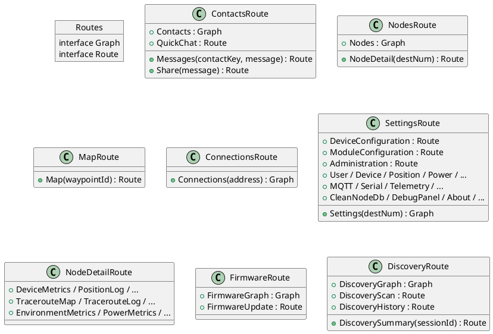

**顶级导航枚举**：

```kotlin
enum class TopLevelDestination(val label: StringResource, val route: Route) {
    Messages(Res.string.messages, ContactsRoute.Contacts),
    Nodes(Res.string.nodes, NodesRoute.Nodes),
    Map(Res.string.map, MapRoute.Map()),
    Settings(Res.string.bottom_nav_settings, SettingsRoute.Settings()),
    Connect(Res.string.connect, ConnectionsRoute.Connections()),
}
```

**Deep Link 处理**：
- `DeepLinkRouter` 接收 `CommonUri`，解析路径和参数
- 映射到对应的 `NavKey` 路由
- 通过 `UIViewModel.navigationDeepLink` Flow 分发给 `MeshtasticNavDisplay`
- 支持路径：`/share`, `/connections`, `/map`, `/messages`, `/quickchat`, `/nodes`, `/settings`, `/channels`, `/firmware`
- 支持旧版编码数据路径：`/e/{base64}`, `/v/#{data}`

---

## 4. 接口设计

### 4.1 内部数据访问 API

**NodeRepository（节点仓库）**：
```kotlin
interface NodeRepository {
    fun getAllNodes(): Flow<List<Node>>
    fun getNodeByNum(nodeNum: Int): Flow<Node?>
    fun getMyNodeInfo(): Flow<MyNodeInfo?>
    suspend fun upsertNode(node: NodeEntity)
    suspend fun setFavorite(num: Int, isFavorite: Boolean)
    suspend fun setIgnored(num: Int, isIgnored: Boolean)
    suspend fun setMuted(num: Int, isMuted: Boolean)
    suspend fun cleanNodeDatabase()
}
```

**PacketRepository（数据包仓库）**：
```kotlin
interface PacketRepository {
    fun getPackets(contactKey: String, myNodeNum: Int): PagingSource<Int, PacketEntity>
    fun getUnreadCount(): Flow<Int>
    suspend fun insertPacket(packet: Packet)
    suspend fun markRead(uuid: Long)
    suspend fun deletePacket(uuid: Long)
    fun searchMessages(query: String): Flow<List<PacketEntity>>
}
```

**MeshLogRepository（Mesh 日志仓库）**：
```kotlin
interface MeshLogRepository {
    fun observeAll(): Flow<List<MeshLog>>
    suspend fun insert(log: MeshLog)
    suspend fun deleteOlderThan(timestamp: Long)
}
```

**FirmwareReleaseRepository（固件发布仓库）**：
```kotlin
interface FirmwareReleaseRepository {
    fun getLatest(): Flow<FirmwareReleaseEntity?>
    suspend fun refreshFromNetwork()
    suspend fun downloadFirmware(url: String, destination: Path)
}
```

**DeviceHardwareRepository（设备硬件仓库）**：
```kotlin
interface DeviceHardwareRepository {
    fun getAll(): Flow<List<DeviceHardwareEntity>>
    suspend fun refreshFromNetwork()
}
```

**QuickChatActionRepository（快捷消息仓库）**：
```kotlin
interface QuickChatActionRepository {
    fun getAll(): Flow<List<QuickChatAction>>
    suspend fun insert(action: QuickChatAction)
    suspend fun updatePosition(uuid: Long, position: Int)
    suspend fun delete(uuid: Long)
}
```

**RadioConfigRepository（无线配置仓库）**：
```kotlin
interface RadioConfigRepository {
    suspend fun getConfig(): Config?
    suspend fun setConfig(config: Config): ResponseState
    suspend fun getModuleConfig(): ModuleConfig?
    suspend fun setModuleConfig(config: ModuleConfig): ResponseState
}
```

### 4.2 业务抽象接口

**RadioTransport（传输层抽象）**：
```kotlin
interface RadioTransport {
    val name: String
    val connectionState: StateFlow<ConnectionState>
    suspend fun connect(address: String)
    suspend fun disconnect(reason: TransportDisconnectReason)
    suspend fun send(bytes: ByteArray)
    val received: Flow<ByteArray>
}
```

**RadioTransportFactory（传输工厂）**：
```kotlin
interface RadioTransportFactory {
    fun create(address: String): RadioTransport
}
```

**MeshConfigFlowManager（配置流程管理）**：
```kotlin
interface MeshConfigFlowManager {
    suspend fun startConfigFlow(session: AdminSession, config: Config): ResponseState
}
```

**AppPreferences（偏好设置聚合接口）**：
包含 14 个子接口：`AnalyticsPrefs`、`AppFunctionsPrefs`、`HomoglyphPrefs`、`FilterPrefs`、`MeshLogPrefs`、`CustomEmojiPrefs`、`UiPrefs`、`MapPrefs`、`MapConsentPrefs`、`MapTileProviderPrefs`、`RadioPrefs`、`MeshPrefs`、`TakPrefs`、`DiscoveryPrefs`（详见 spec.md §8）。

### 4.3 Worker / 平台任务接口

**MeshLogCleanupWorker**：
```kotlin
class MeshLogCleanupWorker(context, params) : CoroutineWorker(context, params) {
    override suspend fun doWork(): Result
    // 清理超过 retentionDays 的 Mesh 日志
}
```

**SendMessageWorker**：
```kotlin
class SendMessageWorker(context, params) : CoroutineWorker(context, params) {
    override suspend fun doWork(): Result
    // 从队列中取出消息并通过 Transport 发送
}
```

**ServiceKeepAliveWorker**：
```kotlin
class ServiceKeepAliveWorker(context, params) : CoroutineWorker(context, params) {
    override suspend fun doWork(): Result
    // 定期检查 MeshService 是否运行，如果被杀则重启
}
```

### 4.4 Intent / Action 协议

| Action | 来源 | 处理 |
|--------|------|------|
| `android.intent.action.VIEW` | Deep Link / App Link | `MainActivity.handleIntent()` → `handleMeshtasticUri()` |
| `android.intent.action.MAIN` | 启动器 | 正常启动流程 |
| `android.intent.action.SEND` + `text/plain` | 系统分享 | 创建分享 Intent，导航到 `/share` |
| `android.nfc.action.NDEF_DISCOVERED` | NFC 标签 | 解析 NDEF 消息中的 URI |
| `android.hardware.usb.action.USB_DEVICE_ATTACHED` | USB 插入 | `usbRepository.refreshState()` |
| `android.intent.action.BOOT_COMPLETED` | 系统启动 | `BootCompleteReceiver` → `MeshService.startService()` |
| `android.intent.action.MY_PACKAGE_REPLACED` | 应用更新 | `BootCompleteReceiver` → 重启 Service |
| `android.appwidget.action.APPWIDGET_UPDATE` | Widget 刷新 | `LocalStatsWidgetReceiver.onUpdate()` |

### 4.5 URI 协议

**Meshtastic Deep Link**：`meshtastic://meshtastic/{path}?{query}`
- `/share?message={text}` → 分享消息界面
- `/connections?address={addr}` → 设备连接（自动连接指定地址）
- `/map` → 地图视图
- `/messages?contact_key={key}` → 指定联系人消息
- `/quickchat?contact_key={key}` → 快捷消息
- `/nodes` → 节点列表
- `/nodes/{nodeNum}` → 节点详情
- `/settings` → 设置
- `/channels` → 频道管理
- `/firmware` → 固件更新

**App Link**：`https://meshtastic.org/{path}`
- `/e/{base64}` → 解析频道/联系人数据（QR 码格式）
- `/v/#{data}` → 解析长格式编码数据
- 其他路径同 Deep Link

### 4.6 文件交换接口

**导出**：
- `ExportDataUseCase.exportOpml()` → OPML 格式节点数据库导出
- `ExportProfileUseCase.exportYaml()` → YAML 格式设备配置导出
- `ExportSecurityConfigUseCase.exportYaml()` → 安全配置导出（无敏感字段）
- `LogExporter.exportLogs()` → 文本格式调试日志导出
- `PrefExporter.exportTakPrefs()` → TAK 配置导出

**导入**：
- `ImportProfileUseCase.importFromYaml(file)` → 从 YAML 导入设备配置
- `InstallProfileUseCase.installToDevice(yaml)` → 将配置安装到设备
- QR 码扫码导入 → 解析 Meshtastic URL → 提取频道/联系人

---

## 5. 数据模型

### 5.1 SQLite 数据模型

完整建表语句（基于 Room @Entity 注解推导）：

```sql
CREATE TABLE my_node (
    myNodeNum INTEGER PRIMARY KEY NOT NULL,
    model TEXT,
    firmwareVersion TEXT,
    couldUpdate INTEGER NOT NULL,
    shouldUpdate INTEGER NOT NULL,
    currentPacketId INTEGER NOT NULL,
    messageTimeoutMsec INTEGER NOT NULL,
    minAppVersion INTEGER NOT NULL,
    maxChannels INTEGER NOT NULL,
    hasWifi INTEGER NOT NULL,
    deviceId TEXT DEFAULT 'unknown',
    pioEnv TEXT
);

CREATE TABLE nodes (
    num INTEGER PRIMARY KEY NOT NULL,
    user BLOB NOT NULL,
    long_name TEXT,
    short_name TEXT,
    position BLOB NOT NULL,
    latitude REAL NOT NULL DEFAULT 0.0,
    longitude REAL NOT NULL DEFAULT 0.0,
    snr REAL NOT NULL,
    rssi INTEGER NOT NULL,
    last_heard INTEGER NOT NULL DEFAULT 0,
    device_metrics BLOB NOT NULL,
    channel INTEGER NOT NULL DEFAULT 0,
    via_mqtt INTEGER NOT NULL DEFAULT 0,
    hops_away INTEGER NOT NULL DEFAULT -1,
    is_favorite INTEGER NOT NULL DEFAULT 0,
    is_ignored INTEGER NOT NULL DEFAULT 0,
    is_muted INTEGER NOT NULL DEFAULT 0,
    environment_metrics BLOB NOT NULL,
    power_metrics BLOB NOT NULL,
    air_quality_metrics BLOB NOT NULL DEFAULT x'',
    paxcounter BLOB NOT NULL,
    public_key BLOB,
    notes TEXT NOT NULL DEFAULT '',
    manually_verified INTEGER NOT NULL DEFAULT 0,
    node_status TEXT,
    last_transport INTEGER NOT NULL DEFAULT 0,
    has_xeddsa_signed INTEGER NOT NULL DEFAULT 0
);

CREATE TABLE packet (
    uuid INTEGER PRIMARY KEY AUTOINCREMENT,
    myNodeNum INTEGER NOT NULL DEFAULT 0,
    port_num INTEGER NOT NULL,
    contact_key TEXT NOT NULL,
    received_time INTEGER NOT NULL,
    read INTEGER NOT NULL DEFAULT 1,
    data BLOB NOT NULL,
    packet_id INTEGER NOT NULL DEFAULT 0,
    routing_error INTEGER NOT NULL DEFAULT -1,
    snr REAL NOT NULL DEFAULT 0,
    rssi INTEGER NOT NULL DEFAULT 0,
    hopsAway INTEGER NOT NULL DEFAULT -1,
    sfpp_hash BLOB,
    filtered INTEGER NOT NULL DEFAULT 0,
    message_text TEXT NOT NULL DEFAULT ''
);

CREATE VIRTUAL TABLE packet_fts USING fts5(message_text, content='packet', content_rowid='uuid');

CREATE TABLE contact_settings (
    contact_key TEXT PRIMARY KEY NOT NULL,
    muteUntil INTEGER NOT NULL DEFAULT 0,
    last_read_message_uuid INTEGER,
    last_read_message_timestamp INTEGER,
    filtering_disabled INTEGER NOT NULL DEFAULT 0
);

CREATE TABLE reactions (
    myNodeNum INTEGER NOT NULL DEFAULT 0,
    reply_id INTEGER NOT NULL,
    user_id TEXT NOT NULL,
    emoji TEXT NOT NULL,
    timestamp INTEGER NOT NULL,
    snr REAL NOT NULL DEFAULT 0,
    rssi INTEGER NOT NULL DEFAULT 0,
    hopsAway INTEGER NOT NULL DEFAULT -1,
    packet_id INTEGER NOT NULL DEFAULT 0,
    status INTEGER NOT NULL DEFAULT 0,
    routing_error INTEGER NOT NULL DEFAULT 0,
    relays INTEGER NOT NULL DEFAULT 0,
    relay_node INTEGER,
    "to" TEXT,
    channel INTEGER NOT NULL DEFAULT 0,
    sfpp_hash BLOB,
    PRIMARY KEY (myNodeNum, reply_id, user_id, emoji)
);

CREATE TABLE meshlog (
    uuid INTEGER PRIMARY KEY AUTOINCREMENT,
    received_time INTEGER NOT NULL,
    text TEXT NOT NULL,
    category TEXT,
    source TEXT,
    timestamp INTEGER NOT NULL
);

CREATE TABLE quick_chat_actions (
    uuid INTEGER PRIMARY KEY AUTOINCREMENT,
    position INTEGER NOT NULL,
    mode TEXT NOT NULL,
    text TEXT NOT NULL,
    icon INTEGER NOT NULL,
    enabled INTEGER NOT NULL
);

CREATE TABLE metadata (
    num INTEGER PRIMARY KEY NOT NULL,
    proto BLOB NOT NULL,
    timestamp INTEGER NOT NULL
);

-- device_hardware, device_link, firmware_release,
-- traceroute_node_position, discovery_session,
-- discovery_preset_result, discovered_node tables
-- (结构详见 spec.md §6)
```

**索引**：

```sql
CREATE INDEX idx_packet_myNodeNum ON packet(myNodeNum);
CREATE INDEX idx_packet_port_num ON packet(port_num);
CREATE INDEX idx_packet_contact_key ON packet(contact_key);
CREATE INDEX idx_packet_contact_port_time ON packet(contact_key, port_num, received_time);
CREATE INDEX idx_packet_packet_id ON packet(packet_id);
CREATE INDEX idx_packet_received_time ON packet(received_time);
CREATE INDEX idx_packet_filtered ON packet(filtered);
CREATE INDEX idx_packet_read ON packet(read);

CREATE INDEX idx_nodes_last_heard ON nodes(last_heard);
CREATE INDEX idx_nodes_short_name ON nodes(short_name);
CREATE INDEX idx_nodes_long_name ON nodes(long_name);
CREATE INDEX idx_nodes_hops_away ON nodes(hops_away);
CREATE INDEX idx_nodes_is_favorite ON nodes(is_favorite);
CREATE INDEX idx_nodes_last_heard_fav ON nodes(last_heard, is_favorite);
CREATE INDEX idx_nodes_public_key ON nodes(public_key);

CREATE INDEX idx_reactions_reply_id ON reactions(reply_id);
CREATE INDEX idx_reactions_packet_id ON reactions(packet_id);
CREATE INDEX idx_metadata_num ON metadata(num);
```

**数据库版本历史**（关键里程碑）：
- v13：删除 `NodeInfo` 和 `MyNodeInfo` 旧表（迁移到 `nodes` 和 `my_node`）
- v29-v30：删除 `reply_id` 列（迁移到 `reactions` 表）
- v33-v35：删除 `retry_count` 列
- v42-v43：删除 `device_link.original_url` 列

### 5.2 领域模型

完整领域模型字段说明表：

| 模型 | 字段 | 类型 | 说明 |
|------|------|------|------|
| Node | num | Int | 节点 ID |
| Node | user | User (proto) | 用户信息（ID、长名称、短名称、硬件型号） |
| Node | position | Position (proto) | GPS 位置 |
| Node | snr | Float | 信噪比 (dB) |
| Node | rssi | Int | 接收信号强度 |
| Node | lastHeard | Int | 最后接收时间 (Unix seconds) |
| Node | deviceMetrics | DeviceMetrics | 设备指标（电池、电压、信道利用率） |
| Node | channel | Int | 频道索引 |
| Node | viaMqtt | Boolean | 是否经 MQTT 传输 |
| Node | hopsAway | Int | 距本节点的跳数 |
| Node | isFavorite | Boolean | 是否收藏 |
| Node | isIgnored | Boolean | 是否忽略 |
| Node | isMuted | Boolean | 是否静音 |
| Node | environmentMetrics | EnvironmentMetrics | 环境传感器数据 |
| Node | powerMetrics | PowerMetrics | 电源传感器数据 |
| Node | airQualityMetrics | AirQualityMetrics | 空气质量数据 |
| Node | paxcounter | Paxcount | BLE/WiFi 人流量计数 |
| Node | publicKey | ByteString? | 节点公钥 |
| Node | notes | String | 用户备注 |
| Node | manuallyVerified | Boolean | 是否手动验证（扫码/导入） |
| Node | signsPackets | Boolean | 是否 XEdDSA 签名 |
| Node | nodeStatus | String? | 节点自定义状态文本 |
| Node | lastTransport | Int | 最后传输方式编号 |
| Node | metadata | DeviceMetadata? | 设备元数据 |
| Message | uuid | Long | 唯一标识 |
| Message | receivedTime | Long | 接收时间戳 |
| Message | node | Node | 关联节点 |
| Message | text | String | 消息文本 |
| Message | fromLocal | Boolean | 是否本地发送 |
| Message | time | String | 格式化时间 |
| Message | read | Boolean | 是否已读 |
| Message | status | MessageStatus? | 送达状态 |
| Message | routingError | Int | 路由错误码 |
| Message | emojis | List\<Reaction\> | 表情回复列表 |
| Message | snr | Float | 信噪比 |
| Message | rssi | Int | 信号强度 |
| Message | hopsAway | Int | 跳数 |
| Message | replyId | Int? | 回复目标消息 ID |
| Message | viaMqtt | Boolean | 是否经 MQTT |
| Message | relayNode | Int? | 中继节点 ID |
| Message | transportMechanism | Int | 传输方式 |
| Message | xeddsaSigned | Boolean | XEdDSA 签名状态 |
| Position | latitude | Double | 纬度 (degrees) |
| Position | longitude | Double | 经度 (degrees) |
| Position | altitude | Int | 海拔 (meters) |
| Position | time | Int | 位置时间戳 (Unix seconds) |
| Position | satellitesInView | Int | 可见卫星数 |
| Position | groundSpeed | Int | 地面速度 |
| Position | groundTrack | Int | 地面航向 |
| Position | precisionBits | Int | GPS 精度位数 |
| DataPacket | to | String? | 目标地址 |
| DataPacket | from | String? | 源地址 |
| DataPacket | bytes | ByteString? | 负载字节 |
| DataPacket | dataType | Int | 端口类型 (PortNum) |
| DataPacket | time | Long | 时间戳 (msec) |
| DataPacket | id | Int | 包 ID |
| DataPacket | status | MessageStatus? | 消息状态 |
| DataPacket | channel | Int | 频道索引 |
| DataPacket | wantAck | Boolean | 是否请求确认 |
| DataPacket | viaMqtt | Boolean | 是否经 MQTT |
| DataPacket | replyId | Int? | 回复目标 |
| DataPacket | relayNode | Int? | 中继节点 |
| DataPacket | transportsMechanism | Int | 传输方式 |
| DataPacket | xeddsaSigned | Boolean | 签名状态 |

### 5.3 SharedPreferences 结构

应用程序使用 Koin DI 注入 `AppPreferences` 接口，底层通过 `DataStore`（Android）或 `java.util.prefs`（Desktop）实现持久化。

**偏好分组**（按接口）：

| 分组 | 接口 | 底层实现 |
|------|------|----------|
| 分析 | AnalyticsPrefs | AnalyticsPrefsImpl |
| AI 功能 | AppFunctionsPrefs | AppFunctionsPrefsImpl |
| 同形字符 | HomoglyphPrefs | HomoglyphPrefsImpl |
| 过滤 | FilterPrefs | FilterPrefsImpl |
| 日志 | MeshLogPrefs | MeshLogPrefsImpl |
| Emoji | CustomEmojiPrefs | CustomEmojiPrefsImpl |
| UI | UiPrefs | UiPrefsImpl |
| 地图 | MapPrefs | MapPrefsImpl |
| 地图许可 | MapConsentPrefs | MapConsentPrefsImpl |
| 瓦片源 | MapTileProviderPrefs | MapTileProviderPrefsImpl |
| 无线电 | RadioPrefs | RadioPrefsImpl |
| Mesh | MeshPrefs | MeshPrefsImpl |
| TAK | TakPrefs | TakPrefsImpl |
| 通知 | NotificationPrefs | NotificationPrefsImpl |
| 发现 | DiscoveryPrefs | DiscoveryPrefsImpl |
| 节点列表布局 | NodeListLayoutPreferences | (内嵌于 UiPrefsImpl) |

完整 key 目录和默认值详见 spec.md §8。

### 5.4 文件格式 Schema

**OPML 导出格式**：[推断] 标准 OPML 2.0 XML 格式，包含：
- `<opml version="2.0">`
- `<head>` 标题元数据
- `<body>` 包含节点列表的 `<outline>` 元素
- 每个 outline 包含节点名称、ID、最后听到时间等属性

**设备配置 YAML 格式**：[推断] YAML 格式的 Config protobuf 序列化，包含：
```yaml
device:
  role: CLIENT
  serial_enabled: true
position:
  position_broadcast_secs: 900
lora:
  region: US
  modem_preset: LONG_FAST
  hop_limit: 3
# ... 其他配置
```

**Meshtastic URL 编码**：
- 格式：`https://meshtastic.org/e/{base64}`
- 编码内容：protobuf 序列化的 `ChannelSet` 或 `SharedContact` 压缩后 Base64 编码
- 解码流程：Base64 解码 → protobuf 反序列化 → 提取频道设置或联系人信息

**固件文件格式**：
- `.bin` 或 `.hex` 格式的固件二进制镜像
- 通过 XModem 协议（128 字节块）进行 OTA 传输
- `XModemManager` 管理传输流程（SOH/EOT/ACK/NAK 协议处理）

---

## 6. UI设计系统

详见 §3.4 设计系统规格文档。

---

## 7. 屏幕清单与导航

### 7.1 屏幕清单总表

| 屏幕名称 | 类型 | 模块 | 入口 | 功能摘要 |
|----------|------|------|------|----------|
| AppIntroductionScreen | Compose Fullscreen | feature:intro | 首次启动 | 隐私政策、引导流程 |
| MainScreen | Compose Shell | androidApp | 引导完成 | 底部导航容器（5 Tab） |
| ConnectionsScreen | Compose Screen | feature:connections | 底部 Tab "连接" | BLE/USB/TCP 设备列表 |
| ContactsScreen (AdaptiveContactsScreen) | Compose Screen | feature:messaging | 底部 Tab "消息" | 联系人/对话列表 |
| MessagesScreen | Compose Screen | feature:messaging | 联系人列表项 | 聊天消息详情 |
| ShareScreen | Compose Screen | feature:messaging | 系统分享/Deep Link | 消息分享、联系人选择 |
| QuickChatScreen | Compose Dialog | feature:messaging | 消息输入框 | 快捷消息选择器 |
| NodeListScreen (AdaptiveNodeListScreen) | Compose Screen | feature:node | 底部 Tab "节点" | 节点列表 + 过滤 |
| NodeDetailScreen | Compose Screen | feature:node | 节点列表项 | 节点详情全信息 |
| MapScreen | Compose Screen | feature:map | 底部 Tab "地图" | 地图 + 节点标记 |
| SettingsScreen | Compose Screen | feature:settings | 底部 Tab "设置" | 设置分类列表 |
| RadioConfigScreen | Compose Screen | feature:settings | 设置 > 无线配置 | 全部设备配置项 |
| ChannelScreen | Compose Screen | feature:settings | 设置 > 频道 | 频道列表管理 |
| DeviceConfigurationScreen | Compose Screen | feature:settings | 设置 > 设备配置 | 设备基本信息 |
| ModuleConfigurationScreen | Compose Screen | feature:settings | 设置 > 模块配置 | 14+ 模块配置入口 |
| AdministrationScreen | Compose Screen | feature:settings | 设置 > 管理 | 远程管理、固件更新 |
| AboutScreen | Compose Screen | feature:settings | 设置 > 关于 | 版本、许可证 |
| DebugPanel | Compose Screen | feature:settings | 设置 > 调试 | 日志查看、消息追踪 |
| FilterSettingsScreen | Compose Screen | feature:settings | 设置 > 过滤 | 关键词过滤管理 |
| CleanNodeDatabaseScreen | Compose Screen | feature:settings | 设置 > 清空节点DB | 确认清空操作 |
| NodeListScreen (Settings) | Compose Screen | feature:settings | 设置 > 节点列表 | 列表布局/显示偏好 |
| DeviceLinkDirectoryScreen | Compose Screen | feature:settings | 设置 > 设备链接 | 硬件购买链接列表 |
| AppFunctionsSettingsScreen | Compose Screen | feature:settings | 设置 > App Functions | AI 功能开关 |
| FirmwareUpdateScreen | Compose Screen | feature:firmware | 设置 > 固件更新 | 固件版本 + OTA |
| WifiProvisionScreen | Compose Screen | feature:wifi-provision | 设置 > WiFi 配置 | WiFi 凭据输入 |
| DiscoveryScan | Compose Screen | feature:discovery | 发现 > 扫描 | 扫描控制面板 |
| DiscoverySummary | Compose Screen | feature:discovery | 扫描完成 | 发现结果总结 |
| DiscoveryHistory | Compose Screen | feature:discovery | 发现 > 历史 | 历史会话列表 |
| HelpDocs / HelpDocPage | Compose Screen | feature:docs | 设置 > 帮助 | 帮助文档浏览 |
| TracerouteMapScreen | Compose Screen | feature:node | 节点详情 | 路由追踪路径可视化 |
| PositionLogScreens | Compose Screen | feature:node | 节点详情 > 位置 | 位置历史图表 |
| MetricLogComponents (Device/Env/Power/...) | Compose Screen | feature:node | 节点详情 | 各类指标时间图表 |
| Car HomeScreen / NodeDetailScreen | Compose Screen | feature:car | Android Auto (google) | 车载消息界面 |

### 7.2 全局导航图

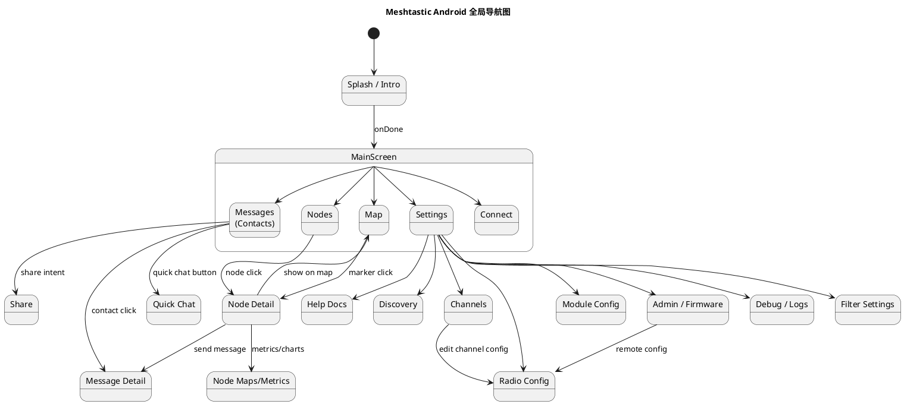

### 7.3 Deep Link 处理

Deep Link 处理流程在 `MainActivity.handleMeshtasticUri()` 中，将 Android `Uri` 转换为 KMP `CommonUri`，然后调用 `UIViewModel.handleDeepLink()`。

`DeepLinkRouter` 解析 `CommonUri`：
1. 移除 `meshtastic://meshtastic` 或 `https://meshtastic.org` 前缀
2. 提取路径段（如 `/share`, `/nodes/123`）
3. 提取查询参数（如 `?message=hello`, `?address=t192.168.1.1`）
4. 转换为对应的 `NavKey` 路由对象列表
5. 通过 `_navigationDeepLink` SharedFlow 发送给导航系统

---

## 8. 用户交互规格

### 8.1 手势交互目录

| 手势 | 目标组件 | 行为 |
|------|----------|------|
| 点击 | 节点列表项 | 导航到 NodeDetailScreen |
| 长按 | 节点列表项 | 显示 NodeContextMenu |
| 点击 | 消息气泡 | 显示送达详情 (DeliveryInfoDialog) |
| 长按 | 消息气泡 | 显示 MessageActionsBottomSheet |
| 点击 | 消息中的回复引用 | 滚动到被引用消息 |
| 点击 | 地图节点标记 | 显示节点信息卡片 |
| 点击 | 信息卡片 | 导航到节点详情 |
| 下拉 | 列表顶部 | 触发刷新 |
| 点击 | 快捷消息按钮 | 显示 QuickChat 选择器 |
| 点击 | 指南针按钮 | 打开 CompassBottomSheet |
| 拖拽 | 快捷消息项 | 重新排序 |
| 点击 | FAB | 展开菜单选项 |
| 滑动 | 消息项 | (预留：未来操作如删除/回复) |

### 8.2 对话框目录

详见 spec.md §7.4。

### 8.3 剪贴板与反馈行为

- **复制文本**：长按消息 → `MessageActionsBottomSheet` → "Copy" 选项 → 文本复制到系统剪贴板
- **复制节点信息**：NodeDetailScreen 中的 `CopyIconButton` → 复制节点 ID 或完整信息
- **发送反馈**：
  - `SnackbarManager`：短暂操作反馈（"已复制"、"已发送"、"配置已保存"）
  - `AlertManager`：阻塞式对话框（错误、警告、确认）
- **Toast**：`showToast()` 工具函数，显示短时文本提示

---

## 9. 平台集成

### 9.1 构建配置与依赖版本

**构建配置**（`androidApp/build.gradle.kts`）：
- `namespace`: `org.meshtastic.app`
- `applicationId`: 由 `configProperties` 动态配置（google/fdroid 变体使用不同 ID）
- `minSdk`: [推断] ~26 (API 26/Oreo)
- `targetSdk`: [推断] ~35 (API 35)
- `compileSdk`: [推断] ~35
- 构建类型：`debug`, `release`
- 产品变体：`google`, `fdroid`
- ABI 分割：`armeabi-v7a`, `arm64-v8a`

**关键依赖库及版本**（从 `androidApp/build.gradle.kts` 依赖项提取）：

| 依赖库 | 用途 |
|--------|------|
| `androidx.room3` | Room 数据库 (KMP) |
| `androidx.navigation3` | Navigation 3 (KMP) |
| `androidx.compose.material3` | Material3 UI |
| `androidx.lifecycle` | Lifecycle/ViewModel |
| `androidx.work` | WorkManager 后台任务 |
| `androidx.glance` | AppWidget 框架 |
| `androidx.core.splashscreen` | Splash Screen API |
| `androidx.profileinstaller` | 基线配置文件安装 |
| `compose.multiplatform` | Compose Multiplatform |
| `jetbrains.navigation3` | JetBrains Navigation |
| `koin` | 依赖注入 (DI) |
| `kotlinx.coroutines` | 协程 |
| `kotlinx.serialization` | JSON 序列化 |
| `kotlinx.datetime` | 跨平台日期时间 |
| `ktor` | HTTP 客户端 |
| `coil` | 图片加载 |
| `okio` | I/O 字节处理 |
| `usb-serial-android` | USB 串口通信 |
| `kermit` | 日志框架 |
| `meshtastic.protobufs` | Meshtastic protobuf 定义 |

**google 变体专属依赖**：
| 依赖库 | 用途 |
|--------|------|
| `firebase.analytics` | Firebase 分析 |
| `firebase.crashlytics` | Firebase 崩溃报告 |
| `firebase.ai` | Firebase AI/翻译 |
| `play.services.maps` | Google Maps SDK |
| `maps.compose` | Maps Compose 库 |
| `dd.sdk.android` | Datadog RUM/Logs/Trace |
| `mlkit.translate` | ML Kit 翻译 |
| `location.services` | Fused Location Provider |

**fdroid 变体专属依赖**：
| 依赖库 | 用途 |
|--------|------|
| `osmdroid.android` | OpenStreetMap 地图 |
| `osmdroid.geopackage` | GeoPackage 支持 |
| `osmbonuspack` | OSM 附加功能 |

### 9.2 权限与运行时请求

详见 spec.md §11.1。

### 9.3 系统服务

**前台服务**：
- `MeshService`：`foregroundServiceType="connectedDevice|location"`
- 通知 ID：`SERVICE_NOTIFY_ID`
- 保持唤醒：`WakeLock` (PARTIAL_WAKE_LOCK)

**通知渠道**：
- `NotificationChannels.MESSAGE_CHANNEL`：消息通知
- `NotificationChannels.NODE_EVENT_CHANNEL`：节点事件通知
- `NotificationChannels.LOW_BATTERY_CHANNEL`：低电量通知
- `NotificationChannels.SERVICE_CHANNEL`：前台服务通知
- 渠道迁移：`NotificationChannelMigration` 处理渠道配置变更

**Widget**：
- `LocalStatsWidget`：基于 Glance 的 AppWidget
- `LocalStatsWidgetReceiver`：接收更新广播
- `LocalStatsWidgetState`：Widget 状态定义
- `AndroidAppWidgetUpdater`：触发 Widget 刷新
- `RefreshLocalStatsAction`：刷新动作定义

**Android Auto**（仅 google 变体，`enableCarTemplates=true` 时）：
- `MeshtasticCarAppService`：CarAppService 入口
- `MeshtasticCarSession`：Car 会话管理
- `CarStateCoordinator`：Car 状态协调
- `ConversationShortcutManager`：车载对话快捷方式
- `HomeScreen` / `NodeDetailScreen`：车载 Compose 屏幕
- `EmergencyHandler`：紧急消息处理
- 默认模式（`enableCarTemplates=false`）：仅通知式车载消息，无需 CarAppService

**NFC**：
- `NfcScannerEffect`：NFC 扫码 Compose 效果
- `NfcWriterEffect`：NFC 写入 Compose 效果
- NDEF 消息解析（URI 记录）

**条形码/二维码**：
- `BarcodeScannerProvider`：扫码提供者（CameraX + MLKit）
- `rememberBarcodeScanner`：Compose 扫码集成
- `SingleScanResultGate`：单次扫码门控

### 9.4 备份规则

- `android:allowBackup="false"`：禁用 Android 自动备份
- `android:fullBackupContent="false"`：禁用全量备份
- `@xml/data_extraction_rules`：设备间迁移的数据提取规则
- 手动备份通过 `ExportDataUseCase` / `ExportProfileUseCase` 实现
- 首选项通过 DataStore 持久化，卸载后丢失

---

## 10. 偏好设置目录

### 10.1 UiPrefs（界面偏好）

| Key | 类型 | 默认值 | 实现文件 |
|-----|------|--------|----------|
| `app_intro_completed` | Boolean | false | UiPrefsImpl |
| `theme` | Int | MODE_DYNAMIC | UiPrefsImpl |
| `locale` | String | 系统默认 | UiPrefsImpl |
| `node_sort` | Int | 0 | UiPrefsImpl |
| `include_unknown` | Boolean | false | UiPrefsImpl |
| `exclude_infrastructure` | Boolean | false | UiPrefsImpl |
| `only_online` | Boolean | false | UiPrefsImpl |
| `only_direct` | Boolean | false | UiPrefsImpl |
| `show_ignored` | Boolean | false | UiPrefsImpl |
| `exclude_mqtt` | Boolean | false | UiPrefsImpl |
| `has_shown_not_paired_warning` | Boolean | false | UiPrefsImpl |
| `show_quick_chat` | Boolean | true | UiPrefsImpl |
| `ble_auto_scan` | Boolean | true | UiPrefsImpl |
| `network_auto_scan` | Boolean | true | UiPrefsImpl |
| `node_list_density` | String | "COMPLETE" | NodeListLayoutPreferences |
| `should_show_power` | Boolean | true | NodeListLayoutPreferences |
| `should_show_last_heard` | Boolean | true | NodeListLayoutPreferences |
| `last_heard_is_relative` | Boolean | true | NodeListLayoutPreferences |
| `should_show_location` | Boolean | true | NodeListLayoutPreferences |
| `should_show_hops` | Boolean | true | NodeListLayoutPreferences |
| `should_show_signal` | Boolean | true | NodeListLayoutPreferences |
| `should_show_channel` | Boolean | true | NodeListLayoutPreferences |
| `should_show_role` | Boolean | true | NodeListLayoutPreferences |
| `should_show_telemetry` | Boolean | true | NodeListLayoutPreferences |

### 10.2 RadioPrefs（无线电偏好）

| Key | 类型 | 默认值 | 实现文件 |
|-----|------|--------|----------|
| `dev_addr` | String? | null | RadioPrefsImpl |
| `dev_name` | String? | null | RadioPrefsImpl |

### 10.3 MeshPrefs（Mesh 连接偏好）

| Key | 类型 | 默认值 | 实现文件 |
|-----|------|--------|----------|
| `device_address` | String? | null | MeshPrefsImpl |
| `store_forward_last_request_{address}` | Int | 0 | MeshPrefsImpl |

### 10.4 NotificationPrefs（通知偏好）

| Key | 类型 | 默认值 | 实现文件 |
|-----|------|--------|----------|
| `messages_enabled` | Boolean | true | NotificationPrefsImpl |
| `node_events_enabled` | Boolean | true | NotificationPrefsImpl |
| `node_events_auto_disabled_for_event` | Boolean | false | NotificationPrefsImpl |
| `low_battery_enabled` | Boolean | true | NotificationPrefsImpl |

### 10.5 MapPrefs（地图偏好）

| Key | 类型 | 默认值 | 实现文件 |
|-----|------|--------|----------|
| `map_style` | Int | 0 | MapPrefsImpl |
| `show_only_favorites` | Boolean | false | MapPrefsImpl |
| `show_waypoints_on_map` | Boolean | true | MapPrefsImpl |
| `show_precision_circle_on_map` | Boolean | true | MapPrefsImpl |
| `last_heard_filter` | Long | 0 | MapPrefsImpl |
| `last_heard_track_filter` | Long | 0 | MapPrefsImpl |

### 10.6 其他偏好

完整偏好设置清单详见 spec.md §8。

---

## 附录 A：构建与运行

**构建命令**：
```bash
# Google Play 版本 (Release)
./gradlew :androidApp:assembleGoogleRelease

# F-Droid 版本 (Release)
./gradlew :androidApp:assembleFdroidRelease

# 调试版本
./gradlew :androidApp:assembleGoogleDebug

# 启用 Car Templates (用于 Closed Track)
./gradlew :androidApp:bundleGoogleRelease -PenableCarTemplates=true
```

**目录结构总览**：
```
Meshtastic-Android/
  androidApp/                  # Android 应用入口
  desktopApp/                  # Desktop (JVM) 应用入口
  core/                        # 核心模块 (21 个)
    :model, :database, :repository, :service, :data
    :domain, :ui, :common, :navigation, :network
    :ble, :prefs, :datastore, :resources, :barcode
    :nfc, :takserver, :di, :testing, :konsist
  feature/                     # 功能模块 (12 个)
    :messaging, :node, :map, :connections, :settings
    :discovery, :intro, :firmware, :docs, :wifi-provision
    :car, :widget
  build-logic/                 # Gradle 构建约定插件
  baselineprofile/             # 基线配置文件
  screenshot-tests/            # 截图测试
  docs-screenshots/            # 文档截图
  gradle/                      # Gradle 配置
    libs.versions.toml         # 版本目录
```

---


### 3.9 BLE传输模块 (core:ble) 实现设计

#### 3.9.1 模块介绍

`core:ble` 模块提供 Android 平台上的 BLE（蓝牙低功耗）传输实现。它是 `RadioTransport` 接口的具体实现，负责与 Meshtastic 硬件设备通过 BLE GATT 协议进行双向通信。

#### 3.9.2 功能描述

- BLE 设备扫描和发现
- GATT 连接管理（连接、断开、重连）
- 通过 GATT 特征值收发数据（ToRadio/FromRadio 特征值）
- BLE MTU 协商（请求最大 MTU 512 字节）
- 连接参数优化
- 设备睡眠状态检测（`DeviceSleep` 连接状态）
- 自动重连机制（指数退避策略）

#### 3.9.3 文件夹结构

```
core/ble/src/androidMain/kotlin/org/meshtastic/core/ble/
  BLETransport.kt              # BLE 传输主实现 (RadioTransport)
  BLEScanner.kt                # BLE 扫描器
  GattConnectionManager.kt     # GATT 连接管理器
  BluetoothStateMonitor.kt     # 蓝牙状态监控
  di/
    CoreBleAndroidModule.kt    # Android BLE Koin DI 模块
```

#### 3.9.4 核心算法

**BLE 设备过滤算法**：
1. 开始 BLE 扫描（使用 `ScanFilter` 或手动过滤）
2. 仅显示名称包含 "Meshtastic" 或具有指定服务 UUID 的设备
3. 按 RSSI 降序排列扫描结果（信号最强的在前）
4. 同一 MAC 地址仅保留最后一条记录（去重）
5. 扫描超时后自动停止（可配置超时时长）

**自动重连策略**：
1. 初次断开 -> 立即尝试重连（延迟 0ms）
2. 重连失败 -> 指数退避：1s -> 2s -> 4s -> 8s -> 16s -> 32s -> 最大 60s
3. 设备进入睡眠模式（`DeviceSleep`）-> 等待一段时间后再尝试
4. 用户主动断开（disconnect reason = UserRequest）-> 不自动重连
5. 在 `onServicesDiscovered` 后启动数据通信

**MTU 协商**：
1. GATT 连接建立后立即 `requestMtu(512)`
2. `onMtuChanged` 回调记录协商结果
3. 根据实际 MTU 调整数据包分片大小（MTU - 3 = 最大 ATT 负载）
4. 如果 MTU 协商失败，使用默认 ATT_MTU (23 字节)

#### 3.9.5 错误处理

- **GATT 133 错误**（最常见）：Android BLE 栈内部错误 -> 调用 `gatt.close()` -> 延迟 500ms -> `gatt.connect()`
- **GATT 状态 8（GATT_CONN_TIMEOUT）**：设备超出范围 -> 标记为 `DeviceSleep` -> 等待重连
- **特征值写入失败**（status != GATT_SUCCESS）：重试 3 次 -> 仍失败则 `disconnect(WriteError)`
- **服务发现超时**：30 秒超时 -> `disconnect(ServiceDiscoveryTimeout)`
- **MTU 协商失败**：使用默认 MTU，记录警告日志
- **蓝牙未开启**：请求用户开启蓝牙，显示 `PermissionRecoveryCard`

#### 3.9.6 依赖关系

- **内部依赖**：`core:repository`（RadioTransport/RadioTransportFactory 接口）、`core:common`（日志）
- **外部依赖**：Android BLE API (`android.bluetooth.*`)、`kotlinx.coroutines`

---

### 3.10 网络模块 (core:network) 实现设计

#### 3.10.1 模块介绍

`core:network` 模块管理 HTTP 网络通信，基于 Ktor 客户端实现。负责与 Meshtastic API v1、GitHub Releases API 和自定义地图瓦片源的通信。

#### 3.10.2 功能描述

- Meshtastic API v1 客户端（硬件信息 `/v1/hardware`、设备链接 `/v1/device_links`）
- GitHub Releases API 客户端（固件版本查询和下载）
- 地图瓦片下载（google: Google Maps Tile API; fdroid: OSM/Slippy Map 瓦片）
- MQTT JSON 数据格式处理
- HTTP 缓存策略（Stale-While-Revalidate）
- 网络状态感知（ConnectivityManager）
- Ktor 客户端配置（JSON 序列化、内容协商、日志拦截器）

#### 3.10.3 文件夹结构

```
core/network/src/
  commonMain/kotlin/org/meshtastic/core/network/
    api/
      MeshtasticApi.kt           # API v1 REST 客户端
      GitHubApi.kt               # GitHub Releases API 客户端
      TileServerApi.kt           # 地图瓦片 API 客户端
    repository/
      UsbRepository.kt           # USB 设备仓库（封装 UsbManager）
    model/
      ApiResponses.kt            # API 响应数据模型
    di/
      CoreNetworkModule.kt       # Koin DI 模块
  androidMain/kotlin/org/meshtastic/core/network/
    AndroidHttpClient.kt         # Android Ktor 引擎配置（OkHttp 或 CIO）
    NetworkStateMonitor.kt       # 网络状态监控
```

#### 3.10.4 核心算法

**Stale-While-Revalidate 缓存策略**：
1. 请求发出 -> 检查数据库缓存
2. 缓存命中 -> 立即发射缓存值
3. 后台启动网络请求 -> 获取最新数据
4. 网络结果与缓存比较 -> 如有差异，更新缓存并发射新值
5. 网络失败 -> 保留缓存值，不发射错误（静默回退）
6. 缓存未命中 + 网络失败 -> 发射错误

**固件版本比较算法**：
1. 从 GitHub API 获取最新 release (`GET /repos/meshtastic/firmware/releases/latest`)
2. 解析 `tag_name`（如 `v2.5.0.abcdef`）
3. 提取版本号组件（major.minor.patch）
4. 与设备当前 `firmwareVersion` 比较
5. 考虑 `prerelease` 标志：默认仅显示 `draft=false, prerelease=false`
6. `couldUpdate = (latestVersion > currentVersion)`
7. `shouldUpdate = couldUpdate && (currentVersion < minRecommendedVersion)`

**地图瓦片 URL 模板变量替换**：
```kotlin
fun buildTileUrl(template: String, x: Int, y: Int, z: Int): String =
    template
        .replace("{x}", x.toString())
        .replace("{y}", y.toString())
        .replace("{z}", z.toString())
        .replace("{s}", subdomain(x, y))
```

#### 3.10.5 错误处理

- **API 不可用（HTTP 5xx）**：最多 3 次重试，指数退避 1s/2s/4s -> 全部失败返回缓存数据或 `Result.failure`
- **网络超时**：connectTimeout=10s, requestTimeout=30s, socketTimeout=30s -> 返回超时错误
- **HTTP 429 Too Many Requests**：解析 `Retry-After` 头 -> 等待指定秒数后重试
- **SSL/TLS 错误**：记录错误日志 -> 对于已知的自定义测试服务器，使用自定义 TrustManager
- **无网络连接**：`NetworkStateMonitor.isOnline = false` -> 直接返回缓存，不发起网络请求

#### 3.10.6 依赖关系

- **内部依赖**：`core:database`（缓存 API 响应）、`core:model`（数据模型）
- **外部依赖**：`io.ktor:ktor-client-*`、`kotlinx.serialization.json`、`kotlinx.coroutines`

---

### 3.11 消息功能模块 (feature:messaging) 实现设计

#### 3.11.1 模块介绍

`feature:messaging` 模块提供完整的消息收发用户界面，包括联系人列表、消息详情和快捷消息功能。使用 Compose Multiplatform 构建，支持自适应双栏布局（手机单栏、平板双栏）。

#### 3.11.2 功能描述

- 联系人列表（按最近消息时间排序，显示未读计数）
- 消息详情（聊天气泡、送达状态图标、表情回复列表）
- 快捷消息选择器（QuickChat）
- 消息搜索（全文本搜索 FTS）
- 消息分享（接收系统 `ACTION_SEND` Intent）
- 表情回复（Emoji Reactions）的添加和显示
- 消息过滤状态显示
- 消息送达详情对话框（DeliveryInfoDialog）
- 消息操作（复制、删除、回复、查看详情）

#### 3.11.3 文件夹结构

```
feature/messaging/src/commonMain/kotlin/org/meshtastic/feature/messaging/
  Message.kt                    # 消息 UI 组件
  MessageListPaged.kt           # 分页消息列表 (LazyColumn + Paging)
  MessageScreenEvent.kt         # 消息屏幕事件密封类
  MessageViewModel.kt           # 消息 ViewModel
  QuickChat.kt                  # 快捷消息 UI
  QuickChatPreviews.kt          # 快捷消息预览
  QuickChatViewModel.kt         # 快捷消息 ViewModel
  DeliveryInfoDialog.kt         # 消息送达详情对话框
  UnreadUiDefaults.kt           # 未读消息 UI 默认配置
  component/
    MessageActions.kt           # 消息操作处理器
    MessageActionsBottomSheet.kt # 消息操作底部弹出菜单
    MessageBubble.kt            # 消息气泡组件
    MessageItem.kt              # 消息项（气泡 + 元信息）
    MessageItemPreviews.kt      # 消息项 Compose 预览
    MessageScreenComponents.kt  # 消息屏幕组合组件
    MessageSearchBarPreviews.kt # 搜索栏预览
    MessageStatusIcon.kt        # 消息送达状态图标
    Reaction.kt                 # Emoji 回复组件
    ReactionPreviews.kt         # Emoji 回复预览
  ui/
    contact/
      AdaptiveContactsScreen.kt # 自适应联系人屏幕（双栏）
      ContactItem.kt            # 联系人列表项
      Contacts.kt               # 联系人列表
      ContactsViewModel.kt      # 联系人 ViewModel
    sharing/
      Share.kt                  # 消息分享界面
  navigation/
    ContactsNavigation.kt       # 联系人导航图定义
  di/
    FeatureMessagingModule.kt   # Koin DI 模块
```

#### 3.11.4 架构图谱

**消息发送与状态更新时序图**：

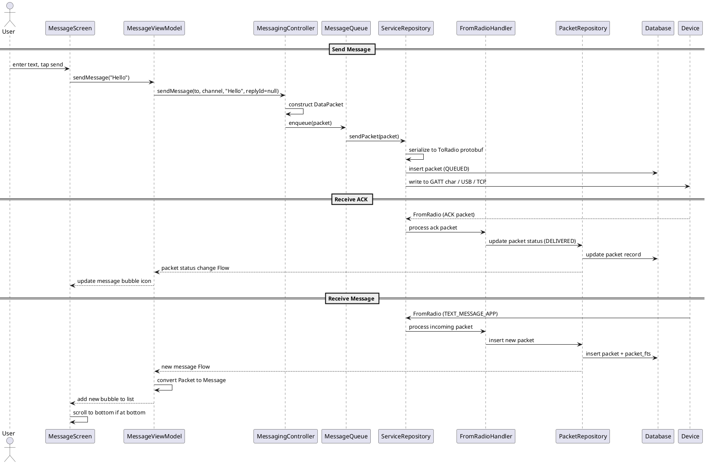

#### 3.11.5 核心算法

**消息分页加载算法**：
1. `PacketDao.getPackets(contactKey, myNodeNum)` 返回 `PagingSource<Int, PacketEntity>`
2. 使用 Room Paging 3 的分页逻辑，每页大小约 50 条
3. `collectAsLazyPagingItems()` 收集到 Compose `LazyPagingItems`
4. `LazyColumn` 使用 `items(count, key)` 渲染消息列表
5. `PagingData` 自动处理加载更多和刷新

**消息送达状态判定**：
```kotlin
fun getStatusStringRes(): Pair<StringResource, StringResource> {
    val title = if (routingError > 0) Res.string.error else Res.string.message_delivery_status
    val text = when (status) {
        MessageStatus.RECEIVED -> Res.string.delivery_confirmed
        MessageStatus.QUEUED -> Res.string.message_status_queued
        MessageStatus.ENROUTE -> Res.string.message_status_enroute
        MessageStatus.SFPP_ROUTING -> Res.string.message_status_sfpp_routing
        MessageStatus.SFPP_CONFIRMED -> Res.string.message_status_sfpp_confirmed
        MessageStatus.DELIVERED -> Res.string.message_status_delivered
        MessageStatus.ERROR -> getStringResFrom(routingError)
        MessageStatus.UNKNOWN, null -> Res.string.message_status_unknown
    }
    return title to text
}
```

**路由错误码映射**：
`routingError` 值映射到具体的错误描述资源字符串：
- `Routing.Error.NONE(0)` -> `routing_error_none`
- `Routing.Error.NO_ROUTE(1)` -> `routing_error_no_route`
- `Routing.Error.TIMEOUT(3)` -> `routing_error_timeout`
- `Routing.Error.NO_CHANNEL(5)` -> `routing_error_no_channel`
- `Routing.Error.NOT_AUTHORIZED(33)` -> `routing_error_not_authorized`
- 共计 17 种路由错误类型

#### 3.11.6 接口设计

```kotlin
// MessageViewModel 核心方法签名
class MessageViewModel(
    private val messagingController: MessagingController,
    private val packetRepository: PacketRepository,
    private val nodeRepository: NodeRepository,
    private val quickChatRepository: QuickChatActionRepository,
) : ViewModel() {
    val messages: Flow<PagingData<Message>>
    fun getMessages(contactKey: String, myNodeNum: Int)
    suspend fun sendMessage(text: String, channel: Int, replyId: Int? = null)
    suspend fun sendReaction(replyId: Int, emoji: String)
    suspend fun deleteMessage(uuid: Long)
    fun searchMessages(query: String): Flow<List<Message>>
    fun getContactInfo(contactKey: String): Flow<Node?>
}

// ContactsViewModel 核心方法签名
class ContactsViewModel(
    private val packetRepository: PacketRepository,
    private val nodeRepository: NodeRepository,
    private val uiPrefs: UiPrefs,
) : ViewModel() {
    val contacts: Flow<List<ContactWithLastMessage>>
    fun getUnreadCount(): Flow<Int>
}
```

---

### 3.12 设置模块 (feature:settings) 实现设计

#### 3.12.1 模块介绍

`feature:settings` 模块提供应用的所有设置相关 UI 界面，包含设备无线配置（15 个配置子页）、模块配置（14 个模块配置页）、频道管理、应用偏好、管理操作和调试面板。这是复杂度最高的功能模块。

#### 3.12.2 功能描述

- 设置主页面（分组列表导航）
- 无线配置（Radio Config）：User, ChannelConfig, Device, Position, Power, Network, Display, LoRa, Bluetooth, Security 的配置界面
- 模块配置（Module Config）：MQTT, Serial, ExtNotification, StoreForward, RangeTest, Telemetry, CannedMessage, Audio, RemoteHardware, NeighborInfo, AmbientLighting, DetectionSensor, Paxcounter, StatusMessage, TAK 的配置界面
- 频道管理：列表查看、编辑名称/PSK、新建频道、删除频道
- 应用偏好：主题、通知、隐私、地图、节点列表布局
- 管理操作：固件更新、远程设备管理、节点数据库清理、设备关机/重启
- 调试面板：实时日志查看（Logcat）、消息追踪、日志导出
- 过滤设置：关键词管理、同形字符检测开关
- TAK 配置：TAK Server 开关、TAK 数据导出

#### 3.12.3 架构图谱

**配置发送流程**：

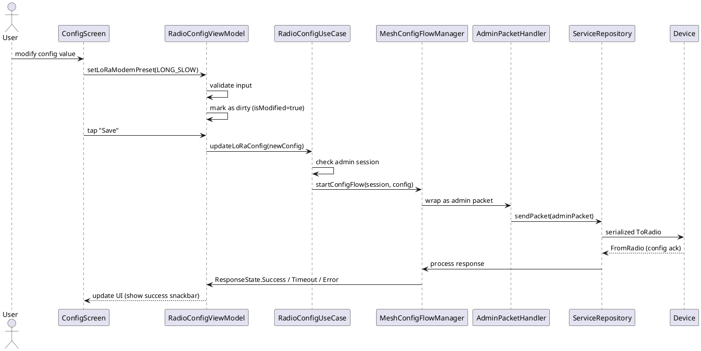

#### 3.12.4 核心算法

**频道名称生成算法**（当用户未设置名称时）：
```kotlin
val name: String get() = settings.name.ifEmpty {
    if (loraConfig.use_preset) {
        when (loraConfig.modem_preset) {
            ModemPreset.SHORT_TURBO -> "ShortTurbo"
            ModemPreset.SHORT_FAST -> "ShortFast"
            ModemPreset.LONG_FAST -> "LongFast"
            ModemPreset.LONG_MODERATE -> "LongMod"
            ModemPreset.VERY_LONG_SLOW -> "VLongSlow"
            // ... 16 total presets
        }
    } else {
        "Custom"
    }
}
```

**频道哈希计算**：
```kotlin
val hash: Int get() = xorHash(name.encodeToByteArray()) xor xorHash(psk.toByteArray())
```

**PSK 密钥解析算法**：
1. 如果 `psk.size != 1`：直接使用 PSK 字节（标准 PSK）
2. 如果 `psk[0] == 0`：明文通信（空 PSK）
3. 如果 `psk[0] == 1`：使用默认 AES 密钥 `channelDefaultKey`
4. 其他值：使用 `channelDefaultKey` 的变种（最后一个字节 + pskIndex - 1）

#### 3.12.5 错误处理

- **无效配置值**：前端 Compose 输入框实时验证（范围、格式、必填），错误时显示红色提示文字并禁用保存按钮
- **配置发送超时**：`RequestTimer` 30 秒超时 -> `ResponseState.Timeout` -> `PacketResponseStateDialog` 显示超时详情，可重试
- **远程管理会话失败**：`EnsureSessionResult.Failure(reason)` -> 显示具体失败原因（密钥不匹配、节点无响应等）
- **固件下载失败**：GitHub API 不可用或网络错误 -> 显示"下载失败"提示，记录错误日志
- **频道 PSK 修改警告**：修改 PSK 将导致所有使用该频道的节点断开 -> `WarningDialog` 确认后方可继续
- **关机/重启确认**：远程管理操作需要用户二次确认 -> `ShutdownConfirmationDialog`

---

### 3.13 偏好设置模块 (core:prefs) 实现设计

#### 3.13.1 模块介绍

`core:prefs` 模块提供跨平台偏好设置的持久化实现。Android 平台使用 Jetpack DataStore，Desktop 平台使用 `java.util.prefs`。模块通过 `AppPreferences` 接口统一暴露所有偏好设置，并提供 `FlowCache` 机制优化读取性能。

#### 3.13.2 核心设计模式

**FlowCache 缓存机制**：
1. 每个偏好值维护一个 `MutableStateFlow` 缓存
2. 读取时直接返回缓存 Flow，无需每次读取底层存储
3. 写入时先更新底层存储，成功后再更新缓存 Flow
4. 多个协程并发读取同一偏好值时共享缓存实例
5. 缓存的生命周期与应用进程一致

**偏好键命名规范**：
- 使用 `lower_snake_case` 命名
- 布尔类型：`{feature}_enabled`、`should_show_{element}`
- 字符串类型：`{entity}_name`、`{entity}_address`
- 集合类型：使用 JSON 序列化存储（如 `filter_words`、`selected_presets`）

**偏好分组策略**：
- 按功能域分组（UI、地图、通知、无线电等）
- 每个分组有独立的实现类（`UiPrefsImpl`、`MapPrefsImpl` 等）
- 所有实现类通过 `AppPreferences` 聚合接口暴露
- Koin DI 中每个分组注册为独立 singleton

#### 3.13.3 文件夹结构

```
core/prefs/src/commonMain/kotlin/org/meshtastic/core/prefs/
  FlowCache.kt                 # Flow 缓存通用实现
  analytics/AnalyticsPrefsImpl.kt
  appfunctions/AppFunctionsPrefsImpl.kt
  discovery/DiscoveryPrefsImpl.kt
  emoji/CustomEmojiPrefsImpl.kt
  filter/FilterPrefsImpl.kt
  homoglyph/HomoglyphPrefsImpl.kt
  map/MapConsentPrefsImpl.kt
  map/MapPrefsImpl.kt
  map/MapTileProviderPrefsImpl.kt
  mesh/MeshPrefsImpl.kt
  meshlog/MeshLogPrefsImpl.kt
  notification/NotificationPrefsImpl.kt
  radio/RadioPrefsImpl.kt
  tak/TakPrefsImpl.kt
  ui/UiPrefsImpl.kt
  ui/NodeListLayoutPreferences.kt
  di/CorePrefsModule.kt
```

---

### 3.14 各模块依赖关系总图

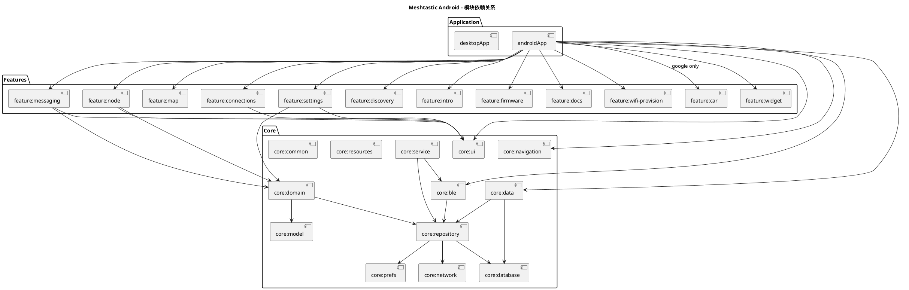

---

## 附录 A：构建配置详细

### A.1 版本管理

版本信息通过 `GitVersionValueSource` (Gradle ValueSource) 从 Git 标签和提交历史自动生成：
- `versionCode`: 基于 Git 提交计数的整数版本号（确保递增）
- `versionName`: 基于最近 Git 标签的语义版本（如 `2.6.0`）
- `MIN_FW_VERSION`: 最低兼容固件版本常量（写入 `BuildConfig`）
- `ABS_MIN_FW_VERSION`: 绝对最低固件版本（更旧的固件完全无法通信）

### A.2 产品变体配置

**google 变体**：
- `applicationId`: `org.meshtastic.app`（或 Play Store 专用 ID）
- 地图：Google Maps SDK + Maps Compose
- 分析：Firebase Analytics + Firebase Crashlytics + Datadog (RUM/Logs/Trace/SessionReplay)
- AI：ML Kit Translation + Firebase AI (on-device + cloud)
- 位置：Google Fused Location Provider
- App Functions：Android System AI 集成（`appfunctions`）

**fdroid 变体**：
- `applicationId`: 可独立于 Google 版
- 地图：osmdroid (OpenStreetMap) + osmbonuspack
- 无任何专有分析或 AI SDK
- 位置：Android 原生 LocationManager API
- GeoPackage：支持离线地图

### A.3 签名配置

- Release 签名信息从 `keystore.properties` 文件读取（`keyAlias`, `keyPassword`, `storeFile`, `storePassword`）
- 如果 keystore 文件不存在于项目根目录，使用 debug 签名
- CI 环境通过 secrets 或环境变量注入签名凭证

---

## 附录 B：CI/CD 与质量保证

### B.1 代码质量工具链

| 工具 | 用途 | 插件/模块 |
|------|------|-----------|
| detekt | Kotlin 静态代码分析（代码异味、复杂度检测） | `DetektConventionPlugin` |
| spotless | 代码格式化（ktlint + ktfmt 风格） | `SpotlessConventionPlugin` |
| konsist | 架构一致性检查（模块依赖规则验证） | `:core:konsist` |
| dokka | KDoc API 文档自动生成 | `DokkaConventionPlugin` |
| kover | Kotlin 代码覆盖率（JaCoCo 引擎） | `KoverConventionPlugin` |
| baselineprofile | 启动性能优化（Macrobenchmark 生成） | `:baselineprofile` 模块 |

### B.2 测试策略

| 测试层 | 工具 | 覆盖范围 |
|--------|------|----------|
| 单元测试 | JUnit5 + MockK/Mokkery + Robolectric | Repository, UseCase, ViewModel |
| UI 组件测试 | Compose UI Test | 所有 Compose 组件的渲染和交互行为 |
| 截图测试 | Compose Screenshot Test | UI 回归对比 |
| 集成测试 | AndroidJUnitRunner + Room in-memory | DAO 操作、数据库迁移正确性 |
| 性能测试 | Macrobenchmark + BaselineProfile | 启动时间、滚动性能指标 |

### B.3 CI 构建优化

- **Gradle Build Cache**：远程 HTTP 缓存 + 本地缓存，加速增量构建
- **Develocity Build Scans**：仅在 CI 环境 (`CI=true`) 发布 Build Scan 用于性能分析
- **Configuration Cache**：加速 Gradle 配置阶段
- **ABI Splits 并行构建**：armeabi-v7a 和 arm64-v8a 独立构建
- **本地化过滤 (CI)**：CI 构建仅包含 `en` 语言，减少打包时间

---


---

> 本文档由 a2h-android-analyzer agent 从源码自动生成。
> 标记 [推断] 的内容为基于代码模式的推断，非确定性事实。
> 生成时间: 2026-07-28
