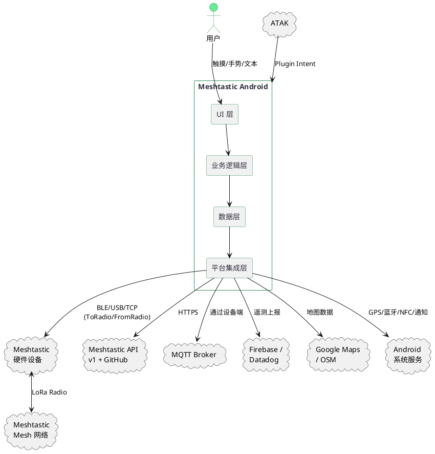
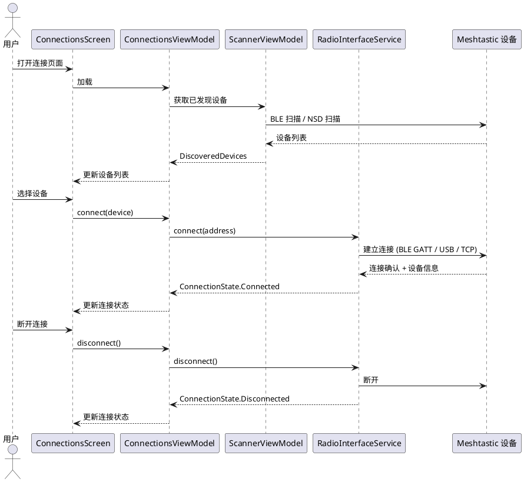
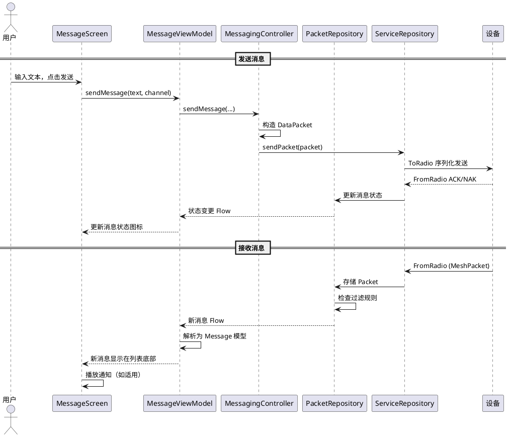
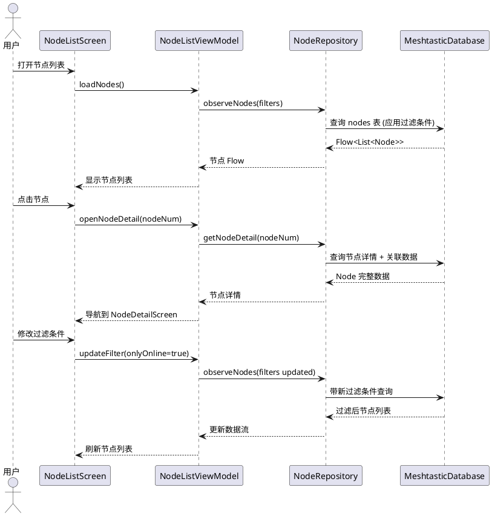
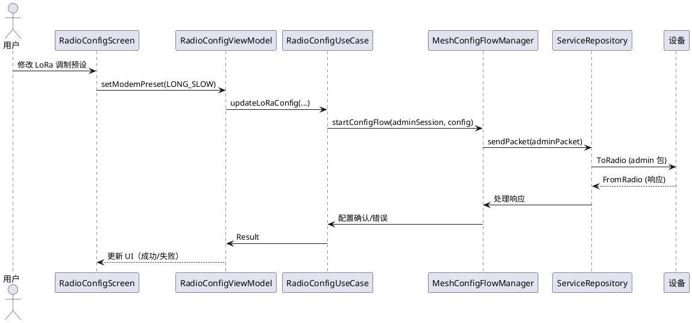
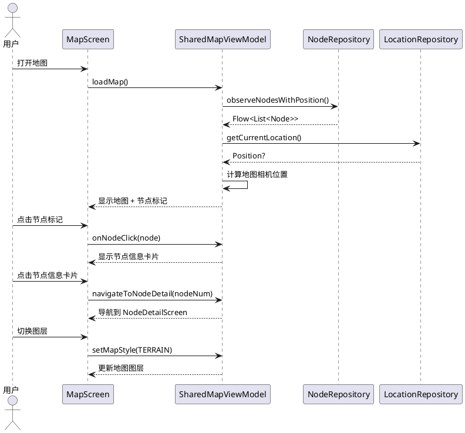
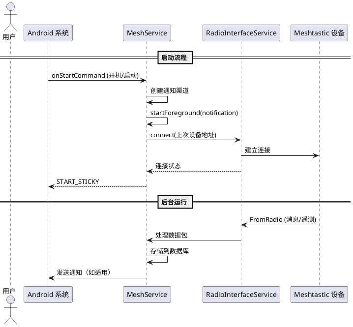

# Meshtastic Android 业务需求规格说明书

## 1. 应用定位

### 1.1 核心职责
[推断] Meshtastic Android 是开源离线 Mesh 通信网络 Meshtastic 的官方 Android 客户端应用。其核心职责是：通过蓝牙(LE)、USB串口或 TCP/IP 与 Meshtastic 硬件设备（LoRa 无线电节点）建立连接，为用户提供去中心化 Mesh 网络中的文本消息收发、节点发现与管理、位置共享、远程设备配置以及网络状态监控能力。

### 1.2 核心输入

**用户输入：**
- 文本输入（消息发送、搜索、配置值）
- 触控手势（点击、长按、滑动、拖拽排序）
- 二维码扫描（通过摄像头扫码加入频道/添加联系人）
- NFC 标签读写（通过 NFC 交换频道配置和联系人信息）
- 文件导入（频道配置文件、设备配置导出文件）
- 系统分享 Intent（从其他应用分享文本到 Mesh 网络）
- 硬件按键（Android 返回导航、音量键等系统标准交互）

**外部数据输入：**
- Meshtastic 设备通过串行协议（ToRadio/FromRadio protobuf）上报的实时数据
- GPS 位置数据（通过 Android LocationManager 获取）
- BLE 扫描发现的设备列表
- USB 串口设备枚举（通过 Android USB Host API）
- TCP/IP 设备发现（通过 mDNS/NSD 或直连 IP）
- MQTT 网关消息（通过互联网转发 Mesh 消息）
- GitHub Releases API（固件版本检查）
- Firebase Analytics / Datadog 遥测数据（仅 Google 版）
- Google ML Kit / Firebase AI 翻译（仅 Google 版）
- 外部地图应用 geo:// Intent（仅 Google 版 Google Maps；F-Droid 版使用 OSM）

### 1.3 核心输出

- 即时消息屏幕显示（聊天气泡、表情回复、送达状态）
- 节点列表显示（在线状态、信号强度、距离、遥测数据）
- 地图显示（节点位置、Traceroute 路径、航点、地理围栏）
- 设备配置界面（频道设置、LoRa 参数、所有模块配置）
- 通知（系统通知栏：新消息、节点事件、低电量）
- 主屏幕 Widget（本地节点统计）
- Android Auto 车载界面（仅 Google 版，通知式消息）
- 二维码生成与显示（频道分享、联系人分享）
- NFC 数据写入
- 遥测图表（设备指标、环境指标、信号指标随时间变化）
- OPML 导出（节点数据库备份）
- TAK Server 数据输出（ATAK/TAK 集成）

### 1.4 职责边界

[推断] 以下事项不在本应用职责范围内：
- 不提供 Meshtastic 硬件设备固件本身（应用仅提供固件更新 UI 和下载能力）
- 不提供 Meshtastic Mesh 网络的无线电基础设施（仅作为客户端连接已有设备）
- 不对通信内容提供端到端加密（加密由硬件设备端的 AES-256-PSK 负责；应用仅协助配置密钥）
- 不在没有设备连接时独立运行 Mesh 网络功能
- 不托管用户数据或提供云存储服务
- 不作为 MQTT 服务器（仅配置设备端的 MQTT 客户端参数）

---

## 2. 领域术语

**Node（节点）**
: Mesh 网络中的一个可寻址设备。由整数 `num` 标识（Node ID），包含 `User`（用户信息）、`Position`（位置）、`DeviceMetrics`（设备指标）等属性。节点通过无线电信号（LoRa）相互发现和通信。

**NodeAddress（节点地址）**
: 节点的唯一标识符。由 `num`（数字节点 ID）和可选的 `userId`（用户字符串 ID）组成。`ID_LOCAL` 表示本地设备，`ID_BROADCAST` 表示广播地址。

**MyNodeInfo（本地节点信息）**
: 当前连接设备的硬件/固件元信息，包括 `myNodeNum`、`model`、`firmwareVersion`、`couldUpdate`、`shouldUpdate`、`maxChannels`、`hasWifi`、`deviceId` 等字段。

**Packet（数据包）**
: Mesh 网络中的最小通信单元。存储于 `packet` 表中，包含 `uuid`（主键）、`port_num`（端口类型，如 TEXT_MESSAGE_APP=1）、`contact_key`、`received_time`、`data`（DataPacket 序列化对象）、`packet_id`、`snr`、`rssi`、`hopsAway` 等。通过 `PacketFts` 表支持全文本搜索（FTS）。

**DataPacket（数据载荷）**
: Packet 的数据部分，包含实际传输的负载。字段包括 `to`（目标地址）、`from`（源地址）、`dataType`（端口号）、`bytes`（负载字节）、`time`（时间戳）、`status`（MessageStatus）、`channel`（频道索引）、`wantAck`（是否需要确认）、`viaMqtt`（是否经 MQTT 传输）、`replyId`（回复目标）等。

**Channel（频道）**
: Mesh 网络中的通信信道。由 `ChannelSettings`（名称、PSK 预共享密钥）和 `LoRaConfig`（调制参数、跳数限制）定义。频道通过 XOR 哈希生成 `channelNum`（0-255），用于计算无线电频率。默认频道使用 `LONG_FAST` 预设和标准 PSK。

**ChannelSettings（频道设置）**
: 频道的配置参数，包括 `name`（频道名称）、`psk`（预共享密钥，AES-256 加密用）、`id`（频道 ID）。

**Meshtastic URL**
: 用于分享频道或联系人的编码 URL，格式为 `https://meshtastic.org/e/{base64_encoded_data}` 或 `https://meshtastic.org/v/#{encoded_data}`，通过二维码或 NFC 传输。

**Contact（联系人）**
: 与某节点关联的对话视图。由 `contact_key` 标识（通常是目标节点的用户 ID）。`ContactSettings` 表存储与该联系人的交互状态（静音、最后阅读位置等）。

**Message（消息）**
: 应用程序层面展示的聊天消息模型，聚合了 `Packet` 数据和 `Node` 信息，包含 `text`（文本内容）、`time`（格式化时间）、`fromLocal`（是否来自本地用户）、`emojis`（表情回复列表）、`status`（送达状态）等。

**Reaction（表情回复）**
: 对消息的 emoji 反应。存储于 `reactions` 表中，联合主键 `(myNodeNum, reply_id, user_id, emoji)`。包含 `timestamp`、`snr`、`rssi`、`hopsAway` 等追踪字段。

**MessageStatus（消息状态）**
: 枚举类型，表示消息的传输状态。取值：`UNKNOWN`（未设置）、`RECEIVED`（从 Mesh 收到的消息）、`QUEUED`（等待发送到设备）、`ENROUTE`（已发送到无线电，等待确认）、`DELIVERED`（收到 ACK 确认）、`SFPP_ROUTING`（SFPP 路由中）、`SFPP_CONFIRMED`（SFPP 确认）、`ERROR`（收到 NAK 或错误）。

**QuickChat（快捷消息）**
: 预定义的快捷文本回复。存储于 `quick_chat_actions` 表中，包含 `uuid`、`position`（列表排序位置）、`mode`（快捷消息动作模式）、`text`（消息文本）、`icon`（图标值）、`enabled`（是否启用）。

**DeviceType（设备连接类型）**
: 枚举类型，表示设备连接方式。取值：`BLE`（蓝牙低功耗）、`TCP`（TCP/IP 网络）、`USB`（USB 串口）。

**InterfaceId（接口标识）**
: 设备地址前缀标识符，用于区分连接类型。包括：`BLUETOOTH`（x 前缀）、`SERIAL`（s 前缀）、`TCP`（t 前缀）、`MOCK`（m 前缀）、`NOP`（n 前缀，表示无设备）。设备地址格式为：`{prefix}{address}`（如 `xAA:BB:CC:DD:EE:FF`）。

**ConnectionState（连接状态）**
: Sealed interface，表示与设备的连接状态。包含四种状态：`Disconnected`（已断连，应尝试重连）、`Connecting`（正在连接中）、`Connected`（已连接，正常通信）、`DeviceSleep`（设备轻度睡眠，等待唤醒）。

**Position（位置）**
: 节点的地理位置信息。包含 `latitude`（纬度）、`longitude`（经度）、`altitude`（海拔）、`time`（位置时间戳）、`satellitesInView`（可见卫星数）、`groundSpeed`（地面速度）、`groundTrack`（地面航向）、`precisionBits`（精度位数）。

**DeviceMetrics（设备指标）**
: Protobuf 定义的设备硬件运行指标，包括 `battery_level`（电池电量百分比）、`voltage`（电压）、`channel_utilization`（信道利用率）、`air_util_tx`（发送空中时间利用率）。

**EnvironmentMetrics（环境指标）**
: Protobuf 定义的环境传感器数据，包括 `temperature`（温度）、`relative_humidity`（相对湿度）、`barometric_pressure`（气压）、`soil_temperature`（土壤温度）、`soil_moisture`（土壤湿度）、`iaq`（室内空气质量指数）、`voltage`、`current`。

**PowerMetrics（电源指标）**
: Protobuf 定义的电源相关数据，包括 `ch1_voltage`/`ch2_voltage`/`ch3_voltage`（通道电压）、`ch1_current`/`ch2_current`/`ch3_current`（通道电流）。

**AirQualityMetrics（空气质量指标）**
: Protobuf 定义的空气质量传感器数据，包括 `pm10_standard`、`pm25_standard`、`pm100_standard`、`co2` 等颗粒物和气体浓度。

**Paxcounter（人流量计数器）**
: Protobuf 定义的通过 BLE/WiFi 信号估算的人流量数据，包含 `ble`（BLE 设备数）和 `wifi`（WiFi 设备数）。

**TelemetryType（遥测类型）**
: 枚举，标识遥测数据的类型，如 `DEVICE_METRICS`、`ENVIRONMENT_METRICS`、`POWER_METRICS`、`AIR_QUALITY_METRICS` 等。

**SFPP（Store and Forward P2P Protocol）**
: 一种点对点存储转发协议，允许离线节点通过中继节点缓存并转发消息。消息状态包含 `SFPP_ROUTING`（转发中）和 `SFPP_CONFIRMED`（转发确认）。

**RouteDiscovery（路由发现）**
: 通过发送路由请求包来发现 Mesh 网络中到达目标节点的路径的过程。用于 `Traceroute`（路由追踪）功能。

**MeshLog（Mesh 日志）**
: 记录设备运行时事件的日志实体。存储于 `meshlog` 表中，包含 `uuid`、`received_time`、`text`（日志内容）、`category`（日志类别）、`source`（来源节点）、`timestamp`。

**Traceroute（路由追踪）**
: 发送到指定目标节点的路由探测请求，用于发现和可视化 Mesh 网络中数据包的传输路径。结果包含路径中每个节点的位置和信号强度信息，可在 TracerouteMap 上显示。

**NeighborInfo（邻居信息）**
: 节点报告的其直接无线电邻居列表，包含邻居节点的 `node_id` 和 `snr`（信噪比）。用于展示 Mesh 网络拓扑。

**Store & Forward（存储转发）**
: 硬件设备端的功能：Store-Forward 路由器节点可以缓存发往离线节点（如传感器节点）的消息，待其唤醒后转发。

**MQTT**
: 消息队列遥测传输协议。Meshtastic 设备可选地将 Mesh 消息通过 MQTT 网关桥接到互联网，或从 MQTT 主题接收消息注入 Mesh 网络。

**Lockdown（锁定模式）**
: 设备安全功能。通过预先设置的密码短语锁定设备，防止未经授权的配置更改。解锁需提供正确的密码短语、启动次数和持续时间参数。`LockdownState` sealed class 管理锁定流程状态。

**XEdDSA（XEdDSA 签名）**
: 基于 X25519 的扩展 EdDSA 签名方案。节点可选地对其广播数据包进行签名，提供身份验证。`signsPackets`/`has_xeddsa_signed` 字段标记节点是否启用签名。

**Public Key Cryptography（PKC/公钥加密）**
: 节点可选地提供公钥用于加密通信。`hasPKC` 属性检查节点是否具有公钥。`publicKey` 字段存储公钥字节。

**DeviceHardware（设备硬件信息）**
: 从 `https://api.meshtastic.org/v1/hardware` 获取的硬件元数据缓存。存储于 `device_hardware` 表中，包含 `hw_model`、`display_name`、`description`、`architecture`、`has_wifi`、`has_bluetooth`、`has_gps`、`num_gpio_pins` 等。

**DeviceLink（设备外链）**
: 从 API 获取的与特定硬件相关的链接资源（购买链接、文档等）。存储于 `device_link` 表中，包含 `hw_model`、`url`、`title`、`icon_url`。

**FirmwareRelease（固件发布）**
: 从 GitHub Releases API 获取的固件版本信息缓存。存储于 `firmware_release` 表中，包含 `id`、`tag_name`、`title`、`description`、`prerelease`、`created_at`、`zip_url`、`page_url` 等。

**EventFirmware（活动固件）**
: 特殊活动（如会议、展会）使用的临时固件版本，通过 Firebase Remote Config 或 Datadog Feature Flag 获取。包含 `title`、`url`、`description`、`hardwareModels`。

**Discovery（网络发现）**
: Local Mesh Discovery 功能：在特定频率/预设上执行周期性扫描，发现临时可见的节点。包含 `DiscoverySession`（扫描会话）、`DiscoveryPresetResult`（预设扫描结果）、`DiscoveredNodeEntity`（发现的节点）。

**Geofence（地理围栏）**
: 用户定义的地理边界。当节点进入或离开围栏区域时触发通知。包含中心点坐标、半径、关联节点列表。

**Waypoint（航点）**
: 地图上的标记点，可通过 Mesh 网络共享给其他节点。通过 `WAYPOINT_APP` 端口号传输。

**RegionPresetConstraint（区域预设约束）**
: 按地理区域限制可用的 LoRa 调制预设（ModemPreset）和频率范围。不同国家/地区有不同的无线电法规要求。

**ModemPreset（调制预设）**
: LoRa 调制的预定义配置组合。枚举值包括：`SHORT_TURBO`、`SHORT_FAST`、`SHORT_SLOW`、`MEDIUM_FAST`、`MEDIUM_SLOW`、`LONG_FAST`（默认）、`LONG_SLOW`、`LONG_MODERATE`、`VERY_LONG_SLOW`、`LONG_TURBO`、`LITE_FAST`、`LITE_SLOW`、`NARROW_FAST`、`NARROW_SLOW`、`TINY_FAST`、`TINY_SLOW`。

**Config（设备配置）**
: Protobuf 定义的高级设备配置对象，包含多个子配置：`DeviceConfig`、`PositionConfig`、`PowerConfig`、`NetworkConfig`、`DisplayConfig`、`LoRaConfig`、`BluetoothConfig`、`SecurityConfig`、`MQTTConfig`、`SerialConfig`、`ExternalNotificationConfig`、`StoreForwardConfig`、`RangeTestConfig`、`TelemetryConfig`、`CannedMessageConfig`、`AudioConfig`、`RemoteHardwareConfig`、`NeighborInfoConfig`、`AmbientLightingConfig`、`DetectionSensorConfig`、`PaxcounterConfig`、`StatusMessageConfig`。

**ServiceRepository（服务仓库）**
: 核心设备通信接口，负责 ToRadio/FromRadio 数据包的收发。包含 `sendPacket`、`connect`、`disconnect`、`startConfigFlow` 等方法。

**RadioTransport（无线电传输层）**
: 抽象接口，封装与设备物理连接的细节。具体实现包括 `BLETransport`（蓝牙）、`SerialTransport`（USB 串口）、`TCPTransport`（网络）。

**MeshService（Mesh 服务）**
: Android 前台服务（Foreground Service），在后台持续维护与设备的连接和数据流。确保应用在后台运行时也不断连。

**API v1（Meshtastic 网络 API）**
: `https://api.meshtastic.org/v1/` 基础的 RESTful API，用于获取硬件信息（`/v1/hardware`）、设备链接（`/v1/device_links`）、固件版本（`/v1/github/latest`）等数据。

---

## 3. 角色与边界

### 3.1 核心角色

[推断] 基于应用功能分析，识别出以下用户角色：

| 角色 | 描述 |
|------|------|
| **Mesh 操作员** | 主要用户，持有 Android 设备并连接到一个 Meshtastic 硬件节点。收发消息、查看网络状态、管理设备配置。 |
| **网络管理员** | 通过远程管理（Remote Admin）功能管理其他节点配置的高级用户。可通过管理员频道远程修改其他节点的设置。 |
| **事件参与者** | 使用活动固件的临时用户，在特定活动/会议场景中使用专属频道和配置。 |
| **节点观察者** | 未连接设备的纯监控用户，仅查看节点列表和地图。 |

### 3.2 外部系统

| 外部系统 | 交互方式 | 用途 |
|---------|---------|------|
| **Meshtastic 硬件设备** | BLE / USB Serial / TCP (ToRadio/FromRadio protobuf 协议) | 收发 Mesh 消息、设备配置、遥测数据 |
| **Android 位置服务** | `LocationManager` / Fused Location Provider | 获取手机 GPS 位置以提供到 Mesh 网络 |
| **Android 蓝牙栈** | `BluetoothLeScanner` / `BluetoothGatt` | BLE 设备发现和连接 |
| **Android USB Host** | `UsbManager` / `UsbDeviceConnection` | USB 串口设备识别和通信 |
| **Android NFC** | `NfcAdapter` / NDEF 消息 | 读取/写入频道配置和联系人 |
| **Meshtastic API v1** | HTTPS REST | 获取硬件元数据、固件版本信息 |
| **GitHub Releases API** | HTTPS REST | 固件发布版本查询和下载 |
| **MQTT Broker** | TCP/MQTT（通过设备端） | Mesh 消息桥接至互联网 |
| **Google Maps / OSM** | 地图 SDK (google: Google Maps; fdroid: osmdroid) | 地图显示和交互 |
| **Firebase (仅 google 版)** | Firebase SDK (Analytics, Crashlytics, Remote Config, AI) | 分析、崩溃报告、AI 翻译 |
| **ATAK Plugin System** | `com.atakmap.app.component` Intent | 作为 ATAK 插件被发现 |
| **Google Play Services (仅 google 版)** | Fused Location, Maps SDK | 位置获取和地图渲染 |
| **Datadog (仅 google 版)** | Datadog SDK (RUM, Logs, Trace, Session Replay) | 性能监控和用户行为分析 |
| **Android Auto (仅 google 版)** | CarAppService | 车载消息通知 |
| **Android App Widget** | Glance AppWidget | 主屏幕小组件 |
| **Android WorkManager** | WorkManager | 后台任务（日志清理、消息发送、服务保活） |

### 3.3 交互上下文

---

## 4. DFX约束

### 4.1 性能

[推断] 基于源码中的设计模式推断以下性能约束：

- **数据库连接池配置**：Android 生产环境使用单连接池（`setSingleConnectionPool()`），避免协程取消风暴下的连接池耗尽。桌面/iOS 使用多连接池（4读1写）。查询协程使用 `ioDispatcher`。
- **分页加载**：消息列表使用 Room Paging 分页加载（`PagingSource`），避免一次性加载大量消息导致 OOM。
- **消息文本过滤**：`MessageFilter` 使用正则过滤和 Homoglyph（同形字符）编码检测，在 UI 线程外执行。
- **消息防抖**：设备端发送消息使用 `MessageQueue` 排队，避免快速连续发送导致丢包。
- **后台任务**：`WorkManager` 用于日志清理（`MeshLogCleanupWorker`）、消息发送（`SendMessageWorker`）、服务保活（`ServiceKeepAliveWorker`）。
- **线程安全**：`LockdownCoordinator` 使用 `Mutex` 保护并发访问。`FlowCache` 提供协程安全的偏好值缓存。
- **内存管理**：`StaleWhileRevalidateFlow` 模式用于网络数据缓存，减少重复请求。
- **基线配置文件**：包含 `baselineprofile` 模块，为 ART 提供启动优化提示。

### 4.2 安全性

- **加密**：无线通信加密由硬件设备端的 AES-256-PSK 负责。应用协助配置 PSK 密钥。
- **设备安全**：`LockdownCoordinator` 实现设备锁定机制，通过密码短语保护配置更改。`LockdownPassphraseStore` 安全存储密码。
- **固件签名**：通过 `minAppVersion` 检查确保客户端版本不低于设备要求的最小版本。`MIN_FW_VERSION` 和 `ABS_MIN_FW_VERSION` 预编译校验。
- **隐私保护**：
  - `google_analytics_adid_collection_enabled` 设为 `false`（禁止 AdID 收集）
  - `google_analytics_ssaid_collection_enabled` 设为 `false`（禁止 SSAID 收集）
  - `google_analytics_default_allow_ad_personalization_signals` 设为 `false`
  - `google_analytics_default_allow_analytics_storage` 设为 `false`（默认拒绝分析存储）
  - Firebase Crashlytics 和分析默认关闭（`firebase_crashlytics_collection_enabled` 和 `firebase_analytics_collection_enabled` 均为 `false`）
  - 位置匿名化：`Position.toString()` 对经纬度做匿名化处理
- **网络安全**：`network_security_config.xml` 配置网络安全策略。
- **ProGuard/R8 混淆**：release 构建使用 R8 代码混淆和缩减。

### 4.3 兼容性

- **最低 Android SDK**：[推断] 基于 `BLUETOOTH_CONNECT` 权限（API 31+）和 `POST_NOTIFICATIONS`（API 33+），目标 SDK 约 34+，最低 SDK 约 26-28。
- **构建变体**：
  - `google`（Google Play 分发，含 Google Maps、Firebase、Datadog、ML Kit）
  - `fdroid`（F-Droid 分发，使用 osmdroid 地图，不含专有 SDK）
- **CPU 架构**：`armeabi-v7a`、`arm64-v8a`（仅 ARM，不支持 x86）
- **多平台支持**：Kotlin Multiplatform 项目，共享代码可用于 Android + Desktop（JVM）+ iOS。
- **本地化**：支持 40+ 语言（en, ar, bg, ca, cs, de, el, es, et, fi, fr, ga, gl, hr, ht, hu, is, it, iw, ja, ko, lt, nl, no, pl, pt, pt-rBR, ro, ru, sk, sl, sq, sr, srp, sv, tr, uk, zh-rCN, zh-rTW）
- **无线协议兼容性**：支持多种 LoRa 调制预设（LONG_FAST/LONG_SLOW 等 16 种），兼容所有 Meshtastic 硬件型号。
- **连接方式兼容性**：同时支持 BLE、USB Serial、TCP/IP 三种设备连接方式。
- **地图兼容性**：Google 版使用 Google Maps，F-Droid 版使用 osmdroid (OpenStreetMap)。
- **Android Auto 兼容性**：`enableCarTemplates` Gradle 属性控制是否编译模板化 Car App（beta 功能，仅供 Closed Track 发布）。

---

## 5. 核心能力

### 5.1 Mesh 设备连接

#### 5.1.1 业务规则

1. **多种连接方式**：应用支持通过 BLE（蓝牙低功耗）、USB 串口和 TCP/IP 三种方式连接 Meshtastic 设备。
   - 验收条件：用户在连接界面可选择查看 BLE 扫描列表、USB 设备列表或手动输入 TCP 地址。

2. **设备地址格式**：设备地址格式为 `{前缀}{地址}`。前缀规则：`x` = BLE、`s` = USB 串口、`t` = TCP、`m` = Mock/演示、`n` = 无设备。
   - 验收条件：解析地址时正确识别前缀并路由到对应的传输实现。

3. **BLE 自动扫描**：当用户打开连接界面且 `bleAutoScan` 偏好为 true 时，自动开始 BLE 扫描。
   - 验收条件：连接页面可见时自动 BLE 扫描，扫描到的设备实时显示在列表中。

4. **网络自动扫描**：当用户打开连接界面且 `networkAutoScan` 偏好为 true 时，自动开始 NSD/mDNS 网络扫描。
   - 验收条件：连接页面可见时自动网络扫描，发现的 TCP 设备实时显示。

5. **设备持久化**：已连接设备地址通过 `RadioPrefs.devAddr` 持久化。设备名称通过 `RadioPrefs.devName` 持久化。
   - 验收条件：重启应用后自动尝试重连上次连接的设备。

6. **连接状态管理**：维护四种连接状态：`Disconnected`、`Connecting`、`Connected`、`DeviceSleep`。UI 根据当前状态显示相应的界面元素。
   - 验收条件：断开连接时显示连接引导；连接中显示加载动画；已连接时显示设备信息和节点数据。

7. **USB 设备插入自动识别**：接收 `ACTION_USB_DEVICE_ATTACHED` Intent，刷新 USB 设备列表。
   - 验收条件：USB 设备插入后自动出现在"串口"标签页列表中。

8. **固件版本兼容性检查**：连接后检查 `minAppVersion`。如果当前 App 版本低于设备要求，显示"应用太旧，必须更新"提示，并断开连接。
   - 验收条件：版本不兼容时显示警告对话框，确认后断开连接。

#### 5.1.2 交互流程

#### 5.1.3 异常场景

- **BLE 扫描超时**：触发条件 → 30秒内未发现任何设备。系统行为 → 停止扫描，UI 显示"未发现设备"空状态。用户感知 → 可手动点击刷新重新扫描。
- **设备连接失败**：触发条件 → GATT 连接超时或设备不在范围内。系统行为 → `ConnectionState.Disconnected`，记录错误日志。用户感知 → 显示连接失败提示，保持设备列表可见。
- **设备意外断连**：触发条件 → 设备超出范围或重启。系统行为 → 自动尝试重连，状态变为 `Connecting`。用户感知 → 显示重连中指示器，成功后恢复数据流。
- **USB 权限未授权**：触发条件 → 首次插入 USB 设备时用户未授权。系统行为 → 请求 USB 权限对话框。用户感知 → 弹出系统权限请求。
- **设备固件版本过低**：触发条件 → `minAppVersion > BuildConfig.VERSION_CODE`。系统行为 → 显示"应用需要更新"对话框，确认后断连。用户感知 → 对话框提示"必须更新应用才能连接此设备"。

### 5.2 Mesh 消息收发

#### 5.2.1 业务规则

1. **文本消息发送**：消息通过 `DataPacket` 构造，设置 `dataType = PortNum.TEXT_MESSAGE_APP`，通过 `ServiceRepository.sendPacket()` 发送。消息发送前先加入 `MessageQueue` 排队。
   - 验收条件：消息出现在聊天列表中，状态显示为 QUEUED → ENROUTE → DELIVERED（或 ERROR）。

2. **消息确认（ACK/NAK）**：发送消息设置 `wantAck = true`。设备端收到 ACK 后状态变为 `DELIVERED`，收到 NAK 或超时后变为 `ERROR`。
   - 验收条件：消息气泡旁显示送达状态图标（对勾/时钟/错误）。

3. **表情回复（Reactions）**：用户可对消息发送 emoji 回复。回复存储在 `reactions` 表中，关联到原始消息的 `reply_id`。
   - 验收条件：消息下方显示已有 emoji 回复列表，用户可点击添加新回复。

4. **消息过滤**：当 `FilterPrefs.filterEnabled = true` 时，包含 `filterWords` 中关键词的消息标记为 `filtered = true`。
   - 验收条件：过滤的消息在列表中显示为"已过滤"状态，点击可查看。

5. **Homoglyph 同形字符编码检测**：当 `HomoglyphPrefs.homoglyphEncodingEnabled = true` 时，检测消息中的同形字符编码并标记。
   - 验收条件：含同形字符的消息显示警告标记。

6. **快捷消息（QuickChat）**：用户可以发送预定义的快捷消息。快捷消息列表可自定义排序、启用/禁用。
   - 验收条件：聊天界面显示快捷消息按钮，点击弹出预定义消息列表。

7. **联系人静音**：用户可对特定联系人设置静音（`ContactSettings.muteUntil`）。静音期间该联系人的消息不触发通知。
   - 验收条件：静音的联系人消息仍显示但不出通知。

8. **消息搜索**：通过 `PacketFts` 全文本搜索表支持消息内容搜索。
   - 验收条件：搜索栏输入关键词，结果实时过滤显示匹配消息。

9. **已读/未读状态**：`Packet.read` 字段追踪消息是否已读。新消息默认 `read = true`（已读）。
   - 验收条件：未读消息在列表中高亮显示，联系人标签显示未读计数。

10. **消息文本翻译（仅 google 版）**：使用 Firebase ML Kit / AI 翻译消息文本。
    - 验收条件：消息旁显示"翻译"按钮，点击后显示翻译结果。

#### 5.2.2 交互流程

#### 5.2.3 异常场景

- **消息发送失败（无 ACK）**：触发条件 → 消息发送到设备后超时未收到 ACK。系统行为 → `MessageStatus.ERROR`，记录 `routingError = TIMEOUT`。用户感知 → 消息显示红色错误图标，点击查看详情。
- **消息发送失败（NAK）**：触发条件 → 设备返回 NAK（No Acknowledgment）。系统行为 → `MessageStatus.ERROR`，记录 `routingError`。用户感知 → 消息显示错误图标。
- **设备离线时发送消息**：触发条件 → 设备未连接时尝试发送。系统行为 → 消息状态设为 `QUEUED`，连接恢复后自动发送。用户感知 → 消息显示时钟图标，提示"等待发送"。
- **消息被过滤**：触发条件 → 消息文本匹配 `filterWords` 中的关键词。系统行为 → `Packet.filtered = true`，消息在列表中模糊显示。用户感知 → 消息标记为"已过滤"，点击可查看。
- **SFPP 路由失败**：触发条件 → 通过 SFPP 中继的消息未确认。系统行为 → 记录 SFPP 路由错误。用户感知 → 显示路由状态和错误详情。

### 5.3 节点管理与网络发现

#### 5.3.1 业务规则

1. **节点数据库**：所有已知节点存储在 `nodes` 表中。节点信息从接收到的 Mesh 数据包中提取和更新。
   - 验收条件：节点列表显示所有已知节点及其最后听到时间、距离、信号强度等。

2. **收藏节点**：用户可将节点标记为"收藏"（`isFavorite = true`），收藏的节点在列表中优先显示。
   - 验收条件：收藏节点显示星标图标，可过滤仅显示收藏节点。

3. **忽略节点**：用户可将节点标记为"忽略"（`isIgnored = true`），忽略的节点默认不显示在列表中。
   - 验收条件：忽略节点需通过"显示忽略的节点"开关才能看到。

4. **静音节点**：用户可将节点标记为"静音"（`isMuted = true`）。
   - 验收条件：静音节点的消息不触发通知。

5. **节点在线判定**：节点在 `lastHeard > onlineTimeThreshold()` 秒内被听到则判定为在线。
   - 验收条件：在线节点显示绿色圆点，离线节点显示灰色圆点。

6. **节点排序**：支持多种排序方式（根据 `UiPrefs.nodeSort`）：按最后听到时间、名称、距离、信号强度等。
   - 验收条件：节点列表工具栏显示排序选择器。

7. **节点过滤**：支持多种过滤条件：
   - `includeUnknown`：是否包含未知节点（未设置用户信息的节点）
   - `excludeInfrastructure`：是否排除基础设施节点（REPEATER/ROUTER 等）
   - `onlyOnline`：仅显示在线节点
   - `onlyDirect`：仅显示直接连接的节点
   - `showIgnored`：是否显示被忽略的节点
   - `excludeMqtt`：是否排除通过 MQTT 连接的节点
   - 验收条件：过滤工具栏显示各过滤开关，节点列表实时反映过滤结果。

8. **节点搜索**：用户可在节点列表中按名称（短名称/长名称）搜索。
   - 验收条件：搜索输入框实时过滤节点列表。

9. **节点详情**：点击节点进入详情页，显示：
   - 用户信息（名称、ID、硬件型号）
   - 设备信息（固件版本、角色、最后传输方式）
   - 位置信息（经纬度、海拔、距离、方位角）
   - 遥测数据（设备指标、环境指标、电源指标、空气质量指标）
   - 信号信息（RSSI、SNR、跳数）
   - 节点操作（发送消息、路由追踪、请求位置更新、远程管理等）
   - 验收条件：详情页显示完整节点信息和所有可用操作按钮。

10. **节点数据库清理**：用户可从设置中触发节点数据库清理（`CleanNodeDatabaseUseCase`），删除所有非本机节点数据。
    - 验收条件：确认对话框后清空所有节点数据，需重新接收 Mesh 数据包重建数据库。

#### 5.3.2 交互流程

#### 5.3.3 异常场景

- **节点数据过期**：触发条件 → 节点超过 `onlineTimeThreshold` 未收到更新。系统行为 → `isOnline = false`，显示为离线。用户感知 → 节点图标变灰，标记为"离线"。
- **未知节点**：触发条件 → 收到无用户信息的节点包（`hw_model == UNSET`）。系统行为 → 创建 fallback Node，使用默认 ID 生成短名称。用户感知 → 节点显示为 "未知 XXXX"。
- **节点公钥错误**：触发条件 → 节点公钥全为 0 字节（`ERROR_BYTE_STRING`）。系统行为 → `mismatchKey = true`。用户感知 → 显示密钥不匹配警告图标。
- **非消息角色节点**：触发条件 → 节点角色为 REPEATER/ROUTER/SENSOR/TRACKER 等基础设施角色。系统行为 → `isUnmessageableRole() = true`，消息发送按钮灰色或隐藏。用户感知 → 无法向此类型节点发送消息。

### 5.4 设备配置管理

#### 5.4.1 业务规则

1. **配置流程管理**：所有设备配置更改通过 `MeshConfigFlowManager` 管理，执行 `startConfigFlow` → 发送配置包 → 等待设备确认 → 结束流程。
   - 验收条件：配置更改发送后显示加载状态，确认后显示成功/失败提示。

2. **远程管理会话**：操作其他节点配置前需建立远程管理会话（`EnsureRemoteAdminSessionUseCase`）。会话通过加密密钥进行安全认证。
   - 验收条件：首次尝试远程管理时自动建立会话，失败时显示错误。

3. **无线配置（Radio Config）**：支持的配置类别：
   - 用户配置（`User`）：设备名称、短名称
   - 频道配置（`ChannelConfig`）：频道名称、PSK、LoRa 调制预设、跳数限制等
   - 设备配置（`Device`）：设备角色、按钮 GPIO、蜂鸣器 GPIO、GPS 等
   - 位置配置（`Position`）：GPS 更新间隔、位置精度、智能定位等
   - 电源配置（`Power`）：省电模式、超级省电间隔等
   - 网络配置（`Network`）：WiFi SSID/密码、以太网、地址模式等
   - 显示配置（`Display`）：屏幕超时、GPS 格式等
   - LoRa 配置（`LoRa`）：区域、调制预设、频率偏移、带宽、扩频因子等
   - 蓝牙配置（`Bluetooth`）：蓝牙启用、配对模式、固定 PIN 等
   - 安全配置（`Security`）：公钥、管理员密钥、序列化管理等
   - 验收条件：每项配置显示当前值和默认值，修改后实时验证并发送到设备。

4. **模块配置（Module Config）**：支持的模块：
   - MQTT：服务器地址、用户名、密码、加密、JSON 等
   - 串口（Serial）：波特率、模式、超时等
   - 外部通知（ExternalNotification）：GPIO 引脚、振铃时间等
   - 存储转发（StoreForward）：启用、历史记录、记录数等
   - 范围测试（RangeTest）：启用、发送间隔等
   - 遥测（Telemetry）：更新间隔、传感器引脚等
   - 预设消息（CannedMessage）：启用、消息列表等
   - 音频（Audio）：编解码器、比特率等
   - 远程硬件（RemoteHardware）：GPIO 引脚配置
   - 邻居信息（NeighborInfo）：更新间隔等
   - 环境照明（AmbientLighting）：LED 配置
   - 检测传感器（DetectionSensor）：GPIO 触发配置
   - 人流量计数（Paxcounter）：更新间隔等
   - 状态消息（StatusMessage）：状态消息内容
   - TAK：ATAK 集成参数
   - 验收条件：每项模块配置显示当前值和默认值，修改后实时验证并发送。

5. **配置变更警告**：修改安全相关配置（如 PSK 密钥、管理员密钥）时显示警告对话框。
   - 验收条件：关键配置修改前弹出"此操作可能影响网络安全"警告，用户确认后执行。

6. **配置导入/导出**：支持导出设备配置文件和导入已有配置（`ExportSecurityConfigUseCase`、`ImportProfileUseCase`）。
   - 验收条件：导出配置文件（YAML 格式）到设备存储；从文件导入配置到设备。

7. **OTA 固件更新**：通过 `IsOtaCapableUseCase` 检查设备是否支持 OTA 更新。支持 XModem 协议文件传输（`XModemManager`）。
   - 验收条件：固件更新界面显示可用版本，确认后下载并通过 BLE/USB 传输固件镜像到设备。

#### 5.4.2 交互流程

#### 5.4.3 异常场景

- **远程管理会话失败**：触发条件 → 无法建立与目标节点的安全会话（密钥不匹配/节点无响应）。系统行为 → `EnsureSessionResult.Failure`，显示错误详情。用户感知 → 提示"无法建立远程管理会话"。
- **配置包超时**：触发条件 → 发送配置后超时未收到设备响应。系统行为 → 通过 `RequestTimer` 触发超时，标记为 `ResponseState.Timeout`。用户感知 → 显示"设备无响应"超时提示，可重试。
- **无效配置值**：触发条件 → 用户输入超出合法范围的配置值。系统行为 → UI 端实时验证，拒绝无效输入。用户感知 → 输入框显示错误提示，防止提交。
- **OTA 不支持**：触发条件 → 设备固件版本不支持 OTA（检查 `BootloaderOtaQuirk`）。系统行为 → 隐藏 OTA 更新按钮或显示不支持提示。用户感知 → 提示"此设备不支持无线固件更新"。
- **固件下载失败**：触发条件 → 网络错误或 GitHub API 不可用。系统行为 → 显示错误提示，记录日志。用户感知 → 提示"固件下载失败，请检查网络连接"。

### 5.5 地图与位置服务

#### 5.5.1 业务规则

1. **地图图层选择**：Google 版支持多种 Google Maps 图层（标准、卫星、地形等）；F-Droid 版使用 OSM 瓦片地图。
   - 验收条件：地图工具栏显示图层选择器，切换后地图实时更新。

2. **节点位置显示**：有有效位置信息的节点显示在地图上，节点标记根据状态（在线/离线/收藏）使用不同颜色。
   - 验收条件：在线节点显示绿色标记，离线节点显示灰色，收藏节点显示星标。

3. **位置精度圈**：当 `MapPrefs.showPrecisionCircleOnMap = true` 时，节点周围显示 GPS 精度圆圈。
   - 验收条件：GPS 精度位数 `precisionBits` 转换为精度半径在地图上显示。

4. **仅显示收藏节点**：当 `MapPrefs.showOnlyFavorites = true` 时，地图仅显示收藏节点。
   - 验收条件：未收藏的节点从地图上移除。

5. **最后听到时间过滤**：`MapPrefs.lastHeardFilter` 控制仅显示最近 N 秒内活跃的节点。
   - 验收条件：超过时间阈值的节点不显示在地图上。

6. **航点显示**：当 `MapPrefs.showWaypointsOnMap = true` 时，航点标记显示在地图上。
   - 验收条件：Waypoint 消息中的位置点显示为特殊标记。

7. **Traceroute 地图**：路由追踪结果在专用地图上显示路径，包含途经所有节点及其信号强度。
   - 验收条件：从源节点到目标节点的路径在地图上用线条连接，节点旁显示 SNR/RSSI。

8. **节点追踪地图**：显示特定节点的历史位置轨迹线。
   - 验收条件：节点过去的位置点用线条连接显示在地图上。

9. **位置上报**：`MapConsentPrefs.shouldReportLocation(nodeNum)` 控制是否向 Mesh 网络上报手机 GPS 位置。
   - 验收条件：启用后，手机 GPS 位置通过连接的设备广播到 Mesh 网络。

10. **地理围栏监控**：`GeofenceMonitor` 跟踪节点进出地理围栏区域，触发 `GeofenceCrossingStore` 记录事件。
    - 验收条件：节点进入/离开围栏时触发系统通知。

#### 5.5.2 交互流程

#### 5.5.3 异常场景

- **GPS 不可用**：触发条件 → 设备无 GPS 硬件或权限被拒绝。系统行为 → `LocationRepository` 返回 null，地图无法定位用户位置。用户感知 → 地图不显示"我的位置"标记，位置上报功能不可用。
- **地图瓦片加载失败**：触发条件 → 网络不可用或瓦片服务器故障。系统行为 → 地图显示空白或缓存瓦片。用户感知 → 地图区域显示灰色，节点标记可能仍可见。
- **节点无位置信息**：触发条件 → 节点 `validPosition == null`。系统行为 → 节点不出现在地图上，仅在列表中显示。用户感知 → 地图上看不到该节点。
- **自定义瓦片源错误**：触发条件 → `MapTileProviderPrefs.customTileProviders` 中的 URL 不可访问。系统行为 → 显示错误提示，回退到默认瓦片源。用户感知 → 地图不显示自定义瓦片，回退到默认地图。

### 5.6 TAK Server 集成

#### 5.6.1 业务规则

1. **TAK Server 开关**：`TakPrefs.isTakServerEnabled` 控制内置 TAK Server 是否运行。
   - 验收条件：启用后，设备作为 TAK 服务器通过 localhost 提供 ATAK 数据流。

2. **ATAK 插件发现**：通过 `com.atakmap.app.component` Intent 过滤器使应用可作为 ATAK 插件被发现。
   - 验收条件：ATAK 应用可发现并加载此应用作为插件。

3. **TAK 数据传输**：TAK 相关的 Mesh 位置和遥测数据通过 `TAKConfig` 配置的端口和协议发送。
   - 验收条件：ATAK 客户端连接到本地 TAK Server 后接收 Mesh 网络数据。

### 5.7 网络发现 (Discovery)

#### 5.7.1 业务规则

1. **扫描任务**：`DiscoveryScan` 在指定频率/预设上执行周期性节点发现扫描。
   - 验收条件：扫描会话记录开始/结束时间、预设列表、发现节点数。

2. **预设选择**：用户可选择多个 LoRa 预设组合用于扫描（`DiscoveryPrefs.selectedPresets`）。
   - 验收条件：扫描时按选中的预设顺序切换频率。

3. **驻留时间**：每个预设的扫描驻留时间由 `DiscoveryPrefs.dwellMinutes` 控制（默认 15 分钟）。
   - 验收条件：每个预设频道上停留指定分钟数后切换到下一个。

4. **扫描历史**：历史扫描会话和结果持久化，用户可查看过去的发现结果。
   - 验收条件：`DiscoveryHistory` 页面列出所有历史扫描会话。

5. **发现地图**：发现的节点可在专用地图上查看（`DiscoveryMap`）。
   - 验收条件：地图显示发现节点的位置和信号信息。

6. **AI 分析（可选）**：`DiscoveryPrefs.aiEnabled` 控制是否使用 AI 分析发现结果。
   - 验收条件：启用后，AI 辅助分析扫描结果中的节点拓扑。

### 5.8 系统集成

#### 5.8.1 业务规则

1. **前台服务**：`MeshService` 作为前台服务运行，类型为 `connectedDevice|location`，保持与设备的持续连接。
   - 验收条件：通知栏显示持续通知"Meshtastic 正在运行"。

2. **开机自启动**：`BootCompleteReceiver` 监听 `BOOT_COMPLETED` 和 `MY_PACKAGE_REPLACED` 事件，自动启动 `MeshService`。
   - 验收条件：设备重启后自动恢复连接。

3. **主屏幕 Widget**：`LocalStatsWidget` 在主屏幕显示本地节点统计信息（节点数、消息数等）。
   - 验收条件：Widget 显示最新统计数据，定期刷新。

4. **Android Auto（仅 google 版）**：`MeshtasticCarAppService` 提供车载消息通知（基于通知的 Car Messaging）。
   - 验收条件：连接 Android Auto 后，新消息通过车载界面显示和语音播报。

5. **App Functions（系统 AI 集成）**：应用向 Android 系统注册 AI 功能（`AiFunctionProvider`），允许系统 AI 助手执行以下操作：
   - 发送消息（`sendMessageEnabled`）
   - 获取 Mesh 状态（`getMeshStatusEnabled`）
   - 获取节点列表（`getNodeListEnabled`）
   - 获取频道信息（`getChannelInfoEnabled`）
   - 获取设备状态（`getDeviceStatusEnabled`）
   - 获取节点详情（`getNodeDetailsEnabled`）
   - 获取 Mesh 指标（`getMeshMetricsEnabled`）
   - 获取最近消息（`getRecentMessagesEnabled`）
   - 获取未读摘要（`getUnreadSummaryEnabled`）
   - 验收条件：系统 AI 助手可通过自然语言查询 Mesh 网络信息。

#### 5.8.2 交互流程

#### 5.8.3 异常场景

- **前台服务被杀**：触发条件 → 系统资源不足或用户强制停止。系统行为 → `START_STICKY` 标志使系统尝试重启服务。用户感知 → 短暂断连后自动重连。
- **启动后未配对的 BLE 设备**：触发条件 → Android 13+ 设备启动后。系统行为 → 检查 `hasShownNotPairedWarning`，显示蓝牙配对提示。用户感知 → 提示"为提高 BLE 连接稳定性，建议在系统设置中配对设备"。
- **权限被撤销**：触发条件 → 用户在系统设置中撤销蓝牙/位置/通知权限。系统行为 → `PermissionRecoveryCard` 显示权限恢复提示。用户感知 → 无法使用相关功能，显示"需要权限"卡片。

---

## 6. 数据约束

### 6.1 Packet（数据包）

存储从 Mesh 网络接收和发送的所有数据包。

| 字段 | 类型 | 约束 |
|------|------|------|
| `uuid` | Long | PRIMARY KEY, AUTO_GENERATE |
| `myNodeNum` | Int | DEFAULT 0, INDEXED |
| `port_num` | Int | INDEXED (端口类型，如 TEXT_MESSAGE_APP=1) |
| `contact_key` | String | INDEXED, 联合索引 (contact_key, port_num, received_time) |
| `received_time` | Long | INDEXED |
| `read` | Boolean | DEFAULT 1 (true) |
| `data` | DataPacket | 序列化为 Binary/BLOB |
| `packet_id` | Int | DEFAULT 0, INDEXED |
| `routing_error` | Int | DEFAULT -1 |
| `snr` | Float | DEFAULT 0 |
| `rssi` | Int | DEFAULT 0 |
| `hopsAway` | Int | DEFAULT -1 |
| `sfpp_hash` | ByteString? | 可为空 |
| `filtered` | Boolean | DEFAULT 0 (false), INDEXED |
| `message_text` | String | DEFAULT "" |

### 6.2 PacketFts（消息全文本搜索）

| 字段 | 类型 | 约束 |
|------|------|------|
| `uuid` | Long | (关联 packet.uuid) |
| `message_text` | String | FTS 索引字段 |

### 6.3 NodeEntity（节点实体）

| 字段 | 类型 | 约束 |
|------|------|------|
| `num` | Int | PRIMARY KEY (不可变节点 ID) |
| `user` | User (BLOB) | 关联的 Protobuf User 对象 |
| `long_name` | String? | INDEXED (用户长名称) |
| `short_name` | String? | INDEXED (用户短名称) |
| `position` | Position (BLOB) | Protobuf Position 对象 |
| `latitude` | Double | DEFAULT 0.0 (从 position 转换) |
| `longitude` | Double | DEFAULT 0.0 (从 position 转换) |
| `snr` | Float | DEFAULT Float.MAX_VALUE |
| `rssi` | Int | DEFAULT Int.MAX_VALUE |
| `last_heard` | Int | DEFAULT 0, INDEXED (Unix 时间戳) |
| `device_metrics` | Telemetry (BLOB) | 设备遥测数据 |
| `channel` | Int | DEFAULT 0 |
| `via_mqtt` | Boolean | DEFAULT false |
| `hops_away` | Int | DEFAULT -1, INDEXED |
| `is_favorite` | Boolean | DEFAULT false, INDEXED, 联合索引 (last_heard, is_favorite) |
| `is_ignored` | Boolean | DEFAULT 0 |
| `is_muted` | Boolean | DEFAULT 0 |
| `environment_metrics` | Telemetry (BLOB) | 环境遥测数据 |
| `power_metrics` | Telemetry (BLOB) | 电源遥测数据 |
| `air_quality_metrics` | Telemetry (BLOB) | 空气质量遥测数据 |
| `paxcounter` | Paxcount (BLOB) | 人流量计数器 |
| `public_key` | ByteString? | INDEXED (公钥) |
| `notes` | String | DEFAULT "" |
| `manually_verified` | Boolean | DEFAULT 0 (仅扫描/导入时设为 true) |
| `node_status` | String? | 可为空 |
| `last_transport` | Int | DEFAULT 0 (最后传输方式) |
| `has_xeddsa_signed` | Boolean | DEFAULT 0 (节点是否 XEdDSA 签名) |

### 6.4 MyNodeEntity（本地节点）

| 字段 | 类型 | 约束 |
|------|------|------|
| `myNodeNum` | Int | PRIMARY KEY |
| `model` | String? | 硬件型号 |
| `firmwareVersion` | String? | 固件版本 |
| `couldUpdate` | Boolean | 是否有可用固件更新 |
| `shouldUpdate` | Boolean | 是否建议更新固件 |
| `currentPacketId` | Long | 当前数据包 ID |
| `messageTimeoutMsec` | Int | 消息超时时间 |
| `minAppVersion` | Int | 最小客户端版本要求 |
| `maxChannels` | Int | 最大频道数 |
| `hasWifi` | Boolean | 是否有 WiFi |
| `deviceId` | String? | 设备唯一标识符 |
| `pioEnv` | String? | PlatformIO 环境名称 |

### 6.5 ContactSettings（联系人设置）

| 字段 | 类型 | 约束 |
|------|------|------|
| `contact_key` | String | PRIMARY KEY |
| `muteUntil` | Long | DEFAULT 0 (静音截止时间) |
| `last_read_message_uuid` | Long? | 可为空 |
| `last_read_message_timestamp` | Long? | 可为空 |
| `filtering_disabled` | Boolean | DEFAULT 0 |

### 6.6 ReactionEntity（表情回复）

| 字段 | 类型 | 约束 |
|------|------|------|
| `myNodeNum` | Int | PRIMARY KEY 之一, DEFAULT 0 |
| `reply_id` | Int | PRIMARY KEY 之一, INDEXED |
| `user_id` | String | PRIMARY KEY 之一 |
| `emoji` | String | PRIMARY KEY 之一 |
| `timestamp` | Long | 时间戳 |
| `snr` | Float | DEFAULT 0 |
| `rssi` | Int | DEFAULT 0 |
| `hopsAway` | Int | DEFAULT -1 |
| `packet_id` | Int | DEFAULT 0, INDEXED |
| `status` | MessageStatus | DEFAULT 0 (UNKNOWN) |
| `routing_error` | Int | DEFAULT 0 |
| `relays` | Int | DEFAULT 0 |
| `relay_node` | Int? | 可为空 |
| `to` | String? | 可为空 |
| `channel` | Int | DEFAULT 0 |
| `sfpp_hash` | ByteString? | 可为空 |

### 6.7 MeshLog（Mesh 日志）

| 字段 | 类型 | 约束 |
|------|------|------|
| `uuid` | Long | PRIMARY KEY, AUTO_GENERATE |
| `received_time` | Long | 接收时间 |
| `text` | String | 日志文本内容 |
| `category` | String? | 日志类别 |
| `source` | String? | 来源 |
| `timestamp` | Long | 日志时间戳 |

### 6.8 QuickChatAction（快捷消息）

| 字段 | 类型 | 约束 |
|------|------|------|
| `uuid` | Long | PRIMARY KEY, AUTO_GENERATE |
| `position` | Int | 列表排序位置 |
| `mode` | String | 快捷消息动作模式 |
| `text` | String | 消息文本 |
| `icon` | Int | 图标值 |
| `enabled` | Boolean | 是否启用 |

### 6.9 MetadataEntity（节点元数据）

| 字段 | 类型 | 约束 |
|------|------|------|
| `num` | Int | PRIMARY KEY, INDEXED |
| `proto` | DeviceMetadata (BLOB) | Protobuf 序列化元数据 |
| `timestamp` | Long | DEFAULT nowMillis |

### 6.10 DeviceHardwareEntity（设备硬件信息）

从 API 缓存的硬件元数据。

| 字段 | 类型 | 约束 |
|------|------|------|
| `hw_model` | Int | PRIMARY KEY |
| `display_name` | String | 显示名称 |
| `description` | String? | 描述 |
| `architecture` | String? | 架构（如 esp32） |
| `has_wifi` | Boolean | 是否有 WiFi |
| `has_bluetooth` | Boolean | 是否有蓝牙 |
| `has_gps` | Boolean | 是否有 GPS |
| `has_screen` | Boolean | 是否有屏幕 |
| `num_gpio_pins` | Int? | GPIO 引脚数 |
| `num_adc_channels` | Int? | ADC 通道数 |
| 其他字段 | - | 来自 API 的其他硬件属性 |

### 6.11 DeviceLinkEntity（设备外链）

| 字段 | 类型 | 约束 |
|------|------|------|
| `id` | Int | PRIMARY KEY (AUTO_GENERATE) |
| `hw_model` | Int | 硬件型号 |
| `url` | String | 链接 URL |
| `title` | String? | 链接标题 |
| `icon_url` | String? | 图标 URL |

### 6.12 FirmwareReleaseEntity（固件发布）

| 字段 | 类型 | 约束 |
|------|------|------|
| `id` | Int | PRIMARY KEY (AUTO_GENERATE) |
| `tag_name` | String | 版本标签 |
| `title` | String? | 标题 |
| `description` | String? | 发布说明 |
| `prerelease` | Boolean | 是否预发布 |
| `created_at` | String? | 创建时间 |
| `zip_url` | String? | 下载 URL |
| `page_url` | String? | 页面 URL |
| `hardware_models` | String? | 支持的硬件型号 |

### 6.13 TracerouteNodePositionEntity（路由追踪节点位置）

| 字段 | 类型 | 约束 |
|------|------|------|
| `uuid` | Long | (关联) |
| `node_id` | Int | 节点 ID |
| `position` | - | 节点位置 |
| `snr` | Float | SNR 值 |
| `timestamp` | Long | 时间戳 |

### 6.14 发现相关实体

**DiscoverySessionEntity（发现会话）**：
| 字段 | 类型 | 约束 |
|------|------|------|
| `id` | Long | PRIMARY KEY |
| `started_at` | Long | 开始时间 |
| `ended_at` | Long? | 结束时间（可为空） |
| `presets` | String | 使用的预设列表（JSON 序列化） |
| `status` | String | 会话状态 |
| `total_nodes_found` | Int | 发现节点总数 |

**DiscoveryPresetResultEntity（预设扫描结果）**：
| 字段 | 类型 | 约束 |
|------|------|------|
| `id` | Long | PRIMARY KEY |
| `session_id` | Long | 关联的会话 ID |
| `preset` | String | 预设名称 |
| `nodes_found` | Int | 发现的节点数 |
| `started_at` | Long | 该预设开始扫描时间 |
| `ended_at` | Long? | 该预设结束扫描时间 |

**DiscoveredNodeEntity（发现的节点）**：
| 字段 | 类型 | 约束 |
|------|------|------|
| `id` | Long | PRIMARY KEY |
| `session_id` | Long | 关联的会话 ID |
| `node_num` | Int | 节点编号 |
| `node_name` | String? | 节点名称 |
| `snr` | Float | SNR 值 |
| `rssi` | Int | RSSI 值 |
| `position` | - | 位置信息 |
| `preset` | String? | 发现的预设 |
| `first_seen` | Long | 首次发现时间 |
| `last_seen` | Long | 最后发现时间 |

### 6.15 SharedPreferences 配置项

以下是通过 `AppPreferences` 接口及其子接口管理的持久化配置项：

**AnalyticsPrefs**：
| Key | 类型 | 默认值 |
|-----|------|--------|
| `analytics_allowed` | Boolean | false [推断] |
| `install_id` | String | UUID [推断] |

**HomoglyphPrefs**：
| Key | 类型 | 默认值 |
|-----|------|--------|
| `homoglyph_encoding_enabled` | Boolean | false [推断] |

**FilterPrefs**：
| Key | 类型 | 默认值 |
|-----|------|--------|
| `filter_enabled` | Boolean | false [推断] |
| `filter_words` | Set\<String\> | 空集合 [推断] |

**MeshLogPrefs**：
| Key | 类型 | 默认值 |
|-----|------|--------|
| `retention_days` | Int | 30 |
| `logging_enabled` | Boolean | false [推断] |

**CustomEmojiPrefs**：
| Key | 类型 | 默认值 |
|-----|------|--------|
| `custom_emoji_frequency` | String? | null [推断] |
| `preferred_skin_tone_index` | Int | 0 [推断] |

**UiPrefs**：
| Key | 类型 | 默认值 |
|-----|------|--------|
| `app_intro_completed` | Boolean | false |
| `theme` | Int | MODE_DYNAMIC (6969420) |
| `locale` | String | 系统默认 |
| `node_sort` | Int | 0 [推断] |
| `include_unknown` | Boolean | false [推断] |
| `exclude_infrastructure` | Boolean | false [推断] |
| `only_online` | Boolean | false [推断] |
| `only_direct` | Boolean | false [推断] |
| `show_ignored` | Boolean | false [推断] |
| `exclude_mqtt` | Boolean | false [推断] |
| `has_shown_not_paired_warning` | Boolean | false |
| `show_quick_chat` | Boolean | true [推断] |
| `ble_auto_scan` | Boolean | true [推断] |
| `network_auto_scan` | Boolean | true [推断] |
| `selected_connection_transport` | DeviceType? | null [推断] |
| `node_list_density` | String | "COMPLETE" [推断] |
| `should_show_power` | Boolean | true [推断] |
| `should_show_last_heard` | Boolean | true [推断] |
| `last_heard_is_relative` | Boolean | true [推断] |
| `should_show_location` | Boolean | true [推断] |
| `should_show_hops` | Boolean | true [推断] |
| `should_show_signal` | Boolean | true [推断] |
| `should_show_channel` | Boolean | true [推断] |
| `should_show_role` | Boolean | true [推断] |
| `should_show_telemetry` | Boolean | true [推断] |

**NotificationPrefs**：
| Key | 类型 | 默认值 |
|-----|------|--------|
| `messages_enabled` | Boolean | true [推断] |
| `node_events_enabled` | Boolean | true [推断] |
| `node_events_auto_disabled_for_event` | Boolean | false |
| `low_battery_enabled` | Boolean | true [推断] |

**MapPrefs**：
| Key | 类型 | 默认值 |
|-----|------|--------|
| `map_style` | Int | 0 [推断] |
| `show_only_favorites` | Boolean | false [推断] |
| `show_waypoints_on_map` | Boolean | true [推断] |
| `show_precision_circle_on_map` | Boolean | true [推断] |
| `last_heard_filter` | Long | 0 (不限制) [推断] |
| `last_heard_track_filter` | Long | 0 [推断] |

**MapConsentPrefs**：
| Key | 类型 | 默认值 |
|-----|------|--------|
| `should_report_location_{nodeNum}` | Boolean | false [推断] |

**MapTileProviderPrefs**：
| Key | 类型 | 默认值 |
|-----|------|--------|
| `custom_tile_providers` | String? | null [推断] |

**RadioPrefs**：
| Key | 类型 | 默认值 |
|-----|------|--------|
| `dev_addr` | String? | null |
| `dev_name` | String? | null |

**MeshPrefs**：
| Key | 类型 | 默认值 |
|-----|------|--------|
| `device_address` | String? | null |
| `store_forward_last_request_{address}` | Int | 0 |

**TakPrefs**：
| Key | 类型 | 默认值 |
|-----|------|--------|
| `is_tak_server_enabled` | Boolean | false [推断] |

**AppFunctionsPrefs**：
| Key | 类型 | 默认值 |
|-----|------|--------|
| `master_enabled` | Boolean | false [推断] |
| `send_message_enabled` | Boolean | false [推断] |
| `get_mesh_status_enabled` | Boolean | false [推断] |
| `get_node_list_enabled` | Boolean | false [推断] |
| `get_channel_info_enabled` | Boolean | false [推断] |
| `get_device_status_enabled` | Boolean | false [推断] |
| `get_node_details_enabled` | Boolean | false [推断] |
| `get_mesh_metrics_enabled` | Boolean | false [推断] |
| `get_recent_messages_enabled` | Boolean | false [推断] |
| `get_unread_summary_enabled` | Boolean | false [推断] |

**DiscoveryPrefs**：
| Key | 类型 | 默认值 |
|-----|------|--------|
| `dwell_minutes` | Int | 15 |
| `selected_presets` | Set\<String\> | 空集合 [推断] |
| `ai_enabled` | Boolean | false [推断] |
| `topology_overlay_enabled` | Boolean | false [推断] |

### 6.16 文件格式约束

- **数据库文件**: Room SQLite 数据库，版本 44，文件路径由 `DatabaseBuilder` 决定。
- **OPML 导出**: 用于节点数据备份的 OPML 格式文件。
- **配置文件导出**: YAML 格式的设备配置导出文件。
- **固件文件**: `.bin` 或 `.hex` 格式的固件镜像，支持 XModem 协议传输。
- **地图瓦片缓存**: PNG 格式的地图瓦片文件，osmdroid 本地缓存。

### 6.17 枚举约束

**DeviceType（设备类型）**:
- `BLE`: 蓝牙低功耗连接
- `TCP`: TCP/IP 网络连接
- `USB`: USB 串口连接

**ConnectionState（连接状态 sealed interface）**:
- `Disconnected`: 已断连
- `Connecting`: 正在连接
- `Connected`: 已连接
- `DeviceSleep`: 设备睡眠

**MessageStatus（消息状态）**:
- `UNKNOWN`: 未设置
- `RECEIVED`: 已收到
- `QUEUED`: 排队中
- `ENROUTE`: 发送中
- `DELIVERED`: 已送达
- `SFPP_ROUTING`: SFPP 路由中
- `SFPP_CONFIRMED`: SFPP 确认
- `ERROR`: 错误

**ModemPreset（调制预设）**:
- `SHORT_TURBO`, `SHORT_FAST`, `SHORT_SLOW`
- `MEDIUM_FAST`, `MEDIUM_SLOW`
- `LONG_FAST`, `LONG_SLOW`, `LONG_MODERATE`, `LONG_TURBO`
- `VERY_LONG_SLOW`
- `LITE_FAST`, `LITE_SLOW`
- `NARROW_FAST`, `NARROW_SLOW`
- `TINY_FAST`, `TINY_SLOW`

**TopLevelDestination（顶级导航）**:
- `Messages`: 消息列表
- `Nodes`: 节点列表
- `Map`: 地图
- `Settings`: 设置
- `Connect`: 设备连接

### 6.18 URI 约束

**Meshtastic Deep Link**:
- `meshtastic://meshtastic` (基础 Deep Link)
- `meshtastic://meshtastic/share?message={text}` (分享消息)
- `meshtastic://meshtastic/connections?address={prefix}{addr}` (连接设备)
- `meshtastic://meshtastic/map` (打开地图)
- `meshtastic://meshtastic/messages` (打开消息)
- `meshtastic://meshtastic/nodes` (打开节点)
- `meshtastic://meshtastic/settings` (打开设置)
- `meshtastic://meshtastic/channels` (打开频道)
- `meshtastic://meshtastic/firmware` (打开固件)

**HTTP Deep Link（频道/联系人分享）**:
- `https://meshtastic.org/e/{base64}` (编码频道/联系人数据)
- `https://meshtastic.org/v/#{data}` (长格式编码频道/联系人)
- `https://meshtastic.org/share?message={text}` (消息分享)
- `https://meshtastic.org/connections?address={addr}` (设备连接)
- `https://meshtastic.org/map` (地图)
- `https://meshtastic.org/messages` (消息)
- `https://meshtastic.org/nodes` (节点)
- `https://meshtastic.org/settings` (设置)
- `https://meshtastic.org/channels` (频道)
- `https://meshtastic.org/firmware` (固件)

**系统 Intent**:
- `android.intent.action.VIEW` + `text/plain` mimeType (分享文本)
- `android.nfc.action.NDEF_DISCOVERED` (NFC 发现)
- `android.hardware.usb.action.USB_DEVICE_ATTACHED` (USB 设备插入)

---

## 7. 用户界面行为规格

### 7.1 屏幕流转行为

| 屏幕 | 类型 | 入口 | 内容描述 | 出口 |
|------|------|------|----------|------|
| `AppIntroductionScreen` | Compose Screen | 首次启动 | 隐私政策、分析同意、功能介绍 | 完成引导 → MainScreen |
| `MainScreen` | Compose Screen | 启动/引导完成 | 底部导航（消息/节点/地图/设置/连接） | 各功能子页面 |
| `ConnectionsScreen` | Compose Screen | 底部导航"连接" | BLE/USB/TCP 设备列表和扫描 | 选择设备 → 连接 |
| `ContactsScreen` | Compose Screen | 底部导航"消息" | 联系人/对话列表、未读计数 | 点击联系人 → MessagesScreen |
| `MessagesScreen` | Compose Screen | 联系人列表 | 聊天消息列表（气泡）、输入框 | 返回联系人列表 |
| `NodeListScreen` | Compose Screen | 底部导航"节点" | 节点列表、过滤/搜索工具栏 | 点击节点 → NodeDetailScreen |
| `NodeDetailScreen` | Compose Screen | 节点列表/地图 | 节点详细信息、操作按钮 | 子指标页 / 聊天 / 地图 |
| `MapScreen` | Compose Screen | 底部导航"地图" | 地图视图、节点标记、航点 | 点击节点标记 → 节点详情 |
| `SettingsScreen` | Compose Screen | 底部导航"设置" | 设置分类列表 | 各子设置页 |
| `RadioConfigScreen` | Compose Screen | 设置 → 无线配置 | 所有设备配置选项 | 返回设置 |
| `ChannelScreen` | Compose Screen | 设置 → 频道 | 频道列表、编辑频道 | 编辑频道对话框 |
| `DeviceConfigurationScreen` | Compose Screen | 设置 → 设备配置 | 设备基本信息设置 | 返回设置 |
| `ModuleConfigurationScreen` | Compose Screen | 设置 → 模块配置 | 模块配置列表 | 各模块配置子页 |
| `AdministrationScreen` | Compose Screen | 设置 → 管理 | 远程管理、节点数据库清理、固件更新 | 返回设置 |
| `AboutScreen` | Compose Screen | 设置 → 关于 | 应用版本、许可证、致谢 | 返回设置 |
| `DebugPanel` | Compose Screen | 设置 → 调试 | 日志查看、消息追踪、导出日志 | 返回设置 |
| `FilterSettingsScreen` | Compose Screen | 设置 → 过滤 | 消息过滤词管理 | 返回设置 |
| `CleanNodeDatabaseScreen` | Compose Screen | 设置 → 清空节点数据库 | 确认清空操作 | 确认 → 执行清理 |
| `DiscoveryScan` | Compose Screen | 设置/连接 → 网络发现 | 扫描控制、频率预设选择 | 扫描结束 → 结果总结 |
| `DiscoverySummary` | Compose Screen | 扫描完成 | 发现结果总结 | 返回 |
| `DiscoveryHistory` | Compose Screen | 网络发现 → 历史 | 历史扫描记录列表 | 点击 → 详情 |
| `DeviceLinkDirectoryScreen` | Compose Screen | 设置 → 设备外链目录 | 设备购买链接列表 | 点击 → 浏览器 |
| `FirmwareUpdateScreen` | Compose Screen | 设置 → 固件更新 | 固件版本列表、OTA 更新 | 返回设置 |
| `WifiProvisionScreen` | Compose Screen | 设置 → WiFi 配置 | WiFi 凭据配置 | 保存 → 发送到设备 |
| `NodeListScreen(Settings)` | Compose Screen | 设置 → 节点列表设置 | 节点列表布局/显示选项 | 返回设置 |
| `AppFunctionsSettingsScreen` | Compose Screen | 设置 → App Functions | AI 功能开关 | 返回设置 |
| `TracerouteMapScreen` | Compose Screen | 节点详情 → 路由追踪地图 | 路由追踪路径可视化 | 返回节点详情 |
| `CompassBottomSheet` | BottomSheet | 节点详情 → 指南针 | 指向目标节点的方向指示 | 关闭/返回 |
| `LockdownDialog` | Dialog | 自动检测 | 设备锁定密码输入 | 解锁 / 断连 |
| `QrDialog` | Dialog | 频道/联系人分享 | 二维码显示 | 关闭 |
| `ScannedQrCodeDialog` | Dialog | 扫描二维码 | 扫码结果显示和操作 | 导入 / 取消 |
| `NfcDialogs` | Dialog | NFC 操作 | NFC 读写状态 | 完成 / 错误 |
| `EmojiPickerDialog` | Dialog | 消息回复 | Emoji 选择器 | 选择 emoji |
| `ThemePickerDialog` | Dialog | 设置 → 主题 | 主题选择（浅色/深色/动态/跟随系统） | 选择主题 |
| `EditChannelDialog` | Dialog | 频道管理 | 编辑频道名称和 PSK | 保存 / 取消 |
| `ShutdownConfirmationDialog` | Dialog | 远程管理 → 关机 | 确认远程关机 | 确认 / 取消 |
| `WarningDialog` | Dialog | 关键配置修改 | 安全警告提示 | 确认 / 取消 |
| `DeliveryInfoDialog` | Dialog | 消息状态图标 | 消息送达详情 | 关闭 |

### 7.2 视图模式行为

- **底部导航**：使用 `MeshtasticNavigationSuite` 实现 5 个顶级目的地的底部导航栏（Messages/Nodes/Map/Settings/Connect）。首次启动或无设备选择时默认导航到 Connect。
- **多返回栈**：`rememberMultiBackstack` 实现每个顶级标签独立的导航返回栈。
- **自适应双栏布局（AdaptiveTwoPane）**：在大屏设备上，联系人列表和消息详情并排显示；在手机上，列表和详情分屏显示。
- **Compose 主题模式**：
  - MODE_DYNAMIC (6969420)：使用 Android 12+ 动态颜色
  - AppCompatDelegate.MODE_NIGHT_YES：强制暗色模式
  - AppCompatDelegate.MODE_NIGHT_NO：强制亮色模式
  - 系统默认：跟随系统暗色模式设置
- **节点列表密度**：`nodeListDensity` 偏好控制节点列表项密度："COMPLETE"（完整信息）、"COMPACT"（紧凑模式）。
- **地图图层**：`MapLayer` 枚举控制地图图层（标准/卫星/地形/混合等）。

### 7.3 手势与交互行为

- **点击节点列表项**：导航到 `NodeDetailScreen`。
- **长按节点列表项**：弹出 `NodeContextMenu`（发送消息、路由追踪、收藏/取消收藏、忽略/取消忽略、远程管理）。
- **点击消息气泡**：显示消息详情（送达状态、路由信息）。
- **长按消息气泡**：弹出 `MessageActionsBottomSheet`（复制文本、回复、表情回复、删除、查看详情）。
- **点击消息中的回复引用**：滚动到被引用的消息。
- **点击地图节点标记**：显示节点信息卡片。
- **点击信息卡片**：导航到节点详情。
- **下拉刷新**：节点列表使用 `SwipeRefreshLayout` 等价（pull-to-refresh）模式。
- **点击节点详情中的指南针按钮**：打开 `CompassBottomSheet`，显示到目标节点的方向和距离。
- **点击快捷消息按钮**：弹出 `QuickChat` 选择器。
- **消息搜索**：通过 `SearchView` 组件搜索消息内容（FTS）。
- **节点搜索**：通过 `NodeFilterTextField` 按名称搜索节点。
- **节点列表排序**：`NodeSortOption` 控制排序方式（最后听到、名称、距离、信号等）。

### 7.4 对话框行为目录

| 对话框 | 触发条件 | 内容 | 用户选择 |
|--------|----------|------|----------|
| `LockdownDialog` | 设备发送锁定状态 | 输入密码短语、启动次数、持续时间以解锁 | 提交 / 断连 |
| `QrDialog` | 分享频道/联系人 | 显示包含 Meshtastic URL 的二维码 | 关闭 |
| `ScannedQrCodeDialog` | 扫描到二维码 | 解析结果显示（频道/联系人信息） | 导入配置 / 取消 |
| `NfcDialogs` | NFC 读写操作 | 提示用户靠近 NFC 标签 | 等待 / 取消 |
| `EmojiPickerDialog` | 添加表情回复 | Emoji 选择器网格 | 选择 emoji / 取消 |
| `ThemePickerDialog` | 设置 → 主题选择 | 主题选项列表（动态/浅色/深色/系统） | 选择 / 取消 |
| `EditChannelDialog` | 编辑频道 | 频道名称输入、PSK 输入、高级选项 | 保存 / 取消 |
| `ShutdownConfirmationDialog` | 远程管理 → 关机 | 确认框"即将远程关机" | 确认关机 / 取消 |
| `WarningDialog` | 修改安全配置 | 警告文本（如"修改 PSK 将断开所有节点连接"） | 确认修改 / 取消 |
| `DeliveryInfoDialog` | 点击消息状态图标 | 消息送达路径、状态、路由错误详情 | 关闭 |
| `PacketResponseStateDialog` | 配置发送失败 | 显示配置响应状态（超时/错误/成功） | 重试 / 取消 |
| `AnalyticsIntro` | 首次启动 | 隐私政策同意、数据收集选择 | 接受 / 拒绝 |
| `EditDeviceProfileDialog` | 编辑设备配置 | 设备角色选择、GPIO 引脚配置等 | 保存 / 取消 |
| `FirmwareReleaseSheetContent` | 查看固件版本详情 | BottomSheet 显示固件版本说明 | 下载 / 关闭 |
| `EventInfoSheet` | 活动固件可用 | 活动信息展示 | 应用活动固件 / 关闭 |

### 7.5 搜索与筛选行为

- **消息搜索**：
  - 搜索位置：消息列表顶部的搜索栏
  - 搜索范围：`packet_fts` 全文本索引
  - 搜索方式：实时过滤（输入即搜索）
  - 搜索字段：消息文本内容

- **节点搜索**：
  - 搜索位置：`NodeFilterTextField` 组件
  - 搜索范围：节点 `long_name` 和 `short_name`
  - 搜索方式：实时过滤

- **节点列表过滤**：
  - `includeUnknown`：包含/排除未知硬件型号的节点
  - `excludeInfrastructure`：排除基础设施节点（REPEATER/ROUTER 角色）
  - `onlyOnline`：仅显示在线节点
  - `onlyDirect`：仅显示直接连接（hopsAway=0）的节点
  - `showIgnored`：显示被忽略的节点
  - `excludeMqtt`：排除通过 MQTT 连接的节点

- **地图过滤**：
  - `showOnlyFavorites`：仅显示收藏节点
  - `lastHeardFilter`：按最后听到时间过滤
  - `showWaypointsOnMap`：显示/隐藏航点
  - `showPrecisionCircleOnMap`：显示/隐藏 GPS 精度圈

- **消息过滤**：
  - `filterEnabled`/`filterWords`：基于关键词的全局消息过滤
  - Homoglyph 检测：检测同形字符编码消息

- **调试日志过滤**（`DebugFilters`）：
  - 按日志级别过滤
  - 按标签/类别过滤
  - 文本搜索过滤

### 7.6 排序与分组行为

- **节点列表排序**（`NodeSortOption`）：
  - 按最后听到时间（Latest）：最新活跃的节点在前
  - 按最后听到时间（Oldest）：最久未活跃的节点在前
  - 按名称（A-Z）：字母顺序升序
  - 按名称（Z-A）：字母顺序降序
  - 按距离（最近）：物理距离最近的在前
  - 按距离（最远）：物理距离最远的在前
  - 按信号强度（最强）：SNR 最高的在前

- **快捷消息排序**：通过 `position` 字段控制列表顺序，用户可拖拽排序。

- **节点列表分组**：
  - 收藏节点优先显示
  - 在线/离线状态分组
  - 通过 `NodeListDensity` 控制信息密度

- **联系人列表排序**：按最近消息时间排序。

- **发现历史排序**：按扫描开始时间倒序。

---

## 8. 偏好设置行为规格

### 8.1 外观与界面偏好

| key | 类型 | 默认值 | 说明 | 行为影响 |
|-----|------|--------|------|----------|
| `theme` | Int | MODE_DYNAMIC (6969420) | 主题模式 | 控制应用颜色方案（动态/浅色/深色/系统） |
| `locale` | String | 系统默认 | 应用语言 | 覆盖系统语言设置 |
| `node_list_density` | String | "COMPLETE" | 节点列表密度 | COMPLETE 显示完整信息；COMPACT 紧凑显示 |
| `should_show_power` | Boolean | true | 节点列表显示电量 | 控制节点列表中电池电量列显示 |
| `should_show_last_heard` | Boolean | true | 显示最后听到时间 | 控制节点列表中最后活跃时间列显示 |
| `last_heard_is_relative` | Boolean | true | 相对时间格式 | true 显示"5分钟前"；false 显示绝对时间 |
| `should_show_location` | Boolean | true | 显示位置信息 | 控制节点列表中位置列显示 |
| `should_show_hops` | Boolean | true | 显示跳数 | 控制节点列表中跳数列显示 |
| `should_show_signal` | Boolean | true | 显示信号强度 | 控制节点列表中 SNR/RSSI 列显示 |
| `should_show_channel` | Boolean | true | 显示频道 | 控制节点列表中频道列显示 |
| `should_show_role` | Boolean | true | 显示设备角色 | 控制节点列表中角色列显示 |
| `should_show_telemetry` | Boolean | true | 显示遥测 | 控制节点列表中遥测列显示 |
| `node_sort` | Int | 0 | 节点排序方式 | 0=时间倒序等 |
| `show_quick_chat` | Boolean | true | 显示快捷消息按钮 | 聊天界面快捷消息按钮的可见性 |

### 8.2 连接偏好

| key | 类型 | 默认值 | 说明 | 行为影响 |
|-----|------|--------|------|----------|
| `dev_addr` | String? | null | 设备地址 | 持久化上次连接设备，重启后自动重连 |
| `dev_name` | String? | null | 设备名称 | 在连接界面显示的设备友好名称 |
| `device_address` | String? | null | Mesh 设备地址 | 通用设备地址存储 |
| `ble_auto_scan` | Boolean | true | BLE 自动扫描 | 连接页面打开时自动开始 BLE 扫描 |
| `network_auto_scan` | Boolean | true | 网络自动扫描 | 连接页面打开时自动开始 NSD 扫描 |
| `selected_connection_transport` | DeviceType? | null | 首选连接方式 | 连接页面默认显示的传输标签页 |
| `has_shown_not_paired_warning` | Boolean | false | 已显示配对提示 | 防止重复显示 BLE 配对建议 |

### 8.3 通知偏好

| key | 类型 | 默认值 | 说明 | 行为影响 |
|-----|------|--------|------|----------|
| `messages_enabled` | Boolean | true | 消息通知 | 收到新消息时是否发送通知 |
| `node_events_enabled` | Boolean | true | 节点事件通知 | 节点上线/下线时是否发送通知 |
| `node_events_auto_disabled_for_event` | Boolean | false | 活动期自动关闭节点事件 | 活动固件期间自动禁用节点事件通知 |
| `low_battery_enabled` | Boolean | true | 低电量通知 | 设备电量低时是否发送通知 |

### 8.4 隐私与安全偏好

| key | 类型 | 默认值 | 说明 | 行为影响 |
|-----|------|--------|------|----------|
| `analytics_allowed` | Boolean | false | 允许分析 | 控制 Firebase/Datadog 数据收集 |
| `homoglyph_encoding_enabled` | Boolean | false | 同形字符检测 | 开启后检测并标记同形字符编码消息 |
| `filter_enabled` | Boolean | false | 消息过滤 | 开启关键词消息过滤 |
| `filter_words` | Set\<String\> | 空集合 | 过滤关键词 | 匹配的消息标记为 filtered |
| `is_tak_server_enabled` | Boolean | false | TAK Server | 控制内置 TAK Server 开关 |

### 8.5 地图偏好

| key | 类型 | 默认值 | 说明 | 行为影响 |
|-----|------|--------|------|----------|
| `map_style` | Int | 0 | 地图样式 | 地图图层选择（标准/卫星/地形等） |
| `show_only_favorites` | Boolean | false | 仅显示收藏 | 地图上仅显示收藏节点 |
| `show_waypoints_on_map` | Boolean | true | 显示航点 | 地图上显示航点标记 |
| `show_precision_circle_on_map` | Boolean | true | 显示精度圈 | 节点周围显示 GPS 精度圈 |
| `last_heard_filter` | Long | 0 | 最后听到过滤 | 仅显示 N 秒内活跃的节点（0=不限） |
| `last_heard_track_filter` | Long | 0 | 轨迹时间过滤 | 追踪地图仅显示 N 秒内的位置点 |
| `custom_tile_providers` | String? | null | 自定义瓦片源 | 自定义地图瓦片的 URL 模板 |
| `should_report_location_{nodeNum}` | Boolean | false | 位置上报许可 | 控制是否向特定节点上报手机 GPS 位置 |

### 8.6 日志与调试偏好

| key | 类型 | 默认值 | 说明 | 行为影响 |
|-----|------|--------|------|----------|
| `retention_days` | Int | 30 | 日志保留天数 | Mesh 日志表中超过此天数的条目被清理 |
| `logging_enabled` | Boolean | false | 日志记录启用 | 控制 Mesh 日志是否写入数据库 |
| `store_forward_last_request_{address}` | Int | 0 | 上次 SF 请求时间 | 记录上次对特定设备的存储转发请求时间戳 |

### 8.7 App Functions（AI 集成）偏好

| key | 类型 | 默认值 | 说明 | 行为影响 |
|-----|------|--------|------|----------|
| `master_enabled` | Boolean | false | AI 主开关 | 全局控制所有 App Functions |
| `send_message_enabled` | Boolean | false | AI 发送消息 | 允许系统 AI 发送消息 |
| `get_mesh_status_enabled` | Boolean | false | AI 查询 Mesh 状态 | 允许 AI 获取 Mesh 网络摘要 |
| `get_node_list_enabled` | Boolean | false | AI 查询节点列表 | 允许 AI 获取节点列表 |
| `get_channel_info_enabled` | Boolean | false | AI 查询频道信息 | 允许 AI 获取频道配置 |
| `get_device_status_enabled` | Boolean | false | AI 查询设备状态 | 允许 AI 获取设备遥测 |
| `get_node_details_enabled` | Boolean | false | AI 查询节点详情 | 允许 AI 获取特定节点信息 |
| `get_mesh_metrics_enabled` | Boolean | false | AI 查询 Mesh 指标 | 允许 AI 获取 Mesh 计量数据 |
| `get_recent_messages_enabled` | Boolean | false | AI 查询消息 | 允许 AI 获取最近消息 |
| `get_unread_summary_enabled` | Boolean | false | AI 查询未读摘要 | 允许 AI 获取未读消息统计 |

### 8.8 网络发现偏好

| key | 类型 | 默认值 | 说明 | 行为影响 |
|-----|------|--------|------|----------|
| `dwell_minutes` | Int | 15 | 预设驻留时间 | 每个 LoRa 预设的扫描停留分钟数 |
| `selected_presets` | Set\<String\> | 空集合 | 选择的预设列表 | 扫描时切换的预设频道集合 |
| `ai_enabled` | Boolean | false | AI 分析 | 是否使用 AI 分析发现结果 |
| `topology_overlay_enabled` | Boolean | false | 拓扑叠加 | 是否在发现地图上显示拓扑叠加层 |

### 8.9 枚举目录

**主题模式值**：
- `MODE_DYNAMIC (6969420)`: Android 12+ 动态取色
- `AppCompatDelegate.MODE_NIGHT_YES (2)`: 强制暗色模式
- `AppCompatDelegate.MODE_NIGHT_NO (1)`: 强制亮色模式
- `AppCompatDelegate.MODE_NIGHT_FOLLOW_SYSTEM (-1)`: 跟随系统

**节点排序值**（保存在 `node_sort` preference 中）：
- 0: 最后听到时间（最新优先）[推断]
- 1: 最后听到时间（最旧优先）[推断]
- 2: 名称（A-Z）[推断]
- 3: 名称（Z-A）[推断]
- 4: 距离（最近优先）[推断]
- 5: 距离（最远优先）[推断]
- 6: 信号强度（最强优先）[推断]

**节点密度值**：
- `"COMPLETE"`：完整信息模式
- `"COMPACT"`：紧凑模式

---

## 9. 文件格式与数据交换规格

### 9.1 主存储文件格式

**SQLite 数据库**（Room）：
- 数据库名称：由 `DatabaseProvider` 提供
- 当前版本：44
- 表清单（16 张表）：
  - `my_node`：本地节点信息
  - `nodes`：所有已知节点
  - `packet`：所有消息数据包
  - `packet_fts`：消息全文本搜索索引
  - `contact_settings`：联系人设置
  - `reactions`：表情回复
  - `meshlog`：Mesh 日志
  - `quick_chat_actions`：快捷消息
  - `metadata`：节点元数据
  - `device_hardware`：硬件信息缓存
  - `device_link`：设备购买链接
  - `firmware_release`：固件版本缓存
  - `traceroute_node_position`：路由追踪数据
  - `discovery_session`：发现会话
  - `discovery_preset_result`：发现预设结果
  - `discovered_node`：发现的节点

**SharedPreferences/DataStore**：
- 多个偏好文件存储各类应用设置（详见 §8）
- 通过 `AppPreferences` 接口统一管理，底层使用 `DataStore` 或 `SharedPreferences`

**缓存文件**：
- 地图瓦片缓存（osmdroid 本地缓存目录）
- 固件下载缓存
- Coil 图片加载缓存
- 应用数据备份排除规则（`@xml/data_extraction_rules`）

### 9.2 导入格式兼容性

- **Meshtastic URL 导入**：通过 QR 码或 NFC 扫码，支持 `https://meshtastic.org/e/{base64}` 和 `https://meshtastic.org/v/#{data}` 格式。解析结果包含频道设置（名称、PSK）或联系人信息。
- **联系人导入**：通过 Meshtastic URL 中的联系人数据创建或更新节点信息。
- **设备配置导入**（`ImportProfileUseCase`）：导入 YAML 格式的设备配置文件。
- **安全配置导入**（通过扫描）: 包含 PSK 密钥、管理员密钥的配置导入。

### 9.3 导出格式规格

- **OPML 导出**（`ExportDataUseCase`）：导出节点数据库为 OPML 格式文件。
- **设备配置导出**（`ExportProfileUseCase` / `ExportSecurityConfigUseCase`）：导出设备配置为 YAML 格式文件（不包含安全敏感字段）。
- **TAK Pref 导出**（`PrefExporter`）：导出 TAK 相关的偏好配置。
- **日志导出**（`LogExporter`）：导出调试日志为文本文件。
- **App Functions 配置导出**：Android App Functions 的 XML 配置导出（用于系统 AI 集成）。

---

## 10. 本地化与无障碍需求

### 10.1 语言支持

应用支持以下 40+ 种语言（通过 `localeFilters` 声明）：

| 代码 | 语言 | 代码 | 语言 |
|------|------|------|------|
| en | 英语 | bg | 保加利亚语 |
| ar | 阿拉伯语 | ca | 加泰罗尼亚语 |
| cs | 捷克语 | de | 德语 |
| el | 希腊语 | es | 西班牙语 |
| et | 爱沙尼亚语 | fi | 芬兰语 |
| fr | 法语 | ga | 爱尔兰语 |
| gl | 加利西亚语 | hr | 克罗地亚语 |
| ht | 海地克里奥尔语 | hu | 匈牙利语 |
| is | 冰岛语 | it | 意大利语 |
| iw | 希伯来语 | ja | 日语 |
| ko | 韩语 | lt | 立陶宛语 |
| nl | 荷兰语 | no | 挪威语 |
| pl | 波兰语 | pt | 葡萄牙语 |
| pt-rBR | 巴西葡萄牙语 | ro | 罗马尼亚语 |
| ru | 俄语 | sk | 斯洛伐克语 |
| sl | 斯洛文尼亚语 | sq | 阿尔巴尼亚语 |
| sr | 塞尔维亚语 | srp | 塞尔维亚语（拉丁） |
| sv | 瑞典语 | tr | 土耳其语 |
| uk | 乌克兰语 | zh-rCN | 简体中文 |
| zh-rTW | 繁体中文 | | |

### 10.2 RTL 支持

- `android:supportsRtl="true"` 声明支持从右到左布局
- 阿拉伯语、希伯来语等 RTL 语言的界面布局自动镜像

### 10.3 无障碍

- Compose 语义和内容描述（Content Description）应已加入（具体实现不在本文档范围内）
- `localeConfig` 指向 `@xml/locales_config` 配置
- 支持 Android 系统字体缩放
- Material3 Expressive 排版系统提供可读性优化

---

## 11. 平台行为规格

### 11.1 权限请求行为

| 权限 | 类型 | 用途 | 降级行为 |
|------|------|------|----------|
| `BLUETOOTH_CONNECT` (API 31+) | user_grant | BLE 设备连接和通信 | 无法使用 BLE 连接；提示前往设置授权 |
| `BLUETOOTH_SCAN` (API 31+) | user_grant | BLE 设备扫描（`neverForLocation`） | 无法扫描 BLE 设备；仅 TCP/USB 可用 |
| `BLUETOOTH` (API ≤30) | system_grant | 旧版蓝牙权限 | N/A |
| `BLUETOOTH_ADMIN` (API ≤30) | system_grant | 旧版蓝牙管理权限 | N/A |
| `ACCESS_FINE_LOCATION` | user_grant | GPS 位置获取和上报 | 无法提供 GPS 位置到 Mesh 网络 |
| `ACCESS_COARSE_LOCATION` | user_grant | 近似位置获取 | 位置精度降低 |
| `POST_NOTIFICATIONS` (API 33+) | user_grant | 发送系统通知 | 不显示新消息/节点事件通知 |
| `CAMERA` | user_grant | 二维码扫描 | 扫码功能不可用；可手动输入频道密钥 |
| `NFC` | system_grant | NFC 读写 | NFC 读写不可用 |
| `INTERNET` | system_grant | API 调用、MQTT、固件下载 | 无法获取在线数据 |
| `ACCESS_NETWORK_STATE` | system_grant | 网络状态感知 | 可能在离线时尝试网络请求 |
| `ACCESS_LOCAL_NETWORK` (API 37+) | user_grant | NSD/mDNS 设备发现 + TAK Server localhost | 无法通过 NSD 发现设备；TAK Server 不可用 |
| `FOREGROUND_SERVICE` | system_grant | 前台 Mesh 服务 | 后台无法持续运行 |
| `FOREGROUND_SERVICE_CONNECTED_DEVICE` | system_grant | 前台服务的连接设备类型 | N/A |
| `FOREGROUND_SERVICE_LOCATION` | system_grant | 前台服务的位置类型 | N/A |
| `CHANGE_WIFI_MULTICAST_STATE` | system_grant | mDNS/NSD 网络发现 | NSD 发现可能不可用 |
| `RECEIVE_BOOT_COMPLETED` | system_grant | 开机自启动 | 重启后不自动连接 |
| `WAKE_LOCK` | system_grant | 保持设备唤醒 | 设备可能进入深度睡眠断开连接 |

**缺少权限时的 UI 行为**：
- 使用 `PermissionRecoveryCard` 组件提示用户恢复所需权限
- 蓝牙权限拒绝后显示"无法扫描 BLE 设备"提示，仅 TCP/USB 连接可用
- 位置权限拒绝后位置相关功能（地图定位、GPS 上报）显示为空状态
- 通知权限拒绝后静默运行，通过应用内 UI 显示新消息

### 11.2 通知行为

**通知渠道**（通过 `NotificationChannels` 管理）：
- `MESSAGE_CHANNEL`：新消息通知
  - 触发条件：收到新 Mesh 消息时
  - 内容包括：发送者、消息预览
  - 动作：`ReplyReceiver`（直接回复）、`MarkAsReadReceiver`（标记已读）
- `NODE_EVENT_CHANNEL`：节点事件通知
  - 触发条件：节点上线/下线、地理围栏触发时
- `LOW_BATTERY_CHANNEL`：低电量通知
  - 触发条件：设备电池低于阈值
- `SERVICE_CHANNEL`：前台服务持续通知
  - 始终显示，提示"Meshtastic 正在运行"

**通知动作**：
- `ReplyReceiver`：从通知栏直接回复消息
- `MarkAsReadReceiver`：标记消息为已读
- `ReactionReceiver`：从通知栏添加表情回复

### 11.3 系统集成行为

- **主屏幕 Widget**（`LocalStatsWidget`）：
  - 类型：Glance AppWidget
  - 刷新机制：`LocalStatsWidgetReceiver` 接收 `APPWIDGET_UPDATE` 广播
  - 内容：本地节点数、消息统计、在线状态

- **Android Auto（仅 google 版）**：
  - 服务：`MeshtasticCarAppService`
  - 功能：通知式消息展示（聊天会话列表、消息朗读）
  - 模板化体验（`enableCarTemplates=true` 时）包含 Home Screen 和 Node Detail

- **App Functions（系统 AI）**：
  - 通过 KSP 注解 `@AppFunction` 注册 AI 可调用的函数
  - 聚合编译：`appfunctions:aggregateAppFunctions=true`
  - 提供 10 种 AI 可访问功能（详见 §8.7）

- **Deep Link 路由**：
  - `DeepLinkRouter` 处理所有传入的 `meshtastic://` 和 `https://meshtastic.org` URI
  - URI 传递给 `UIViewModel.handleDeepLink()` 进行路由分发

- **应用更新重启**：
  - `MY_PACKAGE_REPLACED` 广播触发 `BootCompleteReceiver`，自动重启 `MeshService`

### 11.4 备份与恢复行为

- **Android 自动备份**：`android:allowBackup="false"` 禁用自动备份
- **全备份内容**：`android:fullBackupContent="false"` 禁止全备份
- **数据提取规则**：`@xml/data_extraction_rules` 定义了设备到设备迁移的数据提取规则
- **手动备份**：用户可通过 `ExportDataUseCase` 导出 OPML 格式的节点数据
- **配置备份**：`ExportProfileUseCase` / `ExportSecurityConfigUseCase` 导出设备配置 YAML
- **首选项备份**：偏好设置通过 DataStore 自动持久化，卸载应用后丢失

---

> 本文档由 a2h-android-analyzer agent 从源码自动生成。
> 标记 [推断] 的内容为基于代码模式的推断，非确定性事实。
> 生成时间: 2026-07-28
