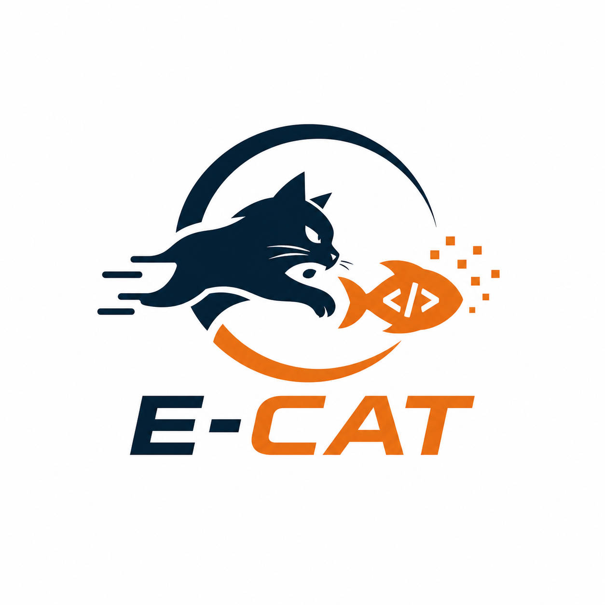

<p align="center">
  
</p>

# ECAT — Entropy-based Code Adversarial Translation

> Android → HarmonyOS 多智能体对抗式迁移框架。

[English](README.md) | **简体中文**

ECAT 把 Android-to-HarmonyOS 迁移建模成 **Generator ↔ Discriminator** 对抗循环：
Generator 执行迁移和修复；Discriminator 计算 **Code Entropy (H)** 并产出文本梯度
（work_list + 改进建议），驱动 Generator 收敛到更低的熵（更高的代码质量）。

📄 **Paper**: [Entropy-based Code Adversarial Translation for Real-world Repository Migration](https://arxiv.org/abs/2608.09273)

📊 **Benchmark**: [A2H-RepoBench](https://github.com/yushuntang/ECAT/tree/benchmark)

> **关于复现**：论文中的实验结果主要基于 **DeepSeek-V4-Pro（20260424-preview 版本）**。skill 库与 subagent不一定适用于新发布的模型已做删减，可自定义修改添加。

## TL;DR

1. `uv tool install --editable ./ECAT` 安装 CLI（editable = 改完即用）
2. `cd your-workspace/ && ecat init` 生成 `.ecat/`、配置文件和 agent 模板
3. 编辑 `ecat.config.yaml`（model、provider、paths）+ `.env`（API keys）
4. `ecat refine` 启动对抗循环，每轮 Discriminator 做多维度评估 → Generator 修复 → 直到 H 收敛

工作目录结构：
```
your-workspace/
├── android_app/         # Android 源码（只读输入）
├── harmony_app/         # HarmonyOS 目标仓（Generator 修改目标）
├── .ecat/               # ecat 运行时数据 + agent 配置
├── .env
└── ecat.config.yaml
```

---

## 安装

### 前置依赖

- **Python ≥3.11 + uv**（[安装](https://docs.astral.sh/uv/getting-started/installation/)）— 装并运行 ecat，Python 依赖随安装自动装好
- **Node.js ≥18 + npm**（[安装](https://nodejs.org/)）— 下面任一 agent CLI 的运行环境
- **至少一个 agent CLI**（三选一，Generator 和 Discriminator 可各用各的）：

  | runtime | CLI | 安装 | 说明 |
  |---|---|---|---|
  | `claude_code` | `claude` | `npm install -g @anthropic-ai/claude-code` | 功能最完整。用订阅需 `claude login`；用 API key 则在 config 里配 `api_key_env` |
  | `opencode` | `opencode` | 见 [opencode 文档](https://opencode.ai/docs/) | 走 OpenAI 兼容端点，成本较低 |
  | `deveco_code` | `deveco` | `npm install -g @deveco/deveco-code` | opencode 的 fork，配置 schema 同源 |

  启动 `ecat migrate` / `ecat refine` 时会校验对应 CLI 是否在 `PATH` 上，缺失会直接报错。

  **能力差异**：`generator_compact_interval`（长会话自动压缩）只有 `claude_code` 实现，
  opencode / deveco_code 下该项无效；其余功能（subagent 派发、skill 加载、会话续跑）三者都支持。

- **DevEco Studio SDK + `hvigorw`**（[下载](https://developer.huawei.com/consumer/cn/deveco-studio/)）— 必需。
  `compile` 维度靠它编译验证，`build_verify`（默认开启）每轮结束让 Generator 走
  `harmonyos-build-fix` skill 修复编译错误。缺失时 `compile` 直接判满分熵（1.0），
  对抗循环失去最重要的收敛信号。
  安装后在 `ecat.config.yaml` 里配 `loop.deveco_studio_path`（Windows 如 `D:/DevEco Studio`，
  macOS 为 `/Applications/DevEco-Studio.app/Contents`）；不配时 ECAT 会从 `JAVA_HOME`
  （指向 DevEco 自带的 `jbr`，macOS 上是 `jbr/Contents/Home`）自动推断，
  macOS 装在默认的 `/Applications` 下也能自动找到。
- 可选：`adb`（随 [Android Studio](https://developer.android.com/studio) 安装）— 仅 `ui_align`
  视觉对齐维度需要；不装则该维度自动跳过（macOS 默认位置 `~/Library/Android/sdk` 会自动找到）

### 安装命令

```bash
git clone https://github.com/<your-org>/ECAT.git
uv tool install --editable ./ECAT          # 装好后 ecat 在任意目录可用
```

`--editable` 必加：让 `ecat` 指向源码，**改完即生效，无需重装**。

运行 ECAT 自身的单元测试（验证开发环境，非迁移评估）：仓库目录下 `uv run --extra dev pytest tests/ -q`。

---

## Quick Start

### 1. 准备工作目录

```
your-workspace/
├── myapp_android/         # Android 源码仓
└── myapp_harmonyos/       # HarmonyOS 目标仓（DevEco 初始化 "Hello World" 脚手架模板）
```

鸿蒙仓用 Hello World 空工程即可：在 DevEco Studio 里新建一个 Empty Ability 工程，或者用命令行从 DevEco 自带的模板复制。

**Windows（Git Bash）**

```bash
DEVECO="/d/Program Files/Huawei/DevEco Studio"
TARGET=/path/to/MyHelloApp

# 1. 复制模板
mkdir -p "$TARGET"
cp -r "$DEVECO/plugins/codegenie-plugin/previewProjectTemplate/." "$TARGET/"

# 2. 改 bundleName / 应用名
cd "$TARGET"
sed -i 's/com\.example\.myapplication/com.yourco.hello/' AppScope/app.json5
sed -i 's/"MyApplication"/"MyHello"/' AppScope/resources/base/element/string.json

# 3. 启动页改成 pages/Index（模板默认注册的是预览占位页 generated/Index，不改会白屏）
sed -i 's#"generated/Index"#"pages/Index"#' entry/src/main/resources/base/profile/main_pages.json
```

**macOS**

```bash
DEVECO="/Applications/DevEco-Studio.app/Contents"
TARGET=/path/to/MyHelloApp

# 1. 复制模板
mkdir -p "$TARGET"
cp -R "$DEVECO/plugins/codegenie-plugin/previewProjectTemplate/." "$TARGET/"

# 2. 改 bundleName / 应用名（macOS 的 sed -i 后面要跟一个空字符串 ''）
cd "$TARGET"
sed -i '' 's/com\.example\.myapplication/com.yourco.hello/' AppScope/app.json5
sed -i '' 's/"MyApplication"/"MyHello"/' AppScope/resources/base/element/string.json

# 3. 启动页改成 pages/Index（模板默认注册的是预览占位页 generated/Index，不改会白屏）
sed -i '' 's#"generated/Index"#"pages/Index"#' entry/src/main/resources/base/profile/main_pages.json
```

模板的 SDK 版本是 5.0.0(12)，需要更新的 API 时在 `build-profile.json5` 里调高 `compatibleSdkVersion` / `targetSdkVersion`。

### 2. 初始化

```bash
cd your-workspace/
ecat init                     # 生成 .ecat/、ecat.config.yaml、.env
```

`ecat init` 把 ECAT 包内的 agent 模板（CLAUDE.md、skills、agents、prompts）复制到
`.ecat/agents/`。已有文件不会被覆盖；`--force` 强制重置。

### 3. 配置

**`ecat.config.yaml`**（最小可用配置）：

```yaml
paths:
  android: ./myapp_android
  harmony: ./myapp_harmonyos

generator:
  runtime: opencode               # claude_code | opencode | deveco_code
  model: deepseek-chat
  provider: deepseek
  base_url: https://api.deepseek.com/v1
  api_key_env: DEEPSEEK_API_KEY

discriminator:
  runtime: claude_code
  model: claude-sonnet-4-6
  api_key_env: ""                 # 空字符串 → 走 claude login 订阅

entropy:
  weights:
    compile: 0.25
    feature_check: 0.20
    entry_nav: 0.10
    page_audit: 0.10
    static_lint: 0.10
    source_parity: 0.05         # Android↔Harmony 源码对等度
    app_identity: 0.05
    placeholder: 0.05
    style: 0.05
    ui_align: 0.00              # 视觉对齐需真机截图，默认关闭
```

**`.env`**（只放密钥，`model` / `base_url` 在 yaml 配）：

```dotenv
DEEPSEEK_API_KEY=sk-xxxxx
ANTHROPIC_API_KEY=sk-ant-xxxxx
```

> **订阅模式**：`api_key_env: ""` 留空，`claude` CLI 会回退到 `claude login` 维护的
> OAuth 订阅；ECAT 自动把 `~/.claude/.credentials.json` 拷贝到每个 role config dir。
> macOS 上登录信息存在钥匙串里，没有这个文件：先运行一次 `claude setup-token`，
> 把输出的 token 写进 `.env`：`CLAUDE_CODE_OAUTH_TOKEN=...`（这种方式在所有系统上都可用）。

### 4. 运行

```bash
ecat refine                             # 用默认 ecat.config.yaml
ecat refine --max-iter 5                # 限制轮数
ecat refine --config my.config.yaml     # 指定配置（多套 config 切换 provider）
```

多套 config 可以共存，各自指向不同的 `paths.harmony`，互不干扰：

```
your-workspace/
├── ecat.config.yaml              # 默认（如 opencode + DeepSeek）
├── ecat.config_claude.yaml       # Claude Code 订阅
└── ecat.config_glm.yaml          # GLM via DashScope
```

每轮 Discriminator 输出各维度 sub_entropy + work_list，Generator 按 work_list 修代码，
直到 H 连续 `stable_iters_to_stop`（默认 2）轮低于 `entropy_threshold`，或达到 `max_iterations`。

完整参数见 [CLI Reference](#cli-reference)。

---

## Evaluation Plugins

每个 plugin 输出 `sub_entropy ∈ [0,1]`（0=完美，1=最差），按 `entropy.weights` 加权得 total H。

> 下表列出全部可用插件。**实际参与计分的维度取决于配置**：`entropy.version`
> 预设（`flash` / `pro` / `custom`）会整体覆盖 `weights`，未在 `weights` 里出现的
> 插件权重为 0，因此不同用法开启的维度数量不同。

| CHECK | Plugin | 类型 | 检查项 |
|---|---|---|---|
| 1 | **compile** | hard | 调 hvigorw 构建，按编译错误数线性计分；无构建工具 → 1.0（满熵），有错误 → `min(1, 0.5 + errors×0.1)` |
| 2 | **static_lint** | hard | grep Android 残留（`findViewById` / `setOnClickListener` / `R.id.*` / `android.` 包 / `androidx.` import 等），任何命中即扣分 |
| 3 | **placeholder** | hard | 两步扫描：① 有 spec 时读 `spec/placeholder-registry.md` 统计 pending/deferred/backfillable（本仓库不附带 spec 生成工具，没有 spec 时跳过这一步）；② grep TODO/FIXME/`// stub`/"Hello World"/"NOT IMPLEMENTED"（限注释行，避免 ArkTS `placeholder:` prop 误报）；计分 = `backfillable×3 + pending×1 + unregistered×0.5 + grep_hit×0.1` |
| 4 | **app_identity** | hard | bundleName 不得含 `com.example`、vendor≠`"example"`、versionName≠模板默认、label 无 `EntryAbility`、应用图标 > 1KB、description 非空，共 6 项 |
| 5 | **page_audit** | hard+agentic | 有 spec 时按 ui-manifest P0/P1/P2 分组验证页面 .ets 是否存在、有 `@Entry`/`build()`（没有 spec 时只检查 `pages/` 下页面是否存在、是否有 `@Entry`）；`completeness = 0.4×line_ratio + 0.6×density ≥ 0.55` 才算 verified；P0 页缺失立即生成高优先级 WorkItem；agentic judge 深度读取未 verified 页面 |
| 6 | **feature_check** | agentic | spec-driven（有 spec 时）+ grep fallback + agentic judge 三层检查 V1 feature 实现；`hard_weight=0.0`，agentic 分数完全覆盖 hard check |
| 7 | **ui_align** | agentic (device) | 视觉对齐：重新编译安装鸿蒙 App，在鸿蒙、安卓两台模拟器上截同一页面拼成左右对比图，由 `visual-judge` 子 agent 看图打分；需两台模拟器在线、安卓端事先装好原版 App、判别器模型能读图；本仓库未附带页面导航脚本，目前只对比首页；默认 weight 0 |
| 8 | **style** | hard | ArkTS 风格违规：`console.log` 残留、显式 `px` 单位、组件非 PascalCase、`var` 关键字、裸字符串颜色值 |
| 9 | **entry_nav** | hard+agentic | 四类 13 项：EntryAbility→main_pages.json 一致性、`router.pushUrl` 目标已注册、Tabs/TabContent 配对、导航图标不使用 launcher 图标 / emoji / 1×1 像素占位图 |
| 10 | **source_parity** | hard+agentic | Android↔Harmony 源码对等性：① 按 stem 比对 Android 源文件是否都有 ArkTS / .cpp / shader 对应，缺失按动作分类 `copy` / `translate` / `header-swap` / `port`；② 可达性闸门——从 pages/、*ability/、workers/、模块 `Index.ets` 出发追相对 + 跨 HSP/HAR 模块 import，标记 ArkTS 对应文件存在但无人引用为 `wire`；③ ETS↔.so↔注册三角——ETS 调用了 native 符号但无 `.cpp` 注册 (`napi_unregistered`) / 注册了但函数体打 `not (yet) implemented` (`native_stub_funcs`)；vendor 目录（cryptopp890 / boost / openssl…）按 `LICENSE` / `Doxyfile` / 版本后缀自动识别并跳过；`samples` / `demo` / `example` 也自动 skip |
| 11 | **data_layer_parity** | hard | 数据层对账：Android DB 表/实体 + SharedPreferences/DataStore 设置键逐项映射到 Harmony，宽松子串匹配（宁漏不误报）；Android 无数据层则 skip |
| 12 | **permission_parity** | hard | 权限/能力对账：Android `<uses-permission>` 逐项映射到 Harmony 等价权限，核对缺漏 |
| 13 | **runtime_liveness** | hard (device) | 真机冷启动存活 + 主页交互冒烟：装 HAP → 拉起 → 探活（崩溃/白屏/闪退）+ 点主页元素；device-driven，默认 weight 0（需 hdc + 模拟器在线） |
| 14 | **hallucination** | hard+agentic | 反向检查 Harmony→Android：找出鸿蒙里凭空造出、安卓原型中无对应来源的功能；默认 weight 0.10 |
| 15 | **crash_risk** | hard | 点击闪退静态风险：ArkUI 事件契约、资源引用、全局异常兜底 |
| 16 | **feature_checklist** | hard+agentic | 人工功能清单（xlsx / csv / md）逐条核对；需 `paths.feature_checklist`，未配置则 skip，默认 weight 0 |

**Judge 类型**：
- **hard**：纯 Python 静态分析（毫秒级）
- **agentic**：agent 用工具直接读取代码文件（几分钟，评估最准）

### Signal density —— 比单纯行数更稳健

`feature_check`、`page_audit` 共用 `_signal_density.py`，对每个 ArkTS 文件
计算 6 类语言 idiom vs Android 对应物的比例：

| 信号 | Android | ArkTS |
|---|---|---|
| click_handler | `setOnClickListener` | `.onClick()` / `.onChange()` |
| state_var | `private var` / `mutableStateOf` | `@State` / `@Prop` / `@Link` |
| list_or_menu_item | `addPreference` / menu xml | `ListItem` / `@Builder` / `MenuItem` |
| string_resource | `R.string.*` | `$r('app.string.*')` |
| media_resource | `R.drawable.*` / `R.mipmap.*` | `$r('app.media.*')` |
| navigation_jump | `Intent(...)` / `startActivity` | `router.pushUrl` / `Navigation.push` |

`completeness = 0.4 × line_ratio + 0.6 × density` —— ArkTS 声明式 UI 天然紧凑，
单纯行数会把"真实迁移完成"误判为 stub；signal_density 锚定到功能表面。

---

## Architecture

```
ECAT Orchestrator
  ├── ConfigLoader          Pydantic v2 + YAML + .env
  ├── LoopDriver            adversarial loop controller
  │     ├── EntropyEngine   a2h_verify plugin set
  │     │     ├── 9 hard plugins (parallel ThreadPoolExecutor)
  │     │     └── 7 agentic judges (deferred to Discriminator session)
  │     ├── GradientBuilder runs Discriminator → text gradient
  │     │     └── dispatches entropy-judge subagents (Agent/task)
  │     └── AgentRunner     Generator subprocess (claude/opencode/deveco)
  ├── Workspace             .ecat/ state management
  └── ReportWriter          charts + markdown + entropy_history.jsonl
```

### Discriminator session 内 subagent 模式

ECAT 不再为每个 agentic judge 各起独立 subprocess。所有 agentic 评估**集中到
Discriminator session 内**，通过通用 `entropy-judge` subagent 并发派发：

```
1. Engine 跑 hard checks (Python 端，秒级)
2. Discriminator subprocess 启动
   → 收齐 hard verdicts
   → 派发 7 个 entropy-judge subagent (parallel via Agent/task)
   → 收齐 agentic verdicts
   → 写 gradient.json (summary + work_list + suggested skills + insights)
3. Generator subprocess 启动，按 work_list 修代码
```

收益：少 7 个 subprocess 冷启动 + Discriminator 看到全部 verdicts 后再写综合 gradient
（跨维度推理）+ Generator 收到含 suggested_skills 的精准 work_list。

### Generator 自动访问 Android 源

`generator.txt` prompt 会把 Android 源根路径（绝对路径）告诉 Generator。
work_list 任何 issue 含"port progress N%"/"missing N/N"/"stub"/"PARTIAL"等量化描述时，
Generator **必须先 Read Android 源**做 1:1 对比，再补缺失功能。

若配置了 `paths.spec`，还会附上 `spec/baseline/source-mapping.md`（ArkTS→Android 文件映射）
作交叉参照；不配 spec 时按文件名匹配。

### 并行 subagent 派发（Generator 侧）

当 work_list 有 ≥2 个独立文件项，Generator prompt 强约束**在单次响应内同时发出
N 个 `task()` / `Agent()` 调用**（runtime-specific tool name 由 driver 自动注入），
让 runtime 并行执行——比串行快 5-10×。

---

## Configuration Reference

### 必须配置

| Key | Description |
|---|---|
| `paths.android` | Android 源码仓相对路径 |
| `paths.harmony` | HarmonyOS 目标仓相对路径（Generator 修改此目录）|
| `generator.runtime` | `claude_code`、`opencode` 或 `deveco_code` |
| `generator.model` | 任意模型名（`deepseek-chat`, `claude-opus-4-7`, ...）|
| `generator.api_key_env` | `.env` 里的 API key 变量名；**空字符串走订阅** |
| `discriminator.*` | 同 generator，可以用不同 runtime/model |
| `entropy.weights` | 各维度权重，未列出的 plugin 用 default_weight；实际生效维度取决于启用的 preset 与配置 |

### 可选高级

| Key | Default | Description |
|---|---|---|
| `loop.max_iterations` | `100` | 最大轮数 |
| `loop.entropy_threshold` | `0.01` | H 低于此值 early stop |
| `loop.regression_tolerance` | `0.1` | H 上升超过此值视为回归，触发 grace 修复 |
| `loop.oscillation_guard.window` | `5` | 窗口内 H 变化都 < min_delta 视为震荡，break |
| `generator.timeout_s` | `3600` | Generator subprocess 超时，到点 psutil 杀进程树 |
| `discriminator.timeout_s` | `2400` | Discriminator subprocess 超时 |
| `retry.max_attempts` | `3` | subprocess 失败重试次数 |
| `reporting.chart_format` | `png` | `png` 或 `html` |

### Multi-provider 示例

Generator / Discriminator / Judge 可以用不同 runtime 和 provider。三种常见组合：

**A. 全 Claude 订阅**：
```yaml
generator:     {runtime: claude_code, model: claude-opus-4-7, api_key_env: ""}
discriminator: {runtime: claude_code, model: claude-opus-4-7, api_key_env: ""}
```

**B. 全 opencode + DeepSeek**（成本低，速度慢）：
```yaml
generator:
  runtime: opencode
  provider: deepseek
  model: deepseek-chat
  base_url: https://api.deepseek.com/v1
  api_key_env: DEEPSEEK_API_KEY
# discriminator 同上
```

**C. 自定义 OpenAI 兼容聚合（DashScope / GLM）**：
```yaml
generator:
  runtime: opencode
  provider: dashscope-proxy           # 自定义名，避开 opencode 内置 openai 特殊路径
  model: glm-5.1
  base_url: https://dashscope.aliyuncs.com/compatible-mode/v1
  api_key_env: GLM_API_KEY
```

---

## CLI Reference

| Command | Description |
|---|---|
| `ecat init [TARGET]` | 初始化 .ecat/、ecat.config.yaml、.env 并 seed agent 配置 |
| `ecat init --force` | 强制重置（覆盖已有 agent 配置,清空 memory/ runs/) |
| `ecat migrate --prompt "..."` | 按指令执行一次 Generator |
| `ecat refine` | 对抗精炼循环（harmony 已有初始迁移代码即可) |
| `ecat status` | 当前熵值、迭代次数 |
| `ecat diff <N>` | 第 N 轮的熵分解、梯度、diff |
| `ecat report` | 生成 markdown 报告 + 图表 |

下面给每个子命令的常用示例。

### `ecat init` — 初始化工作目录

```bash
ecat init                            # 在当前目录初始化
ecat init /path/to/workspace         # 指定目标目录(不存在会创建)
ecat init --force                    # 强制重置(覆盖 .ecat/agents/,清空 memory/ runs/)
ecat init --config my.config.yaml    # 用自定义 config 文件名
```

生成 `.ecat/`、`ecat.config.yaml`、`.env`,把 ECAT 包里的 agent 模板复制到
`.ecat/agents/`。已有文件不覆盖;`--force` 才强制清空。

### `ecat migrate` — 单次执行 Generator

```bash
# 按自然语言指令执行一次 Generator
ecat migrate -p "把 PhotoActivity 翻译成 PhotoPage.ets"

# 长指令从文件读
ecat migrate --prompt-file instructions.txt

# 切换 config(多 provider 测试)
ecat migrate --config ecat.config_claude.yaml -p "fix all hvigorw build errors"
```

跑一次 Generator,按 prompt 自由执行,不进 refine 循环。适合手动控制流程或调试单个 skill。

### `ecat refine` — 对抗精炼循环(核心命令)

```bash
ecat refine                                     # 用默认 ecat.config.yaml
ecat refine --max-iter 5                        # 最多 5 轮
ecat refine --pause                             # 每轮暂停等回车
ecat refine --score-only                        # 只评估一次,不进循环(看当前 H)
ecat refine -p "优先修编译错误,不要重写已通过的页面"    # 追加指令
```

每轮 Discriminator 做多维度评估 → 写文本梯度 → Generator 按 work_list 修代码,
直到 H < `entropy_threshold` 或达到 `max_iterations`。

### `ecat status` / `diff` / `report`

```bash
ecat status                  # 当前 H、ΔH、迭代数
ecat diff 3                  # 第 3 轮的 gradient.json + diff.patch
ecat report                  # 在最新 runs 目录写 report.md + 趋势图
```

`diff` 打印判别器写的策略摘要、结构化 work_list 和 Generator 的实际改动；
`report` 汇总所有 iter 的 H 变化、维度分解与代码统计,适合贴 PR / 汇报。

### 全局选项

```bash
ecat -C /path/to/workspace <command>   # 切到指定目录后执行(任意子命令)
ecat <command> --help                  # 子命令帮助
```

其余配置项（模型、轮数、阈值等）都在 `ecat.config.yaml` 里改；需要多套设置时用 `--config` 切换配置文件。

---

## Troubleshooting

### Generator 频繁超时

DeepSeek / GLM 类模型在大型 work_list 下单 iter 可能跑满 timeout。对策：

1. **减小 work_list**：调小 `loop.max_items_per_iter`（默认 25，可降到 3-5）
2. **提高 timeout**：`generator.timeout_s`（默认 3600）
3. **换更快模型**：Claude Sonnet 通常比 DeepSeek 在工具循环上快 5-10×

### iter X 后 H 突然 ↑↑ 升到 0.3+

通常是 Generator 改坏了 build。Driver 自动触发 `regression_grace` 给下一 iter 修复机会；
若多次仍 break，回退到上一稳定 commit：`cd harmony_dir && git reset --hard HEAD~N`。

### "Invalid API key" Generator/Discriminator 报错

Claude Code subscription 模式下，ECAT 把 `~/.claude/.credentials.json` 拷到 role config dir。
如果还报错：

- `claude /status` 确认订阅未过期
- 清掉环境里的假 `ANTHROPIC_API_KEY` 环境变量
- macOS：确认 `.env` 里配了 `CLAUDE_CODE_OAUTH_TOKEN`（见上文订阅模式说明），否则会报 "Not logged in"
- ECAT 已在 `cli.py:_build_env()` 自动剥离假 key，不应该再发生

### Generator 不去 Read Android 源

检查 `runs_*/iter/generator_prompt.md` 里 `Android source root:` 后是否绝对路径
（应该是绝对路径而非 `./android_app` 这样的相对路径）。如果不是，确认 driver.py
当前版本（绝对路径修复已合入 main）。

### Subagent 派发失败（opencode）

OpencodeRunner 自动把 `<config_dir>/agents/*.md` 拷贝到 tmp_dir 并重写 frontmatter
（Claude Code 风格 → opencode 风格）。如果 frontmatter 仍报错，看
`_rewrite_agent_frontmatter()` 是否正确处理新字段。

### 判别器不派评审、自己打分

现象：某轮 `discriminator.stream.jsonl` 里没有 `Task`/`Agent` 调用，H 突然变成 0 或出现离谱的高分。
原因：判别器用 ToolSearch 搜 `Task` 搜不到（`Task` 已经加载，ToolSearch 只搜按需加载的工具），
就认定没有子 agent 工具，改用规则检查结果自己打分。对策：给判别器禁用 ToolSearch：

```yaml
discriminator:
  extra_args: ["--disallowedTools", "ToolSearch"]
```

### ui_align 截到的安卓画面不是原版 App

- 安卓端要事先装好原版 App 并授予权限（ECAT 不会编译安装安卓端），例如
  `adb shell pm grant <包名> android.permission.READ_MEDIA_IMAGES`；
  需要"所有文件访问"时用 `adb shell appops set <包名> MANAGE_EXTERNAL_STORAGE allow`。
- ECAT 用 `monkey` 启动安卓 App。模拟器没有实体按键时 monkey 报 `SYS_KEYS has no physical keys`
  后直接退出：把 `~/.android/avd/<名字>.avd/config.ini` 里的 `hw.keyboard` 改成 `yes`，重启模拟器。
- 鸿蒙模拟器占用 5555 端口，`adb devices` 会多出 `emulator-5554 offline`，不影响；
  用环境变量 `ANDROID_SERIAL`、`HDC_TARGET` 固定设备更稳。
- 两边放同样的测试图片：鸿蒙模拟器不能用 `mediatool` 导入，先 `hdc file send` 到"下载"目录，
  再在"文件管理"里"分享 → 保存至图库"。

### 从已收敛的代码继续 refine，动态维度还没跑就停了

动态维度默认每 5 轮才跑一次，其余轮次按 0 计入 H；代码已经收敛时，可能还没到下一次动态评估就满足提前停止。
需要动态维度参与时设 `entropy.dynamic_render_interval: 1`（每轮都跑，每轮多几分钟）。

### token 用量看起来偏高

`resume_session: true` 时，Claude Code 每轮报告的是续接会话的累计用量，ECAT 逐轮相加会重复计算；
超时被结束的轮次又没有用量报告。需要准确数字时，以 `.ecat/agents/<role>/projects/` 下的会话记录为准。

### 停止运行

不要按 Ctrl+C：ECAT 收到中断会把 harmony 目录回滚到上一个提交，丢掉未提交的改动。
要保留改动，用 `kill <ECAT 进程号>`（SIGTERM）结束 ECAT 主进程，再结束它派生的 `claude` 子进程。

---

## Development

```bash
uv run --extra dev pytest tests/ -q                                  # 测试
uv run --extra dev ruff check src/ tests/ --fix                      # Lint
uv run --extra dev mypy src/ecat/ --ignore-missing-imports           # 类型检查
```

### 加新评估插件

插件命名 `check_<name>.py`，类继承 `EntropyPlugin`：

```python
# src/ecat/entropy/plugins/a2h_verify/check_my_check.py
from pathlib import Path
from ecat.entropy.base import EntropyPlugin, should_skip_path
from ecat.gradient.schema import WorkItem

class MyCheckPlugin(EntropyPlugin):
    name = "my_check"        # entropy.weights 的 key
    default_weight = 0.05    # config 未指定时的权重
    judge_mode = "hard"      # "hard" | "agentic"
    hard_weight = 0.4        # agentic 模式下 hard 分占比

    def evaluate(self, harmony_dir: Path, *, android_dir=None,
                 spec_dir=None, config=None) -> tuple[float, dict]:
        """返回 (score, details)：score ∈ [0,1]，0=完美、1=最差。"""
        hits = [
            {"file": str(ets)}
            for ets in harmony_dir.rglob("*.ets")
            if not should_skip_path(ets, harmony_dir)
            and "some_bad_pattern" in ets.read_text(encoding="utf-8", errors="ignore")
        ]
        return min(1.0, len(hits) / 10), {"hits": hits}

    def extract_work_items(self, score, details) -> list[WorkItem]:
        """把 details 转成 work_list；基类默认返回 []，需要定制时才重写。"""
        return [
            WorkItem(file=Path(h["file"]), issues=["found bad pattern"],
                     suggested_skills=["harmonyos-build-fix"], severity="medium")
            for h in details.get("hits", [])
        ]
```

| 类属性 | 默认 | 说明 |
|---|---|---|
| `name` | `""` | 必须唯一，对应 `entropy.weights` 的 key |
| `default_weight` | `0.1` | config 未配置该 key 时的权重 |
| `judge_mode` | `"hard"` | `hard` 只跑 `evaluate()`；`agentic` 再叠一层 LLM judge 分 |
| `hard_weight` | `0.4` | agentic 模式下 hard 分占比，`0.0` 表示完全用 judge 分 |
| `judge_prompt` | `""` | agentic 模式必须填 |

`WorkItem` 必填 `file` / `issues` / `suggested_skills` / `severity`，可选 `lines`（问题行号）。

注册三步：文件放进 `plugins/a2h_verify/` → 在 `__init__.py` 的 `_PLUGINS` 里加实例 →
在 `entropy.weights` 里加权。跳过目录用 `should_skip_path()`；行数+信号密度融合评分见
`_signal_density.density_score()` / `combined_completeness()`。

---

## License

MIT — see the `LICENSE` file for the full text.
